**Status.** Everything below was produced by the code in this repository (branch `qpino-fisher-kpp`). All numbers are read from `results/metrics/*.json`; full tables are in [`docs/results_tables.md`](results_tables.md). All quantum circuits are *classically simulated* (exact 5- and 9-qubit statevectors). No quantum advantage is claimed or implied.

# 1. Question and summary

**Research question.** Can a custom quantum Hamiltonian $H_\theta$, through the unitary $U_\theta(\tau)=e^{-iH_\theta\tau}$ together with an $R_y$ data embedding, $Z$-basis measurement and a classical decoder, approximate the nonlinear, dissipative one-step evolution operator of a Galerkin-truncated Fisher–KPP system?

**Default model (§15): real cosine / Neumann basis.** The classical data fed to the circuit are only real Galerkin coefficients, one per mode on one qubit: $u=\sum_{k=0}^{M}b_k\cos(k\pi s/L)$ with no-flux boundaries, M = 8 (9 qubits), and all baselines A–F use the same real inputs.

* **Verification:** all 33 tests pass (`pytest -v tests`), 6 of them new for the cosine basis. The explicit triad tensor $T_{kpq}=\tfrac12[\delta_{|p-q|,k}+\delta_{p+q,k}]$ matches a fine-grid projection to $1.6\times10^{-15}$. The cosine Galerkin ODE converges spectrally to a fine-grid Neumann solver (field error $4.5\times10^{-3}$, $4.2\times10^{-5}$, $7.7\times10^{-10}$ at M = 2, 4, 8). The 9-qubit simulator matches PennyLane to $5\times10^{-15}$.
* **The coupling graph is complete** in the cosine basis (36/36 pairs at M = 8). Selectivity is only in the tensor: 109 of 729 entries are non-zero.
* **Truncation error** of the I-10 field (train / July): cosine M = 4: 0.632 / 0.389 (identical to the M = 4 even mirror, but with 5 instead of 9 qubits); cosine M = 8: 0.555 / 0.314.
* **JHU COVID-19, July 2020, cosine M = 8, λ_PDE = 0.01, 3 seeds.** No learned model beats persistence one day ahead (all increment errors > 1). For the 31-day rollout the 3-parameter Galerkin ODE A is best (17.80 cases/100k/day vs persistence 19.14). QPINO D gets 19.98 ± 2.70, HEA C 20.42 ± 1.67, MLP B 19.45 ± 4.44 and D without ZZ 21.39 ± 2.50. Seed spread is large. With 5 qubits (cosine M = 4), D reaches 18.47 ± 1.51 (earlier M = 2 periodic: 21.33 ± 1.38). Re-uploading R = 1/2/3 gives 19.98 / 19.32 / 20.96, at 446 / 897 / 1419 s per run.
* **Synthetic Neumann Fisher–KPP, cosine M = 8.** 40-step rollout rel. L2: A 2.3e-8, MLP 0.019, HEA 0.058, QPINO D 0.067, D without physics loss 0.066 (2 seeds), D without ZZ 0.112 (2 seeds). The couplings matter; the small physics weight has no resolvable effect.

* **2D contiguous USA (§16), 3×3 real 2D cosine modes on the land mask (9 qubits), JHU field Mar 15–Jul 26 2020.** The truncation floor is 0.116 RMSE in u for July. Against the projected field, the July rollout errors are: linear trend 0.013, Galerkin ODE A 0.026, MLP 0.026, persistence 0.063, QPINO D 0.069 ± 0.016, HEA 0.073, D without ZZ 0.102. The 16-qubit 4×4 runs were not trained: the estimated runtime is 35–90 h per run. Map figures: Fig. 18 and Fig. 19.

**Earlier complex-Fourier variant (kept; §§2, 5.3, 7–9, 14).** Re/Im Fourier coefficients on separate qubits, periodic or mirrored, M = 2 or 4:

* **Synthetic Fisher–KPP (primary validation):** the 5-qubit custom-Hamiltonian QPINO with a *linear* decoder learns the M=2 one-step operator to a one-step increment error of 0.100 ± 0.017 and a 40-step rollout error of 0.043 ± 0.011 on unseen initial conditions (persistence: 1.0 / 0.69). It does **not** match the classical Galerkin ODE (0.0011 / 0.0004), and it is not better than a 165-parameter MLP (0.047 / 0.015) or a generic hardware-efficient ansatz with the same parameter count (0.086 / 0.032). With an MLP decoder it reaches 0.039 / 0.015.
* **Entanglement is necessary:** removing the $ZZ$ couplings triples the error (0.31 / 0.13). Training the Hamiltonian beats frozen random quantum features by ≈3×. The Galerkin-derived graph matches full connectivity and beats nearest-neighbour and "triad-only" graphs.
* **Design pitfalls found:** (i) τ = cΔt with a derivative readout makes the model fail to transfer across Δt (one-step error 0.49–0.56 at Δt = 0.05 / 0.2), while the τ-free HEA transfers. (ii) The default physics-loss curriculum switches the PDE term on too late to matter. Applied from epoch 0 with the true physics, it cuts low-data rollout error from 0.28 to 0.11.
* **JHU COVID-19 (exploratory, I-10 transect, train Mar 1–Jun 16, validate Jun 17–30, test July 2020):** M = 2 leaves 38 % (July) to 63 % (train) of the field unresolved, and the periodic wrap is artificial, so this experiment is exploratory. No learned model beats persistence for next-day prediction (QPINO increment error 1.13 ± 0.09; linear trend 0.95). For the 31-day rollout the best methods are the fitted 3-parameter Fisher–KPP models (field RMSE 18.0 Galerkin / 16.9 full grid vs persistence 19.7 cases/100k/day). The QPINO (21.3 ± 1.4) and the classical MLP (22.3 ± 2.8) are worse than persistence.
* Fitted COVID parameters: ρ = 0.035 /day, β = 0.104 /day, D = 1.5e-3 (528 km²/day), with **D unidentifiable** below ~1e-2.
* **Extension (§14): M = 4 (9 qubits), mirrored boundary, λ_PDE = 0.01, re-uploading R = 1–3.** Mirroring removes the wrap jump but does not reduce the truncation error (M=4 mirrored July 0.389 vs M=2 periodic 0.377). On COVID July the QPINO 31-day rollout improves to 19.35 ± 0.90 (old 21.3), which is about equal to persistence (19.65) and still behind the linear trend (17.94) and the Galerkin ODE (18.00). The best learned model is the HEA (17.58 ± 0.21). On synthetic data, M = 4 is harder for every learned model (D rollout 0.082 vs 0.043). λ_PDE ≤ 0.01 has no measurable effect, and re-uploading gives no resolvable gain. A mirrored-normalisation bug was found and fixed, and the affected runs were rerun (§14.8).
* **No quantum advantage** is shown or claimed (§10).

# 2. The Fisher–KPP model and its M = 2 complex-Fourier Galerkin truncation (earlier complex-Fourier variant; the default real cosine basis is in §15)

## 2.1 Model

$$\partial_t u = D\,\partial_x^2 u + \rho u - \beta u^2,\qquad D,\rho,\beta>0,\qquad x\in[0,2\pi)\ \text{(periodic)}.$$

$D$ (effective diffusion), $\rho$ (growth) and $\beta$ (saturation; carrying capacity $K=\rho/\beta$) are treated as **phenomenological** parameters. For the COVID field they are *not* interpreted as literal mobility or transmission rates. The model does not conserve $\int u\,dx$, and no conservation constraint is imposed.

## 2.2 Derivation

Insert $u_M(x,t)=\sum_{k=-2}^{2}a_k(t)e^{ikx}$ with $a_{-k}=a_k^*$ (real field). Then $\partial_x^2 e^{ikx}=-k^2e^{ikx}$ and
$$u_M^2=\sum_{p=-2}^{2}\sum_{q=-2}^{2}a_pa_q e^{i(p+q)x},$$
which contains wavenumbers $|p+q|\le 4$. Galerkin projection onto $e^{ikx}$, $|k|\le2$ (multiply by $e^{-ikx}/2\pi$ and integrate; $\frac{1}{2\pi}\int_0^{2\pi}e^{i(m-k)x}dx=\delta_{mk}$) keeps only $p+q=k$:
$$\boxed{\dot a_k=(\rho-Dk^2)a_k-\beta\sum_{p+q=k,\ |p|,|q|\le2}a_pa_q,\qquad k=-2,\dots,2.}$$
The discarded $|p+q|=3,4$ terms are the **unresolved modes** produced by the nonlinearity.

**Convolution sums.** Writing $a_1=b_1+ic_1$, $a_2=b_2+ic_2$:

* $k=0$: pairs $(0,0),(\pm1,\mp1),(\pm2,\mp2)$: $\ (u^2)_0=a_0^2+2|a_1|^2+2|a_2|^2$.
* $k=1$: pairs $(0,1),(1,0),(-1,2),(2,-1)$: $\ (u^2)_1=2a_0a_1+2a_1^*a_2$, with $a_1^*a_2=(b_1b_2+c_1c_2)+i(b_1c_2-c_1b_2)$.
* $k=2$: pairs $(0,2),(2,0),(1,1)$: $\ (u^2)_2=2a_0a_2+a_1^2$, with $a_1^2=(b_1^2-c_1^2)+2ib_1c_1$.

**Explicit real equations** for $\mathbf a=(a_0,b_1,c_1,b_2,c_2)=(a_0,\mathrm{Re}a_1,\mathrm{Im}a_1,\mathrm{Re}a_2,\mathrm{Im}a_2)$ (implemented in `src/galerkin.py::galerkin_rhs`):
$$
\begin{aligned}
\dot a_0 &= \rho a_0-\beta\left[a_0^2+2(b_1^2+c_1^2+b_2^2+c_2^2)\right]\\
\dot b_1 &= (\rho-D)b_1-2\beta\left[a_0b_1+b_1b_2+c_1c_2\right]\\
\dot c_1 &= (\rho-D)c_1-2\beta\left[a_0c_1+b_1c_2-c_1b_2\right]\\
\dot b_2 &= (\rho-4D)b_2-\beta\left[2a_0b_2+b_1^2-c_1^2\right]\\
\dot c_2 &= (\rho-4D)c_2-\beta\left[2a_0c_2+2b_1c_1\right]
\end{aligned}
$$

**Conjugate symmetry.** If $a_{-k}=a_k^*$ then $(u^2)_{-k}=\sum_{p+q=-k}a_pa_q=\sum_{p'+q'=k}a_{-p'}a_{-q'}=\big((u^2)_k\big)^*$, and $(\rho-Dk^2)$ is real and even in $k$, so $\dot a_{-k}=\dot a_k^*$ and $\dot a_0\in\mathbb R$: the real-field constraint is invariant under the flow. Verified numerically (Section 6) by integrating all five *complex* modes with no symmetry imposed.

**Reconstruction and derivatives** (analytic, used in the PDE residual):
$u_M=a_0+2(b_1\cos x-c_1\sin x)+2(b_2\cos2x-c_2\sin2x)$, $\ \partial_x^2u_M=-2(b_1\cos x-c_1\sin x)-8(b_2\cos2x-c_2\sin2x)$.
Projection: $a_k=\frac1N\sum_j u(x_j)e^{-ikx_j}$ on a uniform grid (exact for band-limited fields when $N\ge 2M+1$; the Galerkin RHS is recovered exactly from a grid projection when $N\ge3M+1$ because $u_M^2$ has $|k|\le4$).

**Coupling structure.** The Hessian $\partial^2\dot a_i/\partial a_j\partial a_k$ is constant (the RHS is quadratic). Its non-zero off-diagonal pattern is the set of coefficient pairs that interact through the convolution: $(a_0,b_1),(a_0,c_1),(a_0,b_2),(a_0,c_2),(b_1,c_1),(b_1,b_2),(b_1,c_2),(c_1,b_2),(c_1,c_2)$ — **9 of the 10 possible pairs**; only $(b_2,c_2)$ never appears. This defines the "structured" $ZZ$ graph (computed programmatically in `custom_ansatz.galerkin_graph`). Removing the five $a_0$ "mean-field" edges leaves the 5-edge "triad" graph of $k=1\leftrightarrow k=2$ mode-transfer couplings.

## 2.3 Reference solvers

* Full PDE: method of lines, Fourier pseudo-spectral Laplacian (or 2nd-order central differences), `scipy.integrate.solve_ivp(method="DOP853", rtol=1e-9, atol=1e-11)` (`src/fisher_kpp.py`).
* Galerkin ODE (baseline A): `solve_ivp(DOP853, rtol=1e-10, atol=1e-12)`, and a differentiable RK4 flow map with 20 sub-steps per step (agrees with DOP853 to $<10^{-10}$, test `test_galerkin_integrator_agreement`).

# 3. Quantum model

**Inputs (default model).** The circuit receives **only real Galerkin coefficients, one real coefficient per mode on one qubit**: in the default real cosine/Neumann basis (§15) qubit $j$ carries $b_j$, $j=0,\dots,M$ ($M=8$: 9 qubits; $M=4$: 5 qubits). Sections 3.1–3.4 are written for the 5 inputs of the earlier complex-Fourier variant $(a_0,\mathrm{Re}\,a_1,\mathrm{Im}\,a_1,\mathrm{Re}\,a_2,\mathrm{Im}\,a_2)$, where each complex mode used two qubits; the embedding, Hamiltonian family, readout and decoder are identical in both bases, only the meaning of $z_j$ and the coupling graph $E$ change (for the cosine graph see §15.3).

## 3.1 Embedding: why $R_y$

Standardise $\mathbf z=(\mathbf a-\mu)/\sigma$ (training-set statistics). $H_{\mathrm{emb}}(\mathbf z)=\frac12\sum_j\alpha_jz_jY_j$; the terms act on different qubits and commute, so
$S(\mathbf z)=e^{-iH_{\mathrm{emb}}}=\bigotimes_jR_y(\alpha_jz_j)$ (verified to $10^{-12}$ against `scipy.linalg.expm`), with
$$R_y(\phi)|0\rangle=\cos\tfrac\phi2|0\rangle+\sin\tfrac\phi2|1\rangle .$$
Reasons for $R_y$: (i) it produces **real** amplitudes, so $|\psi_{\mathrm{emb}}\rangle$ is a real product state whose computational-basis amplitudes are the products $\prod_j\{\cos\frac{\phi_j}2,\sin\frac{\phi_j}2\}$, i.e. the embedding moves probability between $|0\rangle$ and $|1\rangle$ on each qubit by an amount that encodes the size of the coefficient; (ii) a single qubit then has $\langle Z\rangle=\cos\phi$, $\langle X\rangle=\sin\phi$, $\langle Y\rangle=0$ — the coefficient value appears as a point on the $x$–$z$ great circle of the Bloch sphere; (iii) because $Y/2$ has eigenvalues $\pm\frac12$, every expectation value is a trigonometric polynomial with integer frequencies in $\phi_j$ (next section). Note that $\cos\phi$ is even: measuring $Z$ right after the embedding loses the **sign** of $z_j$. The transverse terms $g_jX_j$ of $H_\theta$ are what rotate $\sin\phi_j$ (sign-carrying) information into the $Z$ basis — with $g=0$ the ansatz is diagonal, commutes with every $Z$-basis observable, and the circuit would do nothing to the measured statistics.

## 3.2 Fourier expressibility (coefficient space)

For one embedding layer, $\langle O\rangle(\boldsymbol\phi)=\langle0|S^\dagger U^\dagger OUS|0\rangle$ and each $R_y(\phi_j)$ appears once in the ket and once in the bra. With generator eigenvalues $\lambda_\pm=\pm\frac12$ the accessible frequency differences per input are $\Omega_j=\{\lambda_a-\lambda_b\}=\{-1,0,1\}$, so
$$f(\mathbf z)=\sum_{\boldsymbol\omega\in\{-1,0,1\}^5}c_{\boldsymbol\omega}(\theta)\,e^{i\boldsymbol\omega\cdot(\boldsymbol\alpha\odot\mathbf z)} ,$$
$3^5=243$ frequency vectors (122 independent for a real output). With $R$ data re-uploads $W_R S\cdots W_1S$ the spectrum per input becomes $\{-R,\dots,R\}$ (sums of $R$ copies of $\Omega_j$), i.e. $(2R+1)^5=243,\ 3125,\ 16807$ frequency vectors for $R=1,2,3$. The trainable $\alpha_j$ rescale (but do not add) frequencies. These are **coefficient-space frequencies**: they describe how a decoded output varies with the *value* of a Galerkin coefficient, i.e. with the angle $\phi_j=\alpha_jz_j$. They are unrelated to the **spatial wavenumbers** $k\in\{-2,\dots,2\}$, which label *which* coefficients exist. The Galerkin RHS is a quadratic *polynomial* in $\mathbf a$; a degree-$R$ trigonometric polynomial represents it only approximately (e.g. $\sin\phi\approx\phi$, $\cos\phi\approx1-\phi^2/2$, products $\sin\phi_j\sin\phi_k$ from $\langle Z_jZ_k\rangle$-type terms), so accuracy depends on staying in a moderate-angle regime — tested by the $\alpha$ ablation. The numerical spectrum of trained models (Fig. 10) confirms the cut-off: Fourier power beyond $|\omega|=R$ is at round-off.

## 3.3 Custom Hamiltonian ansatz (every term)

$$H_\theta=\sum_{j=0}^4h_jZ_j+\sum_{j=0}^4g_jX_j+\sum_{(j,k)\in E}J_{jk}Z_jZ_k,\qquad U_\theta(\tau)=e^{-iH_\theta\tau}\ (\hbar=1).$$

* $h_jZ_j$ — **local phase evolution**: precession of qubit $j$ about $z$. On its own it changes no $Z$-basis probability, but it rotates the $x$–$y$ components ($\sin\phi_j$ information) so that, combined with $X$ mixing, the measured $\langle Z_j\rangle$ can become a general first-harmonic function $c_0+c_1\cos\phi_j+c_2\sin\phi_j$.
* $g_jX_j$ — **single-qubit mixing** (transverse field): rotates population between $|0\rangle$ and $|1\rangle$; required for any non-trivial $Z$-basis output (Section 3.1).
* $J_{jk}Z_jZ_k$ — **interactions between quantum features**: conditional phases that, together with $X$ mixing, make $\langle Z_j\rangle$ depend on $z_k$ and create entanglement. These are the only terms able to generate the cross-coefficient products that appear in the Galerkin convolution (e.g. $a_0b_1$, $b_1b_2+c_1c_2$). $E$ is the 9-edge Galerkin graph (structured), compared with the 10-edge fully connected graph, a 4-edge nearest-neighbour chain $0\!-\!1\!-\!2\!-\!3\!-\!4$, the 5-edge triad graph and $E=\varnothing$ (baseline F). We do **not** assume that two-body $ZZ$ terms reproduce the classical quadratic convolution; adequacy is tested experimentally.

**Time.** $\tau$ is the quantum evolution parameter; $\Delta t$ is the classical step. We use $\tau=c\,\Delta t$ with $c$ fixed or learned ($c=\mathrm{softplus}(\tilde c)>0$). Because the data use a single $\Delta t$, $c$ is degenerate with the overall scale of $H_\theta$ during training (only $cH_\theta$ enters); it matters only when the trained model is applied at a different $\Delta t$ (Section 8.4).

**Exact vs Trotter.** Exact: `torch.linalg.matrix_exp` on the $32\times32$ matrix. First-order product formula:
$U_\theta(\tau)\approx\big[\prod_je^{-ih_jZ_j\delta\tau}\prod_je^{-ig_jX_j\delta\tau}\prod_{(j,k)}e^{-iJ_{jk}Z_jZ_k\delta\tau}\big]^L$, $\delta\tau=\tau/L$ (the $ZZ$ factors act first). In gates: `IsingZZ(2Jδτ)`, `RX(2gδτ)`, `RZ(2hδτ)`.

**Re-uploading.** $U(\mathbf z,\tau)=W_R(\theta_R,\tau)S(\mathbf z)\cdots W_1(\theta_1,\tau)S(\mathbf z)$ with independent $\theta_r$. Because $S(\mathbf z)$ does not commute with $W_r$, this circuit is **not** in general evolution under any single time-independent Hamiltonian; it is a data-dependent product of unitaries and loses the "Hamiltonian surrogate" interpretation in exchange for a richer spectrum.

## 3.4 Measurement, decoder, update

$m_j=\langle Z_j\rangle$ and $m_{jk}=\langle Z_jZ_k\rangle$ (15 features). Decoder $D_\eta$: **linear** (default, so that the non-linearity must come from the circuit) or a 1-hidden-layer tanh MLP (variant D-mlpdec). Output scale $s_G=s_{\mathrm{inc}}/\Delta t$ (training increment scale). Residual update $\hat{\mathbf a}(t+\Delta t)=\mathbf a(t)+\Delta t\,G(\mathbf a,\Delta t)$, which gives an exact identity at $\Delta t=0$ (there $U=I$ and $G$ stays finite; verified). Gradients: PyTorch autograd through `matrix_exp`/Trotter products (exact statevector); on hardware this would be replaced by parameter-shift / generalised shift rules.

# 4. Loss

$\mathcal L=\lambda_{\mathrm{data}}\mathcal L_{\mathrm{data}}+\lambda_{\mathrm{PDE}}\mathcal L_{\mathrm{PDE}}+\lambda_{\mathrm{roll}}\mathcal L_{\mathrm{roll}}+\lambda_{\mathrm{reg}}\mathcal L_{\mathrm{reg}}$, defaults $(1,\,0.1,\,0.5,\,1)$.

* $\mathcal L_{\mathrm{data}}=\frac1B\sum_b\|(\hat{\mathbf a}_{n+1}-\mathbf a_{n+1})/s_{\mathrm{inc}}\|^2$ — the spec's squared error with a fixed diagonal metric $s_{\mathrm{inc}}$ = per-component training std of one-step increments (otherwise $a_0$ would dominate the $\sim\!20\times$ smaller $k=1,2$ coefficients). A value $\approx1$ means "as large as a typical one-step change". A reconstructed-field loss on the grid is also computed and logged.
* $\mathcal L_{\mathrm{PDE}}$ (default target): full reconstructed-field residual on $N_c=64$ collocation points, $R(x_i)=\frac{\hat u_M(x_i,t+\Delta t)-u_M(x_i,t)}{\Delta t}-\mathcal N[u]$, with $\mathcal N[u]=D\partial_x^2u+\rho u-\beta u^2$ evaluated analytically from the Fourier representation and $u^2$ taken **pointwise** (so it contains the $|k|=3,4$ modes). The model is a discrete map, not a continuous trajectory, so no autograd time derivative is used. Schemes: forward ($\mathcal N$ at $t$), **trapezoid** (default, average of $\mathcal N$ at $t$ and $t+\Delta t$), midpoint ($\mathcal N$ at the average state).
* Projected Galerkin residual $R_k=\frac{\hat a_k-a_k}{\Delta t}-f_k(\cdot)$ with the same schemes, always reported separately (and selectable as the training target).
* $\mathcal L_{\mathrm{roll}}$: $H$-step autonomous rollouts ($H=5$ synthetic, $7$ COVID) over all training windows.
* $\mathcal L_{\mathrm{reg}}$: negativity $\overline{\mathrm{relu}(-\hat u)^2}$ (weight 1), saturation $\overline{\mathrm{relu}(\hat u-1.2K)^2}$ (implemented; weight 0 by default because the COVID $K$ is poorly constrained), Hamiltonian-parameter $L_2$ ($10^{-4}$), rollout stability $\overline{\mathrm{relu}(\|\hat{\mathbf a}_{n+s}\|-3\max\|\mathbf a\|)^2}$ (weight 1).
* **Curriculum:** $\lambda_{\mathrm{PDE}}$ is 0 for the first 20 % of epochs and ramps linearly to its target by 60 %. **Model selection** (best validation one-step + rollout loss) is restricted to the last 40 % of epochs for *every* run, with or without physics loss (an earlier version allowed physics-free runs to select from all epochs; this confounded the physics ablation and was fixed before the reported runs).
* Optimiser: Adam, lr 0.02, cosine decay to 5 %, 1500 full-batch epochs, gradient clipping 10, float64, seeds 0/1/2.

# 5. Data: JHU CSSE COVID-19 and the I-10 transect

## 5.1 Source and documentation (computed in `src/data_loader.py::dataset_summary`)

* Repository: <https://github.com/CSSEGISandData/COVID-19> (archived 10 Mar 2023), folder `csse_covid_19_data/csse_covid_19_time_series/`. Files: `time_series_covid19_confirmed_US.csv` (county rows with FIPS, `Admin2`, `Province_State`, `Lat`, `Long_`), `time_series_covid19_deaths_US.csv` (same rows plus `Population`), `time_series_covid19_confirmed_global.csv` (inspected only).
* US file: 3,342 rows; 3,234 have non-zero coordinates and 3,227 have population > 0; 104 are "Unassigned"/"Out of <state>" rows without a location. Dates 2020-01-22 to 2023-03-09 (1,143 daily columns; the archive was frozen on 10 Mar 2023). No missing values (NaN) in the counts.
* Global file: 289 rows (countries / some provinces), a single Lat/Long per row and no population, so it is too coarse for a spatial field.
* Quantity: **cumulative reported confirmed cases**. Differencing gives daily *reported* new cases. That is a testing- and reporting-dependent incidence proxy, **not** infection prevalence.
* Corrections: 40,168 negative daily differences over the whole US file, and 6,408 (totalling 68,900 cases) between Mar 1 and Jul 31 2020. Within the selected corridor counties, 361 negative entries (1,936 cases) were clipped to 0 on the day they appear. Backlog dumps (positive spikes) and weekday reporting cycles remain in the raw series and are damped by the trailing 7-day mean.

## 5.2 Why a transect along Interstate 10

A 1-D PDE needs a spatial coordinate where neighbouring points are neighbouring places. We use the I-10 corridor from Santa Monica, CA to Jacksonville, FL (23 waypoints, arc length L = 3,735 km). It is a single, contiguous, heavily travelled east–west chain of adjacent counties across 9 states (CA, AZ, NM, TX, LA, MS, AL, FL, GA), and it is where the summer-2020 Sun Belt wave happened, so June→July is a non-trivial forecasting window. Each of the 199 counties whose JHU centroid lies within 100 km of the polyline is assigned the arc length $s$ of its nearest transect point. Counties are binned into 32 equal bins of 117 km, and each bin's population-weighted incidence is (sum of cases)/(sum of population). All 32 bins are populated (minimum bin population 4,886). Ordering is purely geographic, never by case counts or names.

**Field:** $u(x_j,t_n)$ = [7-day trailing mean of new reported cases per 100k in bin $j$] / $S$, with $S=82.53$ cases/100k/day, the maximum over bins and **training days only**, and $x_j=2\pi(j+\frac12)/32$. It uses no future data: differences, clipping and the trailing window use only days $\le t$, and the normalisation uses only training statistics.

**Splits (chronological, no shuffling of overlapping windows):** train Mar 1 – Jun 16 2020 (107 one-step pairs; 7-step rollout windows lie inside the training period), validation Jun 17 – Jun 30 (14 pairs), test = July 1–31 (31 one-step-ahead targets, each predicted from the observed previous day, plus one 31-day autonomous rollout from the observed Jun 30 state). Forecast horizon: 1 day (one-step) and 1–31 days (rollout).

## 5.3 The periodic assumption and M = 2 sufficiency (earlier complex-Fourier variant; tested, Fig. 2)

Identifying Los Angeles ($x=0$) with Jacksonville ($x=2\pi$) is a **modelling choice**: the two ends are not neighbours. The wrap-around jump averages 21 % of the field maximum (23 % in training, 14 % in July). Mean relative $L^2$ error of the M = 2 projection of the observed field:

| representation | train | July |
|---|---|---|
| periodic (used) | 0.63 | 0.38 |
| mirror / even extension (cosine series, Im $a_k\equiv0$) | 0.69 | 0.41 |
| periodic after removing the end-to-end linear ramp | 0.73 | 0.85 |

July truncation error versus M: 0.41 (M=1), 0.38 (M=2), 0.32 (M=4), 0.21 (M=8). **M = 2 is not sufficient for this field.** It keeps only the large-scale (~1,900 km and ~3,700 km wavelength) structure, and 38–63 % of the field norm lies in unresolved modes made of localized county-cluster outbreaks. The periodic map is the least-bad of the three boundary treatments for M = 2. The mirror alternative was also trained end to end (model D; July rollout field RMSE 21.5 vs persistence 20.0 cases/100k/day in that representation), which gave the same qualitative conclusion. Following the spec, **the JHU experiment is therefore exploratory**, and the synthetic Fisher–KPP data carry the physical validation.

# 6. Verification (Phase 12) — all 19 tests pass (`pytest -v tests`, log in `results/metrics/verification_tests.log`)

| # | requirement | test | result |
|---|---|---|---|
| 1 | Fourier transform / inverse | `test_fourier_roundtrip` | max error 1.8e-15 (both grids; agrees with `numpy.fft`) |
| 2 | Galerkin eqs vs direct spectral projection | `test_galerkin_equations_vs_projection` | explicit vs convolution 7.1e-15; vs N=64 projection 1.8e-14 |
| 3 | conjugate symmetry | `test_conjugate_symmetry` | RHS symmetry error 1.8e-15; drift after integrating 5 complex modes 3.5e-37 |
| 4 | classical solver | `test_solver_linear_modes`, `_logistic`, `_self_convergence`, `test_galerkin_integrator_agreement` | spectral vs exact mode decay 2.4e-11; FD order 2.02 / 2.00; logistic 7.3e-11; nonlinear self-convergence N=64 1.3e-11; RK4 vs DOP853 5.3e-15 |
| 5 | all circuits unitary | `test_all_circuits_unitary` | max $\|U^\dagger U-I\|$ = 7.8e-15 (exact, Trotter L=1,2,8, five graphs, HEA, R=3 re-upload) |
| – | Trotter consistency | `test_trotter_converges_first_order` | error 0.210, 0.105, 0.052, 0.026 for L=4,8,16,32 (order 1.00) |
| – | torch simulator = PennyLane | `test_torch_matches_pennylane` | max diff 8.1e-15 (exact `qml.exp`, Trotter, re-upload, HEA) |
| 6 | measurements differentiable | `test_measurement_gradcheck` | autograd vs central FD, max relative error 8.1e-8; `torch.autograd.gradcheck` passes |
| 7 | gradients reach decoder and circuit | `test_gradients_reach_all_parameters` | all parameter gradients non-zero for 5 model variants |
| 8 | residual → 0 with resolution | `test_galerkin_residual_converges`, `test_full_pde_residual_converges` | projected residual on the exact Galerkin trajectory: forward order 1.00 (1.5e-3 → 1.9e-4), trapezoid/midpoint order 2.00 (2.6e-5 → 4.0e-7). Full residual: at M=2 it plateaus at 8.1e-3 = the unresolved-mode level (independent estimate 9.9e-3 vs 9.9e-3 on a Galerkin trajectory), and it vanishes as M grows: 8.1e-3, 4.1e-4, 5.4e-7, 6.3e-8 for M=2,4,8,16 |
| 9 | identity at Δt = 0 | `test_identity_at_zero_dt` | max error exactly 0 |
| 10 | training loop on small synthetic set | `test_training_loop_smoke` | total loss 728 → 12.8 in 60 epochs (finite) |
| – | Fourier degree of re-uploaded circuits | `test_fourier_spectrum_degree` | power beyond $|\omega|=R$ ≤ 7e-17 for R=1,2,3 |

These tests passed before any full training. The final `pytest` run after all experiments also passes, 19/19.

# 7. Synthetic Fisher–KPP validation, earlier complex-Fourier variant (M = 2 periodic)

Setup: $D=0.1,\rho=1,\beta=1$ (K = 1), $\Delta t=0.1$, 40 steps (T = 4), pseudo-spectral reference on N=128, with random positive low-mode ICs: 32 train, 8 validation and 12 **unseen test** trajectories. The targets are the M=2 projections of the *full* PDE solution, so they include truncation. The M=2 truncation error of the full solutions is 0.32 % (M=1: 4.3 %, M=4: 0.011 %), and the Galerkin ODE tracks the projected full solution to 0.024 % (Fig. 3). Parameter identification from the training coefficients gives $(D,\rho,\beta)=(0.0980, 0.9985, 0.9981)$ against true $(0.1,1,1)$.

Results (mean ± std over seeds 0,1,2; increment error = $\|\hat{\mathbf a}_{n+1}-\mathbf a_n-(\mathbf a_{n+1}-\mathbf a_n)\|/\|\mathbf a_{n+1}-\mathbf a_n\|$, which is 1 for persistence; full table in `results_tables.md`):

| model | params | 1-step increment rel. L2 | 40-step rollout rel. L2 | full PDE residual RMS (trap.) | 400-step distance to equilibrium u=K |
|---|---|---|---|---|---|
| Persistence | 0 | 1.000 | 0.686 | 1.9e-1 | 0.815 |
| A Galerkin (true params) | 3 | 0.0011 | 0.0004 | 2.7e-3 | 0.000 |
| A Galerkin (fitted params) | 3 | 0.0014 | 0.0006 | 2.8e-3 | 0.000 |
| B MLP (same loss as D) | 165 | 0.047 ± 0.010 | 0.0145 ± 0.0032 | 1.0e-2 | 0.075 |
| B-data MLP (no PDE loss) | 165 | 0.047 ± 0.010 | 0.0144 ± 0.0032 | 1.0e-2 | 0.079 |
| C Ry + hardware-efficient | 105 | 0.086 ± 0.005 | 0.032 ± 0.004 | 1.8e-2 | 0.138 |
| **D QPINO (structured)** | 105 | 0.100 ± 0.017 | 0.043 ± 0.011 | 2.0e-2 | 1.015 |
| D-mlpdec (MLP decoder) | 366 | 0.039 ± 0.011 | 0.015 ± 0.007 | 8.6e-3 | 0.012 |
| E QPINO, no physics loss | 105 | 0.100 ± 0.017 | 0.044 ± 0.011 | 2.0e-2 | 1.015 |
| F QPINO, no ZZ | 96 | 0.309 ± 0.019 | 0.134 ± 0.030 | 5.8e-2 | 5.81 |

What these show:

* **Answer to the research question (synthetic):** yes, approximately. A 5-qubit custom-Hamiltonian evolution with a *linear* readout reproduces the one-step operator to ~10 % of the increment, and its 40-step rollout from unseen ICs stays within 4.3 % (Figs. 8, 9). It is not competitive with the 3-parameter classical Galerkin ODE (0.04 %), and it does not beat a 165-parameter classical MLP or the generic HEA (C) at equal parameter count.
* **Entanglement matters:** removing the $ZZ$ couplings (F) triples the one-step error (0.31 vs 0.10) and makes long rollouts drift far from the $u=K$ equilibrium. Without couplings the state stays a product state, so $\langle Z_j\rangle$ can depend only on $z_j$, and the cross-coefficient products of the convolution are unavailable.
* **Long-term stability:** all models stay finite over 400 steps with no positivity violations, but D (linear decoder) settles away from the equilibrium (mean distance 1.0; one seed 2.2). B, C and D-mlpdec remain close.
* **Physics loss at the default weight is inert here** (D ≈ E, B ≈ B-data), because the data are already exactly consistent with the PDE. See the ablation in §9.2.
* **Generalisation.** Unseen ICs: the table above. Resolution: re-projecting the test trajectories from N = 8 or 256 grids changes the coefficients by ≤1.3e-5 and every model's error by <1 %, so resolution generalisation is trivially satisfied by a 5-coefficient model and is separate from truncation error. Time window: a D model trained only on $t\le2$ has a later-window ($t\in[2,4]$) one-step increment error of 0.113 vs 0.056 in-window (B: 0.128 vs 0.044), with later-window rollout errors of 0.020 (D) and 0.017 (B), vs 0.230 for persistence. **Time step:** D trained at Δt = 0.1 degrades to a one-step increment error of 0.49 at Δt = 0.05 and 0.56 at Δt = 0.2 (rollouts 0.16 / 0.21), while C (HEA, no τ) stays at 0.091 / 0.097 and the MLP at 0.053 / 0.056. Tying the quantum evolution time to the step, τ = cΔt, makes the decoded "derivative" G depend on Δt even though the true RHS does not (§9.1).

# 8. JHU COVID-19 I-10 results — July 2020, earlier complex-Fourier variant (M = 2 periodic; exploratory)

Fitted Fisher–KPP (Galerkin one-step least squares on train pairs, 12 starts): **D = 1.49e-3** in $x\in[0,2\pi)$ units = **528 km²/day**, **ρ = 0.0352 /day**, **β = 0.104 /day**, K = ρ/β = 0.339 u = 28 cases/100k/day. The scaled fit loss is 0.991, i.e. barely better than persistence. **D is not identified from below:** the profile loss is flat at 0.991–1.000 for D ∈ [1e-4, 1e-2] and rises only for D ≥ 0.03 (1.09) and 0.1 (2.09). β trades off against D, and ρ stays at 0.033–0.044 across the profile. The July field (a₀ rising to ≈0.45) exceeds the fitted K, so the fitted saturation is contradicted by the test period. These are phenomenological parameters only.

Test results (mean ± std over 3 seeds; field RMSE in cases/100k/day vs the **observed 32-bin field**, so M=2 truncation error is included; full table in `results_tables.md`):

| model | 1-step coeff. rel. L2 | 1-step increment rel. L2 | 1-step field RMSE | 31-day rollout coeff. rel. L2 | rollout field RMSE | day-7 / day-31 field RMSE |
|---|---|---|---|---|---|---|
| Persistence | 0.042 | 1.000 | 13.70 | 0.388 | 19.71 | 14.6 / 19.6 |
| Linear trend (7-day) | **0.040** | **0.951** | 13.70 | **0.298** | 18.42 | 14.0 / 28.1 |
| A Galerkin ODE (fitted) | 0.043 | 1.025 | 13.71 | 0.327 | **18.01** | 14.4 / **16.6** |
| B MLP | 0.051 | 1.21 ± 0.03 | 13.76 | 0.46 ± 0.09 | 22.3 ± 2.8 | 16.2 / 23.1 |
| B-data MLP | 0.051 | 1.21 ± 0.03 | 13.76 | 0.47 | 22.7 ± 2.5 | 16.4 / 23.3 |
| C Ry + HEA | 0.050 | 1.19 ± 0.07 | 13.75 | 0.42 ± 0.05 | 21.5 ± 1.6 | 16.0 / 23.4 |
| **D QPINO** | 0.048 | 1.13 ± 0.09 | 13.73 | 0.41 ± 0.06 | 21.3 ± 1.4 | 15.0 / 23.4 |
| D-mlpdec | 0.061 | 1.45 ± 0.05 | 13.82 | 0.51 ± 0.12 | 24.3 ± 4.6 | 16.2 / 28.6 |
| E QPINO, no physics | 0.048 | 1.13 ± 0.09 | 13.73 | 0.41 ± 0.07 | 21.4 ± 1.4 | 15.1 / 23.3 |
| F QPINO, no ZZ | 0.051 | 1.21 ± 0.09 | 13.76 | 0.44 ± 0.05 | 21.8 ± 1.9 | 15.6 / 24.4 |

Full-resolution references (no M=2 truncation): persistence of the full field: 1-step 3.31, rollout 18.93. Linear trend: 3.59 / 31.8. Finite-difference Fisher–KPP on all 32 bins with the fitted parameters: 3.70 / **16.95**, the best rollout of any method.

Interpretation:

* **Next-day prediction:** no learned model beats persistence. Every trained model's increment error is > 1, and so are their validation (Jun 17–30) increment errors (D 1.21, E 1.21, B 1.43), so validation would have warned about this. Only the linear trend is marginally better (0.951). Over 1 day the 7-day-smoothed field barely changes, so the 1-step field error (13.7) is almost entirely the M=2 truncation. A full-field persistence gives 3.3.
* **31-day rollout:** the 3-parameter Fisher–KPP models are best: Galerkin 18.0, full-grid 16.9 (vs persistence 19.7). The quantum and classical networks (21–24) are **worse than persistence**. Among them, D is slightly better than C, F and B, but the seed spread (±1.4) covers those differences. B rollouts have 12 % negative grid values; D has 0.7 %.
* Physics loss at the default weight changes nothing (D ≈ E). Stronger physics does help (§9.2).

# 9. Ablations, earlier complex-Fourier variant (Fig. 11; synthetic: seeds 0,1; COVID: seeds 0,1,2)

## 9.1 Ansatz (synthetic, 40-step rollout rel. L2 / one-step increment)

* **Coupling graph:** structured (9 edges) 0.036 / 0.090; full (10) 0.035 / 0.082; nearest-neighbour chain (4) 0.061 ± 0.045 / 0.119 (unstable across seeds); triad (5, no $a_0$ edges) 0.086 / 0.272; none (F) 0.121 / 0.301; HEA 0.035 / 0.088. The Galerkin graph is as good as full connectivity with one fewer edge and clearly better than NN or triad. The $a_0$-coupling ("mean-field") edges are the important ones. Because the structured graph contains 9 of 10 edges, the comparison with full connectivity cannot discriminate strongly. On COVID all graphs fall within seed noise (rollout 20.6–22.7, persistence 19.7).
* **Trotter L (trained with Trotter):** L=1: 0.031, L=2: 0.028, L=4: 0.035, L=8: 0.041, vs exact 0.036. A trained Trotter circuit is just a different ansatz and works as well as exact evolution. **Post-hoc Trotterisation** of the exact-trained model is poor because $\|H_\theta\|\tau≈13.5$ (learned c = 13.2, τ = 1.32, $\|H\|_2$ = 10.2). The unitary error is 0.82, 0.52, 0.26, 0.13, 0.066 for L = 1, 8, 16, 32, 64, and rollout error falls from 0.41 (L=1) to 0.039 (L=64, vs 0.036 exact). Hardware deployment of an exactly trained model would therefore need L ≈ 64 (≈ 576 two-qubit gates), or training directly at the target L.
* **τ = cΔt:** at the training Δt the choices are equivalent (fixed c = 2/10/50 → 0.042/0.040/0.055; learned c (→12.7) 0.036). c is degenerate with the scale of $H_\theta$. At Δt = 0.2, rollouts are 0.17 (c=2), 0.20 (c=10), 0.37 (c=50), 0.17 (learned). All are far worse than the τ-free HEA (0.037). This is a real design finding: when the circuit outputs a *derivative* through a residual update, τ ∝ Δt couples the readout to Δt. Making τ independent of Δt, or decoding $\hat{\mathbf a}(t+\Delta t)$ directly from $U(\tau=c\Delta t)$ without the Δt prefactor, are the obvious fixes and were not tested.
* **Re-uploading:** R=1: 0.036 / 0.090, R=2: 0.037 / 0.084, R=3: 0.052 / 0.112, at 7× the training time (≈430 s vs 50–60 s per run under load). The richer spectrum does not help on this smooth target and generalises worse in Δt (0.43–0.47 at Δt = 0.2). On COVID, R=3 gave the best quantum rollout (18.7 ± 0.6 vs persistence 19.7). That is one of 18 variants, so it may be a multiple-comparison effect.
* **Readout / decoder:** Z-only (5 features) 0.033 / 0.101 vs Z+ZZ 0.036 / 0.090. The MLP decoder is much better (0.011 / 0.032). **Controls:** a frozen random circuit with a linear decoder gives 0.111 / 0.251, and with an MLP decoder 0.120 / 0.266. Training the Hamiltonian therefore reduces the error by ≈3× relative to random quantum features, and the MLP decoder's gain needs the trained circuit.
* **Embedding scale α:** α₀ = 0.25 gave 0.028 / 0.077 (best), 0.5 gave 0.035, 1 gave 0.036 and 2 gave 0.046. With α fixed at 1 (not trained) the error was 0.126 / 0.184. Small angles suit the quadratic target (§3.2), and learning α, the "frequency scale" of the encoding, matters.

## 9.2 Loss weights (Fig. 11, bottom)

* Synthetic, 32 trajectories, rollout rel. L2: λ_PDE = 0, 0.01, 0.1, 1, 10 → 0.0365, 0.0365, 0.0364, 0.0358, 0.0322. **No curriculum** (λ_PDE = 1 from epoch 0): 0.029. **PDE-only** (no data or rollout loss, true physics): 0.029. λ_roll = 0 → 0.041 and λ_roll = 2 → 0.031. Projected-Galerkin vs full residual, forward vs midpoint vs trapezoid, and removing the regulariser all make <0.5 % difference (Δt = 0.1 is small, as §6 shows, and the residual targets differ only by unresolved modes of size 1e-2).
* Synthetic **low-data** (2 trajectories × 10 steps): λ_PDE = 0 → 0.282, λ_PDE = 0.1 → 0.282, λ_PDE = 10 → 0.270, **λ_PDE = 1 without curriculum → 0.113**, PDE-only → 0.192. The MLP gives 0.293 (λ = 0) and 0.295 (λ = 1, with curriculum). When the physics is correct, the physics loss *does* help a lot, but only if it acts early. Under the default curriculum (ramp 20→60 % of epochs) combined with cosine learning-rate decay, it arrives too late to matter. The default curriculum is therefore not a good choice, and this is the most actionable training finding.
* An earlier run allowed physics-free models to select checkpoints from all epochs, which made "λ_PDE = 0" look better in the low-data regime (0.114 vs 0.282). That was a model-selection artefact, and it was fixed (same selection window for every run) before all reported numbers.
* COVID (rollout field RMSE, persistence 19.7): λ_PDE = 0 → 21.35, 0.1 → 21.33, 1 → 20.57, 10 → 20.38, PDE-only → 18.83 ± 0.82. Projected residual 21.06, λ_roll = 0 → 20.71. Pulling the model toward the fitted Fisher–KPP dynamics improves the rollout, consistent with the classical Galerkin model being the best M=2 forecaster, but no QPINO setting beats the classical Galerkin ODE (18.0).

# 10. Resources, runtime and shots (Fig. 12)

* **Model size:** 5 qubits. D has 105 trainable parameters: 19 Hamiltonian ($h$ 5, $g$ 5, $J$ 9) + α 5 + c 1 + linear decoder 80. C has 105, F 96, B 165, D-mlpdec 366, and A 3.
* **Circuit depth** (embedding + Trotter, from `qml.specs`; IsingZZ counted as one gate): structured graph L=1: depth 9, 24 gates, 9 two-qubit; L=4: depth 30, 81 gates, 36 two-qubit (72 CNOTs). Full graph L=4: depth 31, 40 two-qubit. NN L=4: depth 19, 16 two-qubit. No couplings, L=4: depth 9. HEA (2 layers): depth 15, 35 gates, 10 CNOTs.
* **Circuit evaluations:** per synthetic epoch, 7,040 state evaluations (1,280 one-step + 1,152 windows × 5 rollout steps), i.e. 1.06e7 per 1,500-epoch run in the simulator. On hardware with parameter-shift (2 × 25 quantum parameters + 1) that becomes 3.6e5 circuit executions per epoch, or 3.6e8 shots per epoch at 1,000 shots. Exact gradients of $e^{-iH\tau}$ as a single block need generalised shift rules.
* **Measured runtime (CPU, this box):** batched torch statevector costs 1.3e-5 s per sample-forward vs 6.6e-3 s for a PennyLane `default.qubit` QNode call (≈500×; hence the torch simulator, verified equal to PennyLane). A 1,500-epoch QPINO run takes ≈40–55 s single-process, vs ≈12 s for the MLP and ≈0 for the Galerkin ODE. Wall-clock numbers inside the result JSONs were taken under 2–7 concurrent jobs and are inflated (e.g. 200+ s). Scaling of one forward+backward with batch 256: exact `matrix_exp` 1.9e-3 s (n=5), 0.24 s (n=8), 13.1 s (n=10). Trotter-4: 1.5e-3, 0.024, 1.0 s, and 8.5 s at n=11. Cost grows ≈8× per qubit for exact exponentiation and ≈4–8× for Trotter matrices, because classical simulation is exponential in n.
* **No speed-up claim.** End-to-end costs include classical FFT projection, standardisation, 5 single-qubit rotations, the circuit, $O(\epsilon^{-2})$ shots for each of the 15 expectation values, decoding, and a parameter-shift optimiser loop. For 5 coefficients, the classical Galerkin RHS costs ~30 flops per step. There is no regime in this study where the quantum model is cheaper, and the M=2 problem size is tiny by construction.
* **Shot sensitivity (trained D, exact expectations replaced by multinomial sampling):** synthetic one-step MSE 2.39e-6 (exact) → 1.48e-5 (64 shots), 5.1e-6 (256), 3.1e-6 (1,024), 2.55e-6 (4,096), 2.45e-6 (16,384). The RMS prediction deviation falls as $\approx S^{-1/2}$ (3.4e-3 → 1.0e-4 from 64 to 65,536 shots). For COVID July, exact 4.425e-4 vs 4.54e-4 at 64 shots and 4.42e-4 at ≥1,024, so shot noise is negligible next to model error above ~1k shots. PennyLane finite-shot check (20,000 shots, 3 samples × 15 observables): max deviation from exact 0.016 (1σ ≤ 0.0071, so ≈2.2σ over 45 values, consistent).

# 11. Limitations (honest)

1. **The 1-D field is weak.** M = 2 keeps 37–63 % of the field norm out of reach. The periodic wrap joins Los Angeles to Jacksonville (jump ≈21 % of max). Bins with ~5k residents are noisy. Reported cases depend on testing. The I-10 corridor is one of many possible transects, and no alternative transect was tried.
2. **COVID forecasts:** no learned model (quantum or classical) beats persistence one day ahead. Over 31 days only the 3-parameter Fisher–KPP models beat it. D is poorly identified (flat for D ≤ 1e-2), and the fitted carrying capacity is contradicted by July. With a single 107-pair trajectory, every learned model is data-starved. July 2020 also includes reporting artefacts (e.g. backlogs) that no PDE captures.
3. **QPINO vs classical:** on synthetic data the linear-decoder QPINO is worse than a small MLP and similar to a generic HEA at equal parameter count. With an MLP decoder it is about as good as the MLP, but then part of the capacity is classical (the frozen-circuit control shows the trained circuit is still necessary).
4. **τ coupling:** τ = cΔt plus a derivative readout generalises poorly across Δt (§9.1).
5. **Statistics:** 2–3 seeds per configuration, with no multiple-comparison correction across ~60 ablation cells. Small differences (<1 std) should not be read as effects.
6. **Not done / simplified:** no hardware or noise-model runs (shots only). No training through finite shots or with parameter-shift gradients. The saturation penalty is implemented but disabled by default. The $\langle Z_jZ_k\rangle$-only readout (no single-$Z$) was not tested. The structured graph is nearly complete for M=2 (9/10 edges), so the "selective graph" idea is only weakly tested here and would be more informative at larger M. No full-PDE-trained QPINO (target always the M=2 coefficients). Runtime figures inside JSONs are affected by concurrent jobs.

# 12. Extensions

Decouple τ from Δt or decode the state directly. Use a physics loss from epoch 0, or an adaptive λ. Try larger M, where triad (p+q=k) coupling graphs become genuinely sparser than all-to-all, with qubit-per-mode encodings. Choose encoding scales α from the Galerkin linear spectrum $\rho-Dk^2$ (the spectral-matching idea of the abstract), and learn them jointly. Try alternative transects (I-95, I-35), 2-D Fourier bases, or a population-weighted metric instead of the periodic map. Run noise-model and hardware experiments with Trotter-trained circuits (L ≤ 4).

# 13. Figures

| # | file | content |
|---|---|---|
| 1 | `results/figures/fig01_covid_data.png` | counties and I-10 ordering, raw vs smoothed series, raw and processed space–time fields (JHU) |
| 2 | `fig02_m2_reconstruction.png` | observed vs M=2 reconstruction, truncation error over time, boundary treatments (JHU) |
| 3 | `fig03_galerkin_vs_full.png` | full PDE vs M=2 Galerkin evolution, coefficients, truncation vs M (SYNTHETIC) |
| 4 | `fig04a_circuit_qpino.png`, `fig04b_circuit_hea.png`, `fig04c_coupling_graphs.png` | circuits and coupling graphs |
| 5 | `fig05_loss_curves.png` | train / validation data loss (SYN and JHU) |
| 6 | `fig06_data_vs_pde_losses.png` | data, full PDE, projected Galerkin and rollout losses with the λ_PDE curriculum |
| 7 | `fig07_covid_pred_vs_obs.png` | July observed vs predicted fields and snapshots (JHU) |
| 8 | `fig08_multistep_forecasts.png` | rollout error vs horizon, classical vs quantum (SYN and JHU) |
| 9 | `fig09_fourier_trajectories.png` | coefficient trajectories (SYN test IC; JHU with July rollouts) |
| 10 | `fig10_frequency_spectrum.png` | coefficient-space spectra of trained R=1,2,3 models; accessible frequency counts |
| 11 | `fig11_ablations.png` | graph, Trotter, τ, re-upload/readout/α, loss-weight ablations |
| 12 | `fig12_runtime_resources.png` | simulation cost vs qubits, parameters/time, shot sensitivity |
| 4d | `fig04d_coupling_graphs_m4.png` | M=4 (9-qubit) structured / triad / NN graphs |
| 8b | `fig08b_synthetic_m4.png` | synthetic M=4 rollouts vs old M=2 |
| 13 | `fig13_truncation_boundary_m4.png` | truncation vs M, periodic vs mirrored boundary |
| 14 | `fig14_covid_m4_mirror.png` | July 2020 at M=4 mirrored: rollout error by day, observed vs QPINO field |
| 15 | `fig15_reupload_sweep.png` | re-uploading R=1,2,3 for M=2 and M=4: accuracy and cost |
| 16 | `fig16_lambda_sweep_m4.png` | λ_PDE ∈ {0, 0.001, 0.01} on the new configs |

All figures also exist as PDF.

# 14. Earlier complex-Fourier variant at M = 4 (9 qubits): mirrored boundary, data-dominated loss, re-uploading sweep

These are **new options added alongside** the M = 2 periodic results (§§7–10 are unchanged).
Configuration: `configs/m4_mirror.yaml`. Runner: `experiments/m4_experiments.py` (one run per process), `experiments/m4_scheduler.py`.
Tables: `docs/results_tables_m4.md`. Raw JSONs: `results/metrics/m4/`.

## 14.1 Method changes

* **General-M Galerkin.** `src/galerkin.py` infers M from the vector length 2M+1. M = 2 keeps its explicit equations. M = 4 has its own explicit expansion, derived with sympy, with $q_k=(u_M^2)_k$ and $\dot a_k=(\rho-Dk^2)a_k-\beta q_k$:
  $q_0=a_0^2+2\sum_{k=1}^4(b_k^2+c_k^2)$,
  $q^{b}_1=2(a_0b_1+b_1b_2+b_2b_3+b_3b_4+c_1c_2+c_2c_3+c_3c_4)$,
  $q^{c}_1=2(a_0c_1+b_1c_2-b_2c_1+b_2c_3-b_3c_2+b_3c_4-b_4c_3)$,
  $q^{b}_2=2a_0b_2+b_1^2-c_1^2+2(b_1b_3+b_2b_4+c_1c_3+c_2c_4)$,
  $q^{c}_2=2(a_0c_2+b_1c_1+b_1c_3+b_2c_4-b_3c_1-b_4c_2)$,
  $q^{b}_3=2(a_0b_3+b_1b_2+b_1b_4-c_1c_2+c_1c_4)$,
  $q^{c}_3=2(a_0c_3+b_1c_2+b_1c_4+b_2c_1-b_4c_1)$,
  $q^{b}_4=2a_0b_4+2b_1b_3+b_2^2-2c_1c_3-c_2^2$,
  $q^{c}_4=2(a_0c_4+b_1c_3+b_2c_2+b_3c_1)$.
  Any other M uses the convolution form.
* **M = 4 coupling graph** (Hessian of the RHS, Fig. 4d): 34 of the 36 pairs. Only $(b_3,c_3)$ and $(b_4,c_4)$ are absent, because $b_kc_k$ appears only through $a_k^2\to$ mode $2k$, which is resolved only for $k\le2$. As at M = 2, the "structured" graph is nearly complete, so it is only weakly selective. The triad graph has 26 edges.
* **Circuit size.** 9 qubits with the same Ry embedding and $H_\theta$ family. Readout is 9 ⟨Z⟩ + 36 ⟨ZZ⟩ = 45 features.
* **Parameter counts.**
  * QPINO D: 476 (h 9, g 9, J 34, α 9, c 1, linear decoder 45→9 = 414).
  * F: 442.
  * C (HEA, 2 layers): 459.
  * B (MLP 9-14-14-9): 485. Its width was chosen to match D.
* **Speed (numerically identical).**
  * $U$ is built once per optimiser step and reused across the one-step and all rollout calls.
  * The exact exponential uses eigh with an exact Daleckii–Krein backward (`exact_eigh`) instead of `matrix_exp`. The two agree to 3.6e-14 in U and 3e-13 (relative) in gradients, including a fully degenerate spectrum (test below).
* **Mirrored boundary.** The transect is reflected evenly, $[u,\mathrm{reverse}(u)]$ on 64 points (domain 2L), so there is no LA↔Jacksonville jump. All Im $a_k$ are then exactly 0, and the Galerkin dynamics preserve evenness. **Consequence:** at M = 4 only 5 of the 9 coefficients (and qubits) carry data. The 4 Im qubits always receive angle 0, and the model must learn to output Im ≈ 0 (max |Im| in July rollouts stays ≤ 5e-3). Errors are measured on the original 32 bins.
* **Loss.** Data-dominated: λ_PDE = 0.01 (previously 0.1), with the same ramp (20→60 % of epochs). λ_roll = 0.5, 1,500 epochs, and the same selection window as before.

**Layers currently used** (default, every table unless R is stated):

* QPINO: R = 1, i.e. one Ry embedding followed by one exact $e^{-iH_\theta\tau}$ block, with no Trotter layers. Trotter L = 4 is used only in the ablation and depth counts.
* HEA: 2 layers.
* Classical MLP: 2 hidden layers.
* Decoder: linear.
* The R sweep re-uploads as $W_R S(z)\cdots W_1S(z)$.

## 14.2 Verification (27/27 tests pass; 8 new in `tests/test_galerkin_m4.py`)
| check | result |
|---|---|
| M=4 conjugate symmetry of the RHS / integrated drift / real↔complex round-trip | 5.6e-17 / 1.7e-18 / 0 |
| M=4 explicit vs convolution / vs N=64 spectral projection; general code vs M=2 explicit | 4.4e-16 / 1.3e-15; 4.4e-16 |
| M=4 projected residual order (forward / trapezoid / midpoint) | 1.00 / 2.00 / 2.00 |
| full PDE residual (trapezoid) of an accurate solution projected to M=2 vs M=4 | 8.1e-3 vs 4.1e-4 (×19.6 smaller; plateaus with dt as expected, truncation-limited) |
| mirror: max Im a_k / wrap jump / Im after integrating an even IC | 9e-17 / 0 / 0 |
| torch vs PennyLane `default.qubit` at **9 qubits** (exact R=1, R=2 re-upload, Trotter L=2) | 1.7e-14, 3.1e-14, 3.8e-15 |
| eigh-expm vs matrix_exp: U / gradients / dτ / degenerate spectrum | 3.6e-14 / 3.0e-13 / 0 / 3.6e-12 (rel.) |

## 14.3 Truncation error of the I-10 field (Fig. 13; mean rel. L2 on the 32 bins)
| M | periodic train | periodic July | mirror train | mirror July |
|---|---|---|---|---|
| 2 | 0.627 | 0.377 | 0.688 | 0.412 |
| 4 | 0.543 | 0.323 | 0.632 | 0.389 |
| 8 | 0.383 | 0.207 | 0.555 | 0.314 |

Mirroring removes the wrap jump (23 % of the field maximum in training, 14 % in July). However, it makes the projection **worse** at equal M. The even extension has period 2L, so mode k has wavelength 2L/k: M = 4 mirrored resolves wavelengths 7470, 3735, 2490 and 1868 km, which is coarser than M = 4 periodic (down to 934 km). It uses only 5 real degrees of freedom. M = 4 mirrored is about as good as M = 2 periodic (July 0.389 vs 0.377). The field's localized county-cluster structure, not the boundary jump, dominates the truncation error.

Fitted Fisher–KPP parameters in each representation (same weighted RK4 one-step fit):

| representation | D | ρ | β | fit loss |
|---|---|---|---|---|
| M2 periodic | 1.49e-3 (528 km²/day) | 0.0352 /day | 0.104 | 0.991 |
| M2 mirror | 6.2e-4 (873 km²/day) | 0.0329 /day | 0.083 | 0.592 |
| M4 periodic | 1.07e-3 (377 km²/day) | 0.0463 /day | 0.143 | 0.982 |
| M4 mirror | 1.98e-3 (2,802 km²/day) | 0.0388 /day | 0.114 | 0.546 |

In km²/day, D is not comparable across boundaries, because the mirrored domain is 2L.

## 14.4 JHU July 2020: old (M=2 periodic, λ_PDE=0.1) vs new (M=4 mirror, λ_PDE=0.01)
All values are mean ± std over 3 seeds. RMSE is the field RMSE in cases/100k/day against the observed 32-bin field.

| model | old 1-step incr. err | old 31-day rollout RMSE | new 1-step incr. err | new 1-step RMSE | new 31-day rollout RMSE | new params |
|---|---|---|---|---|---|---|
| Persistence | 1.000 | 19.71 | 1.000 | 14.03 | 19.65 | 0 |
| Linear trend | 0.951 | 18.42 | 0.948 | 14.03 | 17.94 | 0 |
| A Galerkin ODE (fitted) | 1.025 | 18.01 | 1.038 | 14.04 | 18.00 | 3 |
| B MLP | 1.21 ± 0.03 | 22.3 ± 2.8 | 1.39 ± 0.12 | 14.15 | 29.1 ± 4.5 | 485 |
| C Ry + HEA | 1.19 ± 0.07 | 21.5 ± 1.6 | 1.16 ± 0.09 | 14.07 | **17.58 ± 0.21** | 459 |
| **D QPINO** | 1.13 ± 0.09 | 21.3 ± 1.4 | 1.22 ± 0.01 | 14.07 | 19.35 ± 0.90 | 476 |
| E QPINO, no physics | 1.13 ± 0.09 | 21.4 ± 1.4 | 1.22 ± 0.01 | 14.07 | 20.79 ± 2.08 | 476 |
| F QPINO, no ZZ | 1.21 ± 0.09 | 21.8 ± 1.9 | 1.44 ± 0.10 | 14.13 | 19.71 ± 1.18 | 442 |

Projection floor (the observed field's own M=4 mirrored projection): 13.93. Other representations, untrained references (rollout RMSE: persistence / linear trend / A):

* M2 mirror: 20.02 / 16.67 / 18.11.
* M4 periodic: 19.78 / 23.84 / 17.68.

Interpretation:

* **One day ahead:** still **no learned model beats persistence** (every increment error > 1). The linear trend is again marginally better (0.948).
* **31 days:**
  * In the new representation the QPINO D improves from 21.3 to 19.35. That is about equal to persistence (19.65) but still worse than the linear trend (17.94) and the Galerkin ODE (18.00).
  * The generic HEA (C) is the best learned model, at 17.58 ± 0.21, slightly better than A and the linear trend. This is one cell among many, with 3 seeds.
  * The MLP got worse (29.1; it extrapolates poorly over 31 days).
  * With 3 seeds, D vs E vs F are within about 1 std of each other, so neither the ZZ couplings nor the weak physics loss give a resolvable benefit on this data.
* The mirrored M=2 QPINO (R=1, §14.6) reaches 18.34 ± 0.29, also close to A.

## 14.5 Synthetic Fisher–KPP at M = 4 (12 unseen ICs, 40 steps; error vs the M=4 projection of the full-PDE solution)
| model | old M=2 1-step incr. | old M=2 rollout | new M=4 1-step incr. | new M=4 rollout | new rollout field rel. L2 vs full PDE | params |
|---|---|---|---|---|---|---|
| Persistence | 1.000 | 0.686 | 1.000 | 0.686 | 0.685 | 0 |
| A Galerkin ODE (true D, ρ, β) | 0.0011 | 0.0004 | 3.8e-5 | 6.5e-6 | 1.1e-4 | 3 |
| B MLP | 0.047 ± 0.010 | 0.0145 ± 0.003 | 0.135 ± 0.056 | **0.034 ± 0.007** | 0.036 | 485 |
| C HEA | 0.086 ± 0.005 | 0.032 ± 0.004 | **0.104 ± 0.023** | 0.073 ± 0.011 | 0.079 | 459 |
| D QPINO | 0.100 ± 0.017 | 0.043 ± 0.011 | 0.147 ± 0.014 (n=2) | 0.082 ± 0.007 (n=2) | 0.095 | 476 |
| E no physics | 0.100 ± 0.017 | 0.044 ± 0.011 | 0.147 ± 0.014 (n=2) | 0.082 ± 0.007 (n=2) | 0.095 | 476 |
| F no ZZ | 0.309 ± 0.019 | 0.134 ± 0.030 | 0.407 ± 0.007 (n=2) | 0.170 ± 0.012 (n=2) | 0.177 | 442 |

* At M = 4 the Galerkin system itself is far more accurate: A's rollout error is 6.5e-6, and its field error against the full PDE is 1.1e-4 (vs 3.2e-3 at M = 2).
* The learned operators find the 9-D map **harder**:
  * D's rollout error doubles (0.043 → 0.082).
  * Removing ZZ still costs about 2× (F 0.170), so entanglement remains necessary.
  * D remains worse than the classical MLP and the generic HEA of equal size.
* No quantum advantage is shown.

## 14.6 λ_PDE sweep (QPINO D, R=1; λ=0 is model E)
| regime | λ_PDE = 0 | 0.001 | 0.01 |
|---|---|---|---|
| synthetic M=4: rollout rel. L2 (n=2) | 0.08228 | 0.08227 | 0.08227 |
| COVID M=4 mirror: rollout RMSE | 20.79 ± 2.08 | 19.39 ± 0.88 | 19.35 ± 0.90 |
| COVID M=4 mirror: 1-step incr. | 1.221 | 1.227 | 1.223 |

* **Synthetic:** with λ_PDE ≤ 0.01 the physics term does not measurably change the trained model. The differences appear in the 5th decimal: λ·L_PDE ≈ 3e-4 against a data loss ≈ 0.5.
* **COVID:** any non-zero weight (0.001 or 0.01) gives a slightly better and more consistent rollout than λ = 0 (19.4 vs 20.8 ± 2.1), but the difference is about 1 std.
* The data-dominated setting Cayman asked for therefore behaves as a near-pure data-driven model. The low-data experiment in §9.2 shows physics only helps strongly when λ ≈ 1 and applied early.

## 14.7 Re-uploading sweep R ∈ {1, 2, 3} (QPINO D, λ_PDE = 0.01; Fig. 15)
| regime | M | R=1 | R=2 | R=3 |
|---|---|---|---|---|
| synthetic rollout rel. L2 | 2 | 0.044 ± 0.011 | 0.039 ± 0.009 | 0.042 ± 0.015 |
| synthetic rollout rel. L2 | 4 | 0.082 ± 0.007 (n=2) | 0.093 ± 0.006 | 0.069 ± 0.013 (n=2) |
| COVID mirror rollout RMSE | 2 | 18.34 ± 0.29 | 19.32 ± 0.75 | 18.49 ± 2.09 |
| COVID mirror rollout RMSE | 4 | 19.35 ± 0.90 | 19.70 ± 0.60 | 18.77 ± 1.71 |
| COVID mirror 1-step incr. | 2 | 1.20 | 1.12 | 1.19 |
| COVID mirror 1-step incr. | 4 | 1.22 | 1.16 | 1.18 |
| params | 2 / 4 | 105 / 476 | 124 / 528 | 143 / 580 |

**Runtime per R.** All runs used 1,500 epochs on CPU, with 6–7 jobs sharing the 8-core box, so absolute numbers are inflated by contention.

| configuration | threads | R=1 | R=2 | R=3 |
|---|---|---|---|---|
| COVID M=4 mirror, s/epoch | 1 | 0.26 | 0.63 | 0.84 |
| COVID M=4 mirror, s/run | 1 | 396 | 945 | 1,255 |
| COVID M=2 mirror, s/epoch | 1 | 0.009 | 0.02 | 0.04 |
| COVID M=2 mirror, s/run | 1 | 13 | 34 | 53 |
| synthetic M=4, s/epoch | R=1: 1; R=2, 3: 2 | 0.85–2.1 | 2.45 | 3.17 |
| synthetic M=2, s/epoch | R=1: 1; R=2, 3: 2 | 0.03 | 0.13–0.30 | 0.16–0.32 |

Uncontended single-thread benchmarks on the box (synthetic M=4): R=1 1.02 s/epoch and R=3 6.03 s/epoch. COVID M=4 mirror R=1: 0.41 s/epoch.

* No R gives a resolvable accuracy gain: all differences are within about 1–1.5 std at 2–3 seeds. The only exception is a possible small gain for synthetic M=4 R=3 (0.069 vs 0.082, n=2).
* Cost grows roughly linearly in R per state evaluation, plus the per-layer Ry re-application.

## 14.8 Bug found and fixed during this extension (superseded runs)
The first batch of **COVID mirrored runs** (29 JSONs, M = 2 and M = 4) had a normalisation bug. The zero-variance Im components were meant to get normal-scale normalisation, but the detection test (`s_inc < 1e-9`) never fired. `make_norm` adds $10^{-3}\max|\Delta a|$ over *all* components, so those inputs were standardised with σ = 1e-8 and a loss scale about 100× too small. Tiny spurious Im outputs were amplified into large rotation angles: training data loss *rose* 10–100× during training, and July rollouts were unstable (e.g. D 28.2 ± 3.2, E 28.9 ± 9.6). The detection now uses the training range of the coefficients themselves. Every affected run was moved, not deleted, to `results/metrics/m4/superseded_mirror_bug/` and rerun. All mirrored numbers above come from the fixed reruns. Synthetic and periodic runs have no zero-variance components and were not affected.

## 14.9 Trimmed cells and caveats specific to this extension

* **Trimmed for compute** (`results/metrics/m4/TRIMMED.md`): synthetic M=4 seed 2 for D, E, F, D(λ=0.001) and D R=3, so those cells have n = 2. Everything else has 3 seeds. Nothing in the COVID grid was trimmed.
* **Mirroring halves the information per qubit.** 4 of the 9 M=4 qubits always receive angle 0, so the "9-qubit" COVID model is effectively a 5-input model with 4 ancilla-like qubits.
* **D is weakly identified.** The fitted D differs by up to 7× in km²/day across representations.
* **Checkpoints are local only.** The 9-qubit checkpoints (`results/checkpoints/m4/`, 70–110 MB each because they store dense 512×512 operator buffers) are gitignored and were not pushed.
* **Contention.** Runtimes were measured under contention, and the thread count differs between the synthetic R=1 and R≥2 runs (see the runtime table).
* **Uncorrected comparisons.** C (HEA) being best on COVID July is one cell of a large grid, with no multiple-comparison correction.

# 15. Default model: real cosine / Neumann Galerkin basis (one real coefficient per qubit)

This is the **default model** of the repository (`configs/default.yaml: galerkin.basis = cosine, M = 8`). The classical data fed to the circuit are **only real Galerkin coefficients, one real coefficient per mode on one qubit**. All baselines A–F, persistence and linear trend in the cosine runs use exactly the same real inputs $\mathbf b=(b_0,\dots,b_M)$ (same standardisation, same splits, same loss with $\lambda_{\mathrm{PDE}}=0.01$ and the same ramp, same model-selection window). The complex-Fourier (Re/Im) periodic and mirrored runs of §§2, 5.3, 7–9 and 14 are kept as the **earlier complex-Fourier variant**.

## 15.1 Model and explicit triad tensor

On $s\in[0,L]$ with no-flux boundaries $u_s(0)=u_s(L)=0$, rescale $x=\pi s/L\in[0,\pi]$ and expand
$$u(x,t)=\sum_{k=0}^{M}b_k(t)\cos(kx),\qquad b_k\in\mathbb R .$$
Every term satisfies the Neumann condition, and $\{\cos kx\}$ is orthogonal on $[0,\pi]$ with $\int_0^\pi\cos^2(kx)\,dx=\pi$ for $k=0$ and $\pi/2$ for $k>0$, so the projection is $b_0=\frac1\pi\int_0^\pi u\,dx$, $b_k=\frac2\pi\int_0^\pi u\cos kx\,dx$ ($k\ge1$). With $\cos px\cos qx=\tfrac12[\cos(p-q)x+\cos(p+q)x]$ and $\cos(-mx)=\cos(mx)$,
$$u^2=\sum_{p,q=0}^{M}b_pb_q\cos px\cos qx=\sum_{k\ge0}\Big(\sum_{p,q}T_{kpq}\,b_pb_q\Big)\cos kx,\qquad T_{kpq}=\tfrac12\big[\delta_{|p-q|,k}+\delta_{p+q,k}\big].$$
The $k=0$ vs $k>0$ normalisation is built in: the projection weights $\frac1\pi$ and $\frac2\pi$ exactly compensate the norms, so the same $T$ serves all $k$. For example $(u^2)_0=b_0^2+\tfrac12\sum_{p\ge1}b_p^2$, because the mean of $\cos^2$ is $\frac12$. Galerkin truncation keeps $k\le M$ (terms with $p+q>M$ are dropped). With $\partial_x^2\cos kx=-k^2\cos kx$ (dimensional wavenumber $k\pi/L$),
$$\boxed{\ \dot b_k=\big(\rho-D\,k^2\big)\,b_k-\beta\sum_{p,q=0}^{M}T_{kpq}\,b_pb_q,\qquad k=0,\dots,M\ }$$
($D$ in units of $(L/\pi)^2$ per day; $D_{\mathrm{phys}}=D(L/\pi)^2$ with $L=3735$ km). Explicitly at $M=4$:

$$\begin{aligned}
\dot b_0&=\rho b_0-\beta\big[b_0^2+\tfrac12(b_1^2+b_2^2+b_3^2+b_4^2)\big]\\
\dot b_1&=(\rho-D)b_1-\beta\big[2b_0b_1+b_1b_2+b_2b_3+b_3b_4\big]\\
\dot b_2&=(\rho-4D)b_2-\beta\big[2b_0b_2+\tfrac12b_1^2+b_1b_3+b_2b_4\big]\\
\dot b_3&=(\rho-9D)b_3-\beta\big[2b_0b_3+b_1b_2+b_1b_4\big]\\
\dot b_4&=(\rho-16D)b_4-\beta\big[2b_0b_4+b_1b_3+\tfrac12b_2^2\big]
\end{aligned}$$

and in general
$$(u^2)_0=b_0^2+\tfrac12\sum_{p=1}^{M}b_p^2,\qquad (u^2)_k=\underbrace{\sum_{p=0}^{M-k}b_pb_{p+k}}_{\text{difference triads}}+\underbrace{\tfrac12\sum_{p=0}^{k}b_pb_{k-p}}_{\text{sum triads}}\quad(k\ge1),$$
so the mean mode always enters as $2b_0b_k$. At $M=8$ the tensor has **109 non-zero entries of $9^3=729$** (15 %); the number of distinct pairs $\{p,q\}$ entering equation $k$ is $[9,8,8,7,7,6,6,5,5]$ for $k=0..8$. Code: `src/cosine_galerkin.py` (`triad_tensor`, `quad` (einsum), `quad_explicit` (double loop), `galerkin_rhs`, `galerkin_rhs_by_projection`); dispatched through `src/galerkin.py` with `set_basis("cosine")`.

## 15.2 Verification (6 new tests in `tests/test_cosine_galerkin.py`)

| test | result |
|---|---|
| einsum tensor vs explicit double loop vs fine-grid ($N=256$) DCT projection of $Du_{xx}+\rho u-\beta u^2$ | max diff $1.1\times10^{-16}$ (loop) / $1.6\times10^{-15}$ (projection) at $M=8$; $k=0$ normalisation error 0 |
| Neumann reference solvers: 2nd-order FD with reflecting ghost cells vs even-extension spectral | errors $4.4\times10^{-4},1.1\times10^{-4},2.8\times10^{-5}$ at $N=32,64,128$; observed order 2.00 |
| cosine Galerkin ODE vs cosine projection of the fine-grid ($N=256$) Neumann solution, $t\in[0,4]$ | field rel. error $4.5\times10^{-3}$ ($M=2$), $4.2\times10^{-5}$ ($M=4$), $7.7\times10^{-10}$ ($M=8$), $3.0\times10^{-9}$ ($M=16$, time-integration tolerance floor) — spectral convergence |
| cosine projection of the 32-bin field = even-mirror Fourier projection | max diff $2.0\times10^{-15}$ ($M=8$) |
| coupling graph | 36 of 36 pairs at $M=8$, 10 of 10 at $M=4$; 109 tensor non-zeros |
| 9-qubit cosine QPINO, torch simulator vs PennyLane `default.qubit` | max diff $5.4\times10^{-15}$ |

## 15.3 Coupling graph and its selectivity

The structured Hamiltonian graph has an edge $(p,q)$ whenever $\partial^2\dot b_k/\partial b_p\partial b_q\ne0$ for some $k$. For the cosine basis **every pair couples**: for $p\ne q$ the difference triad $k=|p-q|\le M$ always exists. The graph is therefore **complete** (36/36 edges at $M=8$, 10/10 at $M=4$) and **not selective at the pair level**, unlike the complex-Fourier graph (9 of 10 edges at $M=2$, 34 of 36 at $M=4$). The selectivity of the cosine system lives only in the tensor (15 % non-zero; each equation sees 5–9 pairs). A pairwise $Z_pZ_q$ Hamiltonian cannot express which output $k$ a pair should feed. That job is left to the readout/decoder, so in the cosine basis "structured" = "full" and the graph ablation has nothing to test. Model F (no $ZZ$) remains the informative structural ablation.

## 15.4 Data

* **COVID:** the original 32-bin I-10 field (LA → Jacksonville, $L=3735$ km) with Neumann boundaries. The cosine projection is identical to the even-mirror Fourier projection (test above), but each mode now uses one qubit instead of a Re/Im pair whose Im part is identically 0. The splits are unchanged: train Mar 1–Jun 16, validate Jun 17–30, test July 2020 (one-step and a 31-day rollout from the observed Jun 30 state).
* **Synthetic:** a Neumann Fisher–KPP dataset (`cosine_galerkin.generate_neumann_trajectories`). Random smooth non-negative cosine ICs evolve under the full-grid Neumann solver ($N=256$, spectral even extension) with the same $(D,\rho,\beta)$ and $\Delta t$ as the periodic synthetic set, and are projected onto $M+1$ cosine modes. The test set is 12 unseen ICs × 40 steps; rollout errors are measured against the projection of the full PDE solution.

## 15.5 Results (λ_PDE = 0.01, same splits, 3 seeds unless noted; tables from `experiments/m4_tables.py`)

### T7. Truncation error, cosine vs the earlier complex-Fourier variant (mean rel. L2, 32 bins)

| basis | M | qubits | train | val | July |
|---|---|---|---|---|---|
| cosine (Neumann) | 4 | 5 | 0.632 | 0.589 | 0.389 |
| cosine (Neumann) | 8 | 9 | 0.555 | 0.469 | 0.314 |
| cosine (Neumann) | 16 | 17 | 0.395 | 0.391 | 0.239 |
| complex Fourier, periodic | 2 | 5 | 0.627 | 0.535 | 0.377 |
| complex Fourier, periodic | 4 | 9 | 0.543 | 0.475 | 0.323 |
| complex Fourier, mirrored | 2 | 5 | 0.688 | 0.618 | 0.412 |
| complex Fourier, mirrored | 4 | 9 (5 used) | 0.632 | 0.589 | 0.389 |

### T8. COVID July 2020, cosine M=8 (9 qubits, λ_PDE=0.01) vs the previous best of each model

| model | cosine 1-step incr. | cosine 1-step RMSE | cosine 31-day rollout RMSE | rollout coeff rel. L2 | params | previous best rollout RMSE (config) | previous 1-step incr. |
|---|---|---|---|---|---|---|---|
| Persistence | 1.000 | 11.63 | 19.14 | 0.523 | 0 | 19.65 (M4 mirror) | 1.000 |
| LinearTrend | 1.063 | 11.65 | 22.32 | 0.734 | 0 | 16.67 (M2 mirror) | 0.885 |
| A | 1.037 | 11.66 | 17.80 | 0.452 | 3 | 17.68 (M4 periodic) | 1.072 |
| B | 1.308 ± 0.059 | 11.78 ± 0.03 | 19.45 ± 4.44 | 0.598 ± 0.218 | 485 | 22.26 ± 2.75 (M2 periodic λ0.1) | 1.210 |
| C | 1.172 ± 0.022 | 11.71 ± 0.01 | 20.42 ± 1.67 | 0.586 ± 0.084 | 459 | 17.58 ± 0.21 (M4 mirror λ0.01 R1) | 1.158 |
| D | 1.171 ± 0.063 | 11.71 ± 0.03 | 19.98 ± 2.70 | 0.597 ± 0.125 | 478 | 18.34 ± 0.29 (M2 mirror λ0.01 R1) | 1.199 |
| E | 1.170 ± 0.064 | 11.71 ± 0.03 | 20.49 ± 1.72 | 0.617 ± 0.083 | 478 | 20.79 ± 2.08 (M4 mirror λ0 R1) | 1.221 |
| F | 1.268 ± 0.081 | 11.76 ± 0.04 | 21.39 ± 2.50 | 0.641 ± 0.098 | 442 | 19.71 ± 1.18 (M4 mirror λ0.01 R1) | 1.438 |

Projection floor (observed field's own cosine M=8 projection): 11.42. Previous best = lowest rollout RMSE of the same model in any earlier complex-Fourier configuration (M2/M4, periodic/mirror, any λ, R).
* fitted (M8_cosine): D = 7.43e-10 (0.00105 km²/day), ρ = 0.0411/day, β = 0.1329, K = 0.309, fit loss 0.992
* fitted (M4_cosine): D = 0.00198 (2.8e+03 km²/day), ρ = 0.0388/day, β = 0.1140, K = 0.341, fit loss 0.986

**Reading T8.** On the cosine M=8 inputs:
* No learned model beats persistence one day ahead. Every learned model has a one-step increment error above 1 (D 1.17 ± 0.06, C 1.17 ± 0.02, B 1.31 ± 0.06), as in every earlier configuration. The one-step field RMSE of all methods (11.6–11.8) sits on the cosine M=8 projection floor (11.42): day-to-day changes are dominated by unresolved, unpredictable small-scale variation.
* For the 31-day rollout, the best cosine method is the 3-parameter Galerkin ODE A (17.80), ahead of persistence (19.14). Seed means of the learned models lie between 19.3 and 21.4 with seed spreads of ±1.7–4.4. QPINO D is 19.98 ± 2.70 (seeds 16.19, 22.30, 21.45), the HEA C 20.42 ± 1.67, the MLP B 19.45 ± 4.44 (15.21, 25.58, 17.57), E (no physics loss) 20.49 ± 1.72 and F (no ZZ) 21.39 ± 2.50. With 3 seeds, none of the differences among B–F is resolved. D vs F (couplings on/off) is 1.4 apart with overlapping spreads.
* Against the previous best of each model, the cosine M=8 versions are not better. D's previous best was 18.34 ± 0.29 (M=2 mirrored, λ=0.01) and C's was 17.58 ± 0.21 (M=4 mirrored). The cosine runs are also much more seed-sensitive. B improves on its previous best (22.26 → 19.45), but with a large spread. The real inputs remove the wasted, identically-zero Im qubits of the mirrored variant. They do not, by themselves, improve the forecasts: at matched qubit count (9) the cosine basis carries 9 modes instead of 5, so each learned model must fit 9 outputs from the same ~100 training days.
* Linear trend is much worse in the cosine M=8 basis (22.32 vs 17.94 at M=4): extrapolating 9 noisy coefficients amplifies high-mode noise.
* Fitted cosine M=8 physics: ρ = 0.041/day, β = 0.133, carrying capacity K = 0.31 (scaled units), and D → 7e-10 (≈0.001 km²/day). With M = 4, D = 2.0e-3 (≈2.8e3 km²/day), so **D remains unidentifiable**, as in the earlier variant.

**Equal-qubit comparison (T9, 5 qubits).** Cosine M=4 gives D 18.47 ± 1.51 and C 19.30 ± 0.50, compared with 21.33 ± 1.38 and 21.45 ± 1.55 for the earlier M=2 periodic complex-Fourier runs (which also used λ_PDE = 0.1). Both learned models improve by about 2–3 points at the same qubit count. Part of the gain comes from the loss change (§14.4 isolates it for the earlier variant). Cosine M=4 is numerically the same field approximation as the M=4 even mirror (truncation error identical, 0.389 in July), so the persistence/linear-trend/A references (19.65/17.94/18.00) are identical to the M=4-mirror ones. On COVID, the 5-qubit cosine D trains in 12 s per run (9 qubits: ~450 s).

**Re-uploading (T11, cosine M=8, COVID, QPINO D).** R = 1, 2, 3 give rollout 19.98 ± 2.70, 19.32 ± 1.86 and 20.96 ± 2.79, and one-step increment errors 1.171, 1.105 and 1.069. The one-step error decreases slightly with R, but stays above persistence. No rollout trend is resolved. Cost per run grows linearly with R: 446 ± 17 s, 897 ± 8 s and 1419 ± 4 s per run (0.30, 0.60 and 0.95 s/epoch, 1 thread, 9 qubits, exact eigh-based exponential), with 478, 532 and 586 parameters.

### T9. Equal-qubit comparison (5 qubits): cosine M=4 vs complex-Fourier M=2 periodic

| model | COVID cosine M=4 rollout RMSE | COVID cosine M=4 1-step incr. | COVID M=2 periodic rollout RMSE (old λ0.1) | synthetic cosine M=4 rollout rel. L2 (Neumann data) | synthetic M=2 periodic rollout (old λ0.1; periodic data) |
|---|---|---|---|---|---|
| D | 18.47 ± 1.51 | 1.231 ± 0.008 | 21.33 ± 1.38 | 0.0303 ± 0.0010 | 0.0434 ± 0.0110 |
| C | 19.30 ± 0.50 | 1.172 ± 0.046 | 21.45 ± 1.55 | 0.0346 ± 0.0109 | 0.0324 ± 0.0043 |
| Persistence / LinearTrend / A (COVID cosine M=4) | 19.65 / 17.94 / 18.00 | | | | |

### T11. Re-uploading R ∈ {1,2,3}, cosine M=8, COVID (QPINO D, λ_PDE=0.01)

| R | params | 1-step incr. | rollout RMSE | rollout coeff rel. L2 | s/epoch (1 thread) | train time/run (s) |
|---|---|---|---|---|---|---|
| 1 | 478 | 1.171 ± 0.063 | 19.98 ± 2.70 | 0.597 ± 0.125 | 0.30 ± 0.01 | 446 ± 17 |
| 2 | 532 | 1.105 ± 0.026 | 19.32 ± 1.86 | 0.555 ± 0.082 | 0.60 ± 0.01 | 897 ± 8 |
| 3 | 586 | 1.069 ± 0.054 | 20.96 ± 2.79 | 0.627 ± 0.125 | 0.95 ± 0.00 | 1419 ± 4 |

### T10. Synthetic Neumann Fisher–KPP, cosine M=8 (12 unseen ICs, 40 steps)

| model | 1-step incr. | 40-step rollout rel. L2 | rollout field rel. L2 vs full Neumann PDE | params | s/epoch |
|---|---|---|---|---|---|
| Persistence | 1.00e+00 | 7.24e-01 | 7.23e-01 | 0 | – |
| A | 2.80e-07 | 2.31e-08 | 1.00e-06 | 3 | – |
| B | 0.0373 ± 0.0037 | 0.0194 ± 0.0021 | 0.0182 ± 0.0025 | 485 | 0.01 |
| C | 0.0570 ± 0.0139 | 0.0577 ± 0.0238 | 0.0553 ± 0.0251 | 459 | 0.92 |
| D | 0.0996 ± 0.0208 | 0.0672 ± 0.0128 | 0.0610 ± 0.0103 | 478 | 0.95 |
| E | 0.1089 ± 0.0165 (n=2) | 0.0655 ± 0.0233 (n=2) | 0.0546 ± 0.0158 (n=2) | 478 (n=2) | 0.93 (n=2) |
| F | 0.1712 ± 0.0132 (n=2) | 0.1121 ± 0.0308 (n=2) | 0.1041 ± 0.0284 (n=2) | 442 (n=2) | 0.92 (n=2) |

**Reading T10 (synthetic Neumann Fisher–KPP, cosine M=8).** With known physics, the classical Galerkin ODE A is exact up to integration error (rollout 2.3e-8). Among learned models with matched parameter counts, the classical MLP B is best: rollout 0.0194 ± 0.0021, one-step 0.037. QPINO D reaches 0.067 ± 0.013 (one-step 0.100 ± 0.021), the HEA C 0.058 ± 0.024, and D without physics loss (E, 2 seeds) 0.066 ± 0.023. Removing the $ZZ$ couplings (F, 2 seeds) degrades the rollout to 0.112 ± 0.031 and the one-step error to 0.171 ± 0.013. The **couplings matter**, as in the earlier variant, while λ_PDE = 0.01 has no resolvable effect (D vs E). At 5 qubits (cosine M=4), D reaches 0.0303 ± 0.0010 and C 0.0346 ± 0.0109, against 0.0434 ± 0.0110 and 0.0324 ± 0.0043 for the earlier M=2 periodic runs. Those used a different (periodic) synthetic dataset and λ_PDE = 0.1, so this comparison is indicative only. Training cost per synthetic run, 1 thread: ~1400 s at 9 qubits (D, C, E, F; 0.92–0.95 s/epoch), 37–50 s at 5 qubits, 13–16 s for the MLP.

## 15.6 Figure

Fig. 17 (`results/figures/fig17_cosine_basis.png|pdf`) has six panels:
* (a) truncation error against qubit budget for the cosine, periodic-Fourier and mirrored-Fourier bases;
* (b) COVID 31-day rollout RMSE by day for cosine M=8, all models and references;
* (c) July rollout RMSE of every model in cosine M=8 and M=4 versus the earlier complex-Fourier configurations;
* (d)–(f) the observed July field, a QPINO D rollout forecast and the Galerkin ODE A forecast.

## 15.7 Caveats specific to the cosine runs

* **Trimmed:** synthetic cosine M=8 E and F seed 2 (`results/metrics/m4/TRIMMED.md`). E and F synthetic use 2 seeds. Everything else ran with 3 seeds.
* **Seed sensitivity:** on COVID, the cosine M=8 learned models have seed spreads of ±1.7–4.4 RMSE units. With 3 seeds, no ranking among B–F is resolved.
* **The coupling graph is complete** in the cosine basis, so the "physics-derived graph" carries no structural information here. Only the F (no-ZZ) ablation tests the couplings.
* **Basis comparison:** cosine M=4 is numerically identical to the M=4 even-mirror projection. The gain from real inputs is qubit efficiency (5 instead of 9 qubits for the same field), not a better field representation.
* **D is unidentifiable** on the COVID field: the fitted D moves from 2e-3 (M=4) to 7e-10 (M=8).
* The `max_abs_Im_rollout` field in the cosine JSONs is meaningless (no Im components) and is not reported.
* All quantum circuits are classically simulated (exact statevector). **No quantum advantage** is shown or claimed.

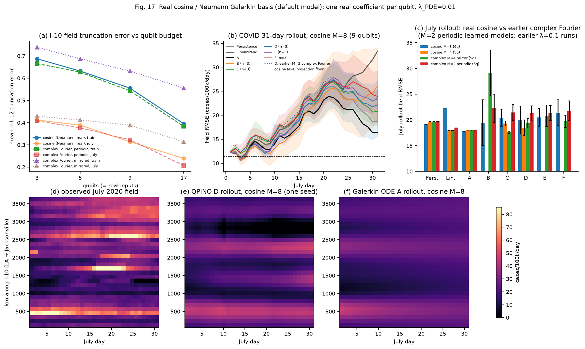

# 16. 2D contiguous-USA QPINO (2D real cosine basis on the land mask)

## 16.1 Field, basis and land mask

**Field.** We use the same gridded field as Cayman's PINN study (`/workspace/covid_pinn_hires`): $u=\mathrm{log1p}(\text{cumulative cases per }100\text{k})/\mathrm{log1p}(4800)$ from the JHU CSSE county series, rasterised to 256×128 cells (0.230°×0.203°, ≈20.5×22.5 km, σ = 1 cell spatial smoothing). The field has 17,609 land cells and runs from Mar 15 to Jul 26 2020. **Splits:** train Mar 15–Jun 16, validate Jun 17–30, test Jul 1–26. The one-step forecast starts from the observed previous day; the rollout starts from the observed Jun 30 state. The gridded field starts on Mar 15 (the 1D runs start on Mar 1) and ends on Jul 26. λ_PDE = 0.01 with the same ramp, and 3 seeds.

**Basis.** On the bounding rectangle $[0,L_x]\times[0,L_y]$ ($L_x=5245$ km, $L_y=2875$ km; lengths in units of $L_y/\pi=915$ km):
$$u(x,y,t)\approx\sum_{k,l=0}^{K-1}b_{kl}(t)\cos\frac{k\pi x}{L_x}\cos\frac{l\pi y}{L_y},$$
with **one real coefficient $b_{kl}$ per qubit** (index $j=kK+l$). $K=3$ gives 9 qubits and $K=4$ gives 16.

**Land mask, handled honestly.** Ocean, Canada and Mexico cells carry no data, so they get **no weight**. The ocean is not padded with zeros, which would put an artificial coastline jump into every mode.
* **Projection:** the coefficients are the $L^2(\Omega)$ least-squares projection on the land set $\Omega$, $\mathbf b=G^{-1}\Phi^\top W\mathbf u$, with the land mass matrix $G_{ij}=\langle\phi_i,\phi_j\rangle_\Omega$. $G$ is not diagonal on $\Omega$: cond($G$) = 64 for 3×3 and 668 for 4×4.
* **Dynamics:** the weak (Galerkin) form of Fisher–KPP on $\Omega$,
$$G\,\dot{\mathbf b}=-D\,K_\Omega\mathbf b+\rho\,G\mathbf b-\beta\,C_\Omega(\mathbf b,\mathbf b),\qquad (K_\Omega)_{ij}=\langle\nabla\phi_i,\nabla\phi_j\rangle_\Omega,\quad C_{\Omega,i}(\mathbf b,\mathbf b)=\langle\phi_i,(\Phi\mathbf b)^2\rangle_\Omega .$$
  Its natural boundary condition is **no flux across the coastline and borders**, i.e. a Neumann condition on the land domain itself, not on the rectangle. All integrals use midpoint quadrature on the 256×128 cells (`src/cosine2d_galerkin.py`, dispatched through `galerkin.set_basis("cosine2d")`).
* **Full rectangle:** with mask ≡ 1 the system reduces exactly to the tensor-product cosine triads $T_{kpq}T_{lrs}$ of §15.
* **Coupling graph:** the masked tensor $G^{-1}C_\Omega$ is dense, so the Hamiltonian graph is complete (36 edges at 9 qubits).
* **Same inputs everywhere:** every model uses the same real inputs $\mathbf b$, including persistence, linear trend, A (3 fitted parameters), B (MLP), C (HEA), D (QPINO), E (D without physics loss) and F (D without ZZ). At 9 qubits B, C, D, E and F have 442–485 parameters.

## 16.2 Verification (4 new tests in `tests/test_cosine2d.py`; 37/37 tests pass)

| test | result |
|---|---|
| mask ≡ 1: weak-form RHS vs tensor-product cosine triads | 8.5e-14 (3×3), 7.4e-15 (4×4) |
| mask ≡ 1: weak form vs $L^2$ projection of $D\nabla^2u+\rho u-\beta u^2$ (fine grid) | 3.4e-15 |
| irregular mask: exact recovery of in-span fields, residual ⟂ basis on land, $D=0$ reaction term = projection of $\rho u-\beta u^2$, torch = numpy | all < 1e-14 |
| irregular mask: coupling graph complete (36 edges); 9-qubit QPINO torch vs PennyLane | 2.9e-14 |

## 16.3 Results

### T12. Truncation error of the 2D real cosine basis on the land mask

| modes | qubits | rel. L2 train | rel. L2 val | rel. L2 July | RMSE train | RMSE July | cond(G) |
|---|---|---|---|---|---|---|---|
| 3×3 | 9 | 0.372 | 0.213 | 0.165 | 0.1378 | 0.1157 | 64 |
| 4×4 | 16 | 0.338 | 0.196 | 0.153 | 0.1238 | 0.1073 | 668 |

### T13. July 2020 RMSE (u, land cells)

| modes | model | params | 1-step incr. rel. L2 | 1-step RMSE | rollout RMSE Jul 1–26 | Jul 12 | Jul 26 | rollout RMSE vs projection | s/epoch |
|---|---|---|---|---|---|---|---|---|---|
| 3×3 | truncation floor | – | 0 | 0.1157 | 0.1157 | 0.1188 | 0.1014 | 0 | – |
| 3×3 | Persistence | 0 | 1.000 | 0.1158 | 0.1318 | 0.1285 | 0.1443 | 0.0630 | – |
| 3×3 | LinearTrend | 0 | 0.566 | 0.1158 | 0.1164 | 0.1190 | 0.1039 | 0.0125 | – |
| 3×3 | A | 3 | 1.004 | 0.1158 | 0.1186 | 0.1208 | 0.1088 | 0.0258 | – |
| 3×3 | B | 485 ± 0 | 6.760 ± 2.492 | 0.1164 ± 0.0004 | 0.1188 ± 0.0010 | 0.1202 ± 0.0008 | 0.1112 ± 0.0031 | 0.0263 ± 0.0045 | 0.01 ± 0.00 |
| 3×3 | C | 459 ± 0 | 5.875 ± 1.079 | 0.1164 ± 0.0003 | 0.1376 ± 0.0109 | 0.1354 ± 0.0125 | 0.1544 ± 0.0114 | 0.0725 ± 0.0196 | 0.30 ± 0.01 |
| 3×3 | D | 478 ± 0 | 3.939 ± 0.459 | 0.1161 ± 0.0000 | 0.1355 ± 0.0076 | 0.1327 ± 0.0075 | 0.1542 ± 0.0168 | 0.0691 ± 0.0159 | 0.36 ± 0.01 |
| 3×3 | E | 478 ± 0 | 3.944 ± 0.454 | 0.1161 ± 0.0000 | 0.1344 ± 0.0079 | 0.1328 ± 0.0076 | 0.1459 ± 0.0174 | 0.0667 ± 0.0168 | 0.36 ± 0.01 |
| 3×3 | F | 442 ± 0 | 6.041 ± 1.269 | 0.1170 ± 0.0005 | 0.1563 ± 0.0249 | 0.1493 ± 0.0163 | 0.1808 ± 0.0426 | 0.1015 ± 0.0369 | 0.36 ± 0.01 |
| 4×4 | truncation floor | – | 0 | 0.1073 | 0.1073 | 0.1093 | 0.0952 | 0 | – |
| 4×4 | Persistence | 0 | 1.000 | 0.1073 | 0.1248 | 0.1200 | 0.1410 | 0.0638 | – |
| 4×4 | LinearTrend | 0 | 0.688 | 0.1073 | 0.1090 | 0.1098 | 0.1013 | 0.0192 | – |
| 4×4 | A | 3 | 0.722 | 0.1073 | 0.1146 | 0.1143 | 0.1149 | 0.0403 | – |
| 4×4 | B | 816 ± 0 | 6.587 ± 0.673 | 0.1078 ± 0.0001 | 0.1221 ± 0.0066 | 0.1172 ± 0.0050 | 0.1368 ± 0.0113 | 0.0571 ± 0.0140 | 0.00 ± 0.00 |

Reference without truncation: persistence of the full-resolution Jun 30 field gives rollout RMSE 0.0762 (Jul 12 0.0615, Jul 26 0.1195) and one-step RMSE 0.0098. Every Galerkin model is bounded below by the truncation floor.
* fitted A (3×3): D = 1.06e-13 (non-dim; 8.84e-08 km²/day), ρ = 0.0315/day, β = 0.0356, K = ρ/β = 0.884, fit loss 1.024
* fitted A (4×4): D = 1.36e-11 (non-dim; 1.14e-05 km²/day), ρ = 0.0289/day, β = 0.0284, K = ρ/β = 1.015, fit loss 1.016

### 16-qubit (4×4) runtime benchmark (statevector, no dense operators, 1 thread)

| Trotter L | batch | fwd+bwd (s) | est. s/epoch (93 one-step + 609 rollout evaluations) | est. run (1500 epochs) |
|---|---|---|---|---|
| 4 | 16 | 4.93 | 216 | 90 h |
| 1 | 32 | 3.82 | 84 | 35 h |

**Reading the tables.**
* **The truncation floor dominates.** Three-by-three cosine modes leave 37 % (train) and 17 % (July) of the field unresolved. The July RMSE floor is 0.116 (4×4: 0.107). Persistence of the *full-resolution* Jun 30 field scores 0.076, below every Galerkin model's floor, until about Jul 20. Errors are therefore best compared through the **rollout RMSE against the projected field** (the last error column), which removes the common floor.
* **On that comparison, 3×3 / 9 qubits:**
  * the linear trend is best, at 0.0125;
  * the Galerkin ODE A (0.026) and the MLP B (0.026 ± 0.005) tie;
  * persistence gets 0.063;
  * QPINO D gets 0.069 ± 0.016, D without physics loss (E) 0.067 ± 0.017, and the HEA C 0.073 ± 0.020;
  * D without ZZ couplings (F) is worst, at 0.102 ± 0.037.
* **Against the full-resolution observed field (July rollout RMSE):** A 0.1186, B 0.1188 ± 0.0010, linear trend 0.1164, persistence 0.1318, D 0.1355 ± 0.0076, C 0.1376 ± 0.0109, F 0.1563 ± 0.0249.
* **So on the 2D map the QPINO does not beat persistence, the 3-parameter Galerkin ODE or the matched MLP.** The ZZ couplings again help (D vs F). The small physics weight has no measurable effect (D vs E).
* **One day ahead,** every learned model's increment error is far above 1 (D 3.9, B 6.8). The day-to-day increments of the slowly growing cumulative field are tiny compared with the models' one-step errors. The 31-day errors stay bounded only because the rollouts remain close to the Jun 30 state.
* **Fitted A:** ρ = 0.031/day and β = 0.036 (K = ρ/β = 0.88 in u). **D collapses to ≈0** (1e-13 non-dimensional; < 1e-4 km²/day). Spatial spread is not identifiable at this resolution of the dynamics, as in the PINN study (PINN D = 0.0008 km²/day).

**4×4 (16 qubits): trimmed by the runtime rule.** A dense 2^16×2^16 unitary needs 68 GB. A statevector Trotter implementation without dense operators (`experiments/bench_16q.py`, batch 16 to 32, 1 thread) costs 3.8–4.9 s per forward+backward. That extrapolates to 84–216 s per epoch and **35–90 h per 1500-epoch run**, far above the ~30 min limit, so D and C at 4×4 were not run. The 4×4 classical references were run: truncation, persistence, linear trend, A, and the MLP (816 parameters, rollout 0.1221 ± 0.0066).

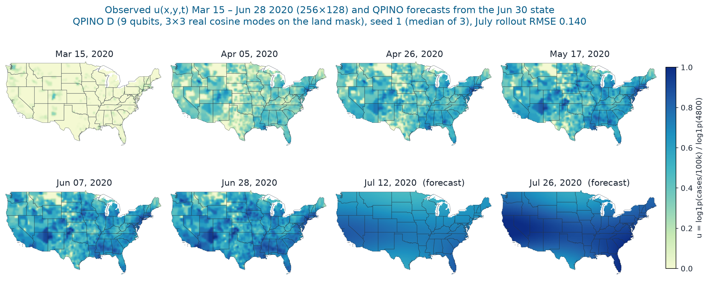

**Fig. 18** shows the observed $u$ for Mar 15, Apr 5, Apr 26, May 17, Jun 7 and Jun 28 2020 (full 256×128 resolution), followed by the QPINO D forecasts for Jul 12 and Jul 26 (9 qubits, 3×3 modes, the median-RMSE seed of 3, rolled out from the observed Jun 30 state). The styling follows Cayman's PINN figure (light YlGnBu, state borders). The forecasts are necessarily as smooth as nine cosine modes allow.

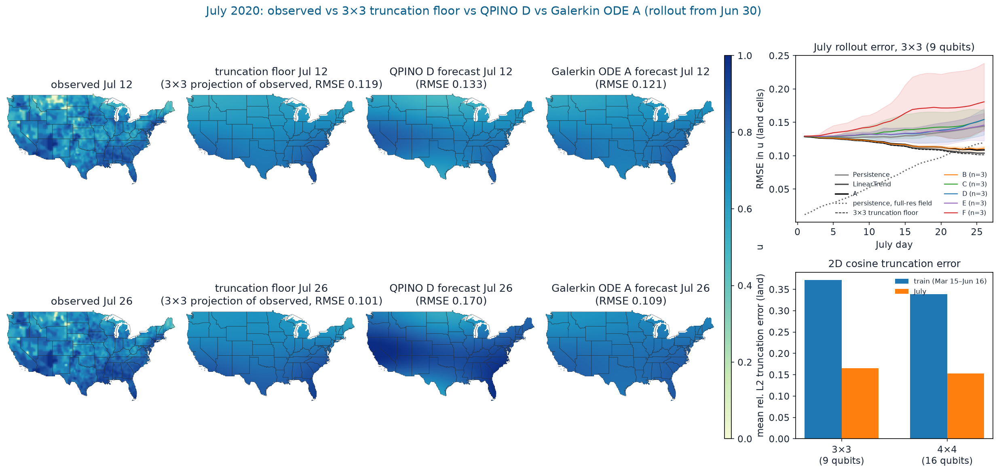

**Fig. 19** shows Jul 12 (top) and Jul 26 (bottom) as observed, as the 3×3 truncation floor (the projection of the observed field), as the QPINO D forecast and as the Galerkin ODE A forecast. It also shows the July RMSE by day for every model and the 2D truncation error for 3×3 and 4×4.

## 16.4 Caveats

* The rollout starts on Jun 30, not Jun 28 as in the PINN figure. The gridded field ends on Jul 26, so the test window is 26 days.
* Only $3\times3$ modes were trained, and the floor (0.116) is larger than every learned model's improvement over it. A meaningful 2D forecast needs far more modes than a statevector simulator of one qubit per mode can afford.
* The weak form imposes no-flux on the staircase land boundary. Mixing across borders (Canada, Mexico) is ignored.
* A scheduler bug (`pgrep -E`) launched all 15 3×3 jobs at once, with 11 concurrent on 8 cores. The results are unaffected, but the s/epoch values (0.30–0.36) are inflated by about 1.4×. The bug is fixed (`results/metrics/usa2d/NOTES.md`).
* All circuits are classically simulated. **No quantum advantage** is shown or claimed.

# 17. Spatially varying growth rate ρ(x,y) and a near-zero PDE weight

Cayman's suggestion (from his finite-difference Fisher–KPP solver) was to let the growth rate vary in space so that growth can be localised: $u_t = D\nabla^2u + \rho(x,y)\,u - \beta u^2$ on the §16 2D land-masked cosine basis. A second instruction set the PDE weight in the loss close to zero, so that the residual serves mainly as a physics-violation diagnostic.

## 17.1 Method

**Galerkin form.** We expand $\rho(x,y)=\sum_m r_m\psi_m(x,y)$ in a small cosine basis $\psi_m=\cos(k\pi x/L_x)\cos(l\pi y/L_y)$, with $K_r=4$ modes per axis (16 coefficients, $\psi_0=1$). On the land mask Ω the weak form is
$$G\dot b = -D\,\mathcal K b + E(r)\,b - \beta\,C(b,b),\qquad E(r)_{ij}=\sum_m r_m\,\langle\phi_i\,\psi_m\,\phi_j\rangle_\Omega ,$$
so the ρu term projects through the triple-product (ρ-coupling) tensor $E_{imj}$. A constant ρ reproduces the scalar model exactly. A non-constant ρ couples modes that the scalar model leaves uncoupled: $G^{-1}E(r)$ is a dense, real, non-symmetric 9×9 matrix. The physics loss and the full-PDE residual on the grid use the pointwise ρ(x,y) (`src/cosine2d_galerkin.py`: `setup(..., Kr)`, `rho_field`, `galerkin_rhs`, `fit_spatial_rho`). In the QPINO physics loss the reference D, ρ(x,y), β come from the classical fit below and are not trained with the circuit. Cayman asked for a joint learn; we did not do that because the physics weight is now 1e-4 (§17.3), so a jointly learned ρ would barely be constrained by the loss. The 8×8 fit below shows how badly an unconstrained ρ(x,y) behaves.

**Fitting ρ(x,y), D and β (classical Galerkin ODE "A-ρ").** A one-step least-squares fit over the full training window gave a good training loss but a poor rollout: validation rollout rel. L2 0.087 against 0.051 for scalar ρ, and July rollout RMSE 0.161. The 16 extra parameters fit the March–April take-off, which looks nothing like June/July. We therefore fit by an H = 7-day multi-step rollout objective on the last NW ∈ {28, 56, all} training days. An L2 shrinkage λ_L2 ∈ {0, 0.1, 1, 10, 100} is applied to the non-constant ρ modes. The pair is chosen by the Jun 17–30 validation rollout. The initial ρ is the local log-growth of the projected field (∂ₜ log u projected on ψ; range [−0.24, 0.71]/day on land, so it is very noisy). **Fairness:** the scalar model is refitted with the identical protocol ("A, scalar ρ (rollout protocol)") so that the comparison isolates the spatial term. Validation selected NW = 28 days and λ_L2 = 100, at the edge of the grid, i.e. the *strongest* shrinkage. The learned ρ(x,y) ranges over [0.0002, 0.0179]/day (mean 0.0093), with D ≈ 1e-8 (unidentifiable, as before) and β = 0.0079. The scalar refit is ρ = 0.0143, β = 0.0153.

**Tests** (`tests/test_spatial_rho.py`, 4 new): (i) a constant ρ vector equals the scalar model; (ii) the Galerkin ρu term equals the land least-squares projection of the pointwise product ρ(x,y)u, including off-diagonal coupling; (iii) the fit recovers a planted r = [0.30, 0.08, −0.06, 0.04] and β = 0.5 from synthetic Galerkin data; (iv) the hinge PDE loss. With the 3 regional tests of §18 the suite has **44 tests, all passing**.

## 17.2 Can localisation help at 3×3? (honest note)

Only slightly. With 9 cosine modes the *solution* cannot hold localised structure: the projection floor (RMSE 0.1157) is set by the basis, not by the dynamics. A localised ρ can only reshape how those 9 smooth modes grow. Against the observed field, A-ρ(x,y) improves the July rollout from 0.1189 (scalar, same protocol) to 0.1184, or 0.1186 for the §16 one-step scalar fit. Against the projected field the improvement is 0.0272 → 0.0251. The learned ρ is smooth (heavy shrinkage) and highest over the northern Plains/upper Midwest, where the 3×3 field was still rising.

**Cheap higher-mode classical reference (8×8, 64 modes, classical only, no circuit).** The truncation floor drops to 0.0911. The scalar Galerkin ODE fitted with the rollout protocol reaches 0.0982, the best July rollout of any model in this section, against linear trend 0.1164 and persistence 0.1318 at 3×3. The 8×8 ρ(x,y) fit is a **negative result**. The validation-selected fit drives β → 0 and produces a signed ρ in [−0.124, 0.106]/day. That makes the dynamics linear and exponential, so the July rollout diverges (RMSE 0.586, Jul 26 1.21). A 16-coefficient ρ with 64 modes and only 28 days of fitting data is not identifiable without much stronger priors (positivity of ρ, a lower bound on β, or smoothness priors). Localised growth therefore needs both more modes *and* a constrained ρ. At 3×3 there is too little resolution for it to matter; at 8×8 there is enough resolution but the fit becomes unstable.

## 17.3 PDE weight 1e-4 and the physics-violation diagnostic

The default `lambda_pde` for the 2D runs is now **1e-4** (`configs/usa2d.yaml`, overridable with `--lambda_pde`). An optional hinge form relu(|R| − τ)² is available through `train.pde_hinge_tol` / `--hinge_tol` (default off; not used in these runs). The full-PDE residual is still computed every epoch (`log_every: 1`). For every model, baselines included, we report the **physics violation**: the RMS (u/day) of the trapezoid full-PDE residual $(u^{n+1}-u^n)/\Delta t-\tfrac12[f(u^n)+f(u^{n+1})]$ on 2000 land points. We evaluate it on train and val one-step predictions and on the July rollout, against both the scalar and the spatial reference physics. The observed July data themselves give 0.0022 (scalar reference) / 0.0024 (spatial reference) after 3×3 projection.

**As expected, λ = 0.01 was already effectively data-only.** Moving to 1e-4 changes the QPINO D rollout from 0.1355 ± 0.0076 to 0.1348 ± 0.0081 (scalar ρ). C changes from 0.1376 to 0.1373 and B from 0.1188 to 0.1190, all well within the seed spread. With the PDE term this small, the scalar/ρ(x,y) choice barely enters training: D 0.1348 → 0.1330, C 0.1373 → 0.1372, B 0.1190 → 0.1184, all within one seed standard deviation.

The diagnostic is informative. The QPINO rollouts violate the fitted physics about 4× more than the observed data do (≈0.0087 against 0.0022). The MLP violates it about 2× more (≈0.004), and the Galerkin ODEs violate it at or below the data level.

## 17.4 Results (3 seeds; same splits and metrics as §16)

### T14. July 2020 RMSE and physics violation

λ_PDE = 1e-4 for all trained rows except the §16 rows (λ = 0.01). ρ(x,y) = Σ r_m ψ_m with a 4×4 cosine basis (16 coefficients). PDE violation = RMS (u/day) of the trapezoid full-PDE residual on 2000 land points; 'own' uses the model's reference physics (scalar fit for scalar rows, spatial fit for ρ(x,y) rows); rollout column gives scalar-ref / spatial-ref. Observed July data: 0.0022 / 0.0024 (3×3 projection, scalar / spatial ref).

| modes | model | params | 1-step RMSE | rollout RMSE | Jul 12 | Jul 26 | rollout vs projection | PDE viol. val 1-step (own) | PDE viol. test rollout (scalar / spatial ref) |
|---|---|---|---|---|---|---|---|---|---|
| 3×3 | truncation floor | – | 0.1157 | 0.1157 | 0.1188 | 0.1014 | 0 | – | 0.0022 / 0.0024 |
| 3×3 | Persistence | 0 | 0.1158 | 0.1318 | 0.1285 | 0.1443 | 0.0630 | – | 0.0056 / 0.0032 |
| 3×3 | Linear trend | 0 | 0.1158 | 0.1164 | 0.1190 | 0.1039 | 0.0125 | – | 0.0025 / 0.0021 |
| 3×3 | A, scalar ρ (§16 one-step fit) | 3 | 0.1158 | 0.1186 | 0.1208 | 0.1088 | 0.0258 | 0.0001 | 0.0000 / 0.0029 |
| 3×3 | A, scalar ρ (rollout protocol) | 3 | 0.1158 | 0.1189 | 0.1206 | 0.1101 | 0.0272 | 0.0029 | 0.0025 / 0.0018 |
| 3×3 | **A-ρ(x,y)** (rollout protocol) | 18 | 0.1158 | 0.1184 | 0.1203 | 0.1088 | 0.0251 | 0.0013 | 0.0029 / 0.0014 |
| 3×3 | D (9-qubit QPINO), scalar ρ, λ=0.01 (§16) | 478 ± 0 | 0.1161 ± 0.0000 | 0.1355 ± 0.0076 | 0.1327 ± 0.0075 | 0.1542 ± 0.0168 | 0.0691 ± 0.0159 | – | – |
| 3×3 | D (9-qubit QPINO), scalar ρ, λ=1e-4 | 478 ± 0 | 0.1161 ± 0.0000 | 0.1348 ± 0.0081 | 0.1324 ± 0.0076 | 0.1474 ± 0.0172 | 0.0673 ± 0.0173 | 0.0090 ± 0.0010 | 0.0089 ± 0.0015 / 0.0084 ± 0.0019 |
| 3×3 | **D (9-qubit QPINO), ρ(x,y), λ=1e-4** | 478 ± 0 | 0.1161 ± 0.0000 | 0.1330 ± 0.0074 | 0.1318 ± 0.0077 | 0.1421 ± 0.0153 | 0.0639 ± 0.0158 | 0.0093 ± 0.0005 | 0.0087 ± 0.0013 / 0.0082 ± 0.0017 |
| 3×3 | C (HEA QPINO), scalar ρ, λ=0.01 (§16) | 459 ± 0 | 0.1164 ± 0.0003 | 0.1376 ± 0.0109 | 0.1354 ± 0.0125 | 0.1544 ± 0.0114 | 0.0725 ± 0.0196 | – | – |
| 3×3 | C (HEA QPINO), scalar ρ, λ=1e-4 | 459 ± 0 | 0.1164 ± 0.0003 | 0.1373 ± 0.0097 | 0.1354 ± 0.0126 | 0.1553 ± 0.0112 | 0.0723 ± 0.0176 | 0.0057 ± 0.0007 | 0.0086 ± 0.0012 / 0.0084 ± 0.0010 |
| 3×3 | **C (HEA QPINO), ρ(x,y), λ=1e-4** | 459 ± 0 | 0.1164 ± 0.0003 | 0.1372 ± 0.0097 | 0.1354 ± 0.0126 | 0.1552 ± 0.0111 | 0.0722 ± 0.0177 | 0.0057 ± 0.0005 | 0.0086 ± 0.0012 / 0.0084 ± 0.0010 |
| 3×3 | B (MLP), scalar ρ, λ=0.01 (§16) | 485 ± 0 | 0.1164 ± 0.0004 | 0.1188 ± 0.0010 | 0.1202 ± 0.0008 | 0.1112 ± 0.0031 | 0.0263 ± 0.0045 | – | – |
| 3×3 | B (MLP), scalar ρ, λ=1e-4 | 485 ± 0 | 0.1164 ± 0.0004 | 0.1190 ± 0.0010 | 0.1205 ± 0.0008 | 0.1110 ± 0.0031 | 0.0274 ± 0.0048 | 0.0054 ± 0.0026 | 0.0044 ± 0.0012 / 0.0040 ± 0.0013 |
| 3×3 | **B (MLP), ρ(x,y), λ=1e-4** | 485 ± 0 | 0.1164 ± 0.0003 | 0.1184 ± 0.0011 | 0.1202 ± 0.0009 | 0.1094 ± 0.0023 | 0.0246 ± 0.0051 | 0.0061 ± 0.0033 | 0.0038 ± 0.0003 / 0.0035 ± 0.0008 |
| 8×8 (classical) | truncation floor | – | 0.0911 | 0.0911 | 0.0917 | 0.0809 | 0 | – | – |
| 8×8 (classical) | classical A, scalar ρ (one-step fit) | 3 | 0.0913 | 0.1162 | 0.1092 | 0.1414 | 0.0721 | 0.0002 | 0.0002 / 0.0307 |
| 8×8 (classical) | classical A, scalar ρ (rollout protocol) | 3 | 0.0912 | 0.0982 | 0.0957 | 0.0993 | 0.0365 | 0.0065 | 0.0060 / 0.0258 |
| 8×8 (classical) | classical A-ρ(x,y) (rollout protocol) | 18 | 0.0951 | 0.5861 | 0.3452 | 1.2131 | 0.5790 | 0.0011 | 0.1080 / 0.0039 |

* ρ(x,y) fit (3×3): window 28 d, λ_L2 = 100, D = 1e-08, β = 0.0079, ρ range on land [0.0002, 0.0179]/day (mean 0.0093), val rollout rel. L2 0.0263; scalar same protocol: window 56 d, ρ = 0.0143, β = 0.0153, val rollout rel. L2 0.0462.
* ρ(x,y) fit (8×8): window 28 d, λ_L2 = 10, D = 3.58e-12, β = 0.0000, ρ range on land [-0.1242, 0.1060]/day (mean -0.0083), val rollout rel. L2 0.1052; scalar same protocol: window 28 d, ρ = 0.0042, β = 0.0000, val rollout rel. L2 0.1687.
* local log-growth initialiser range (3×3 projection, last 28 training days): [-0.241, 0.712]/day.

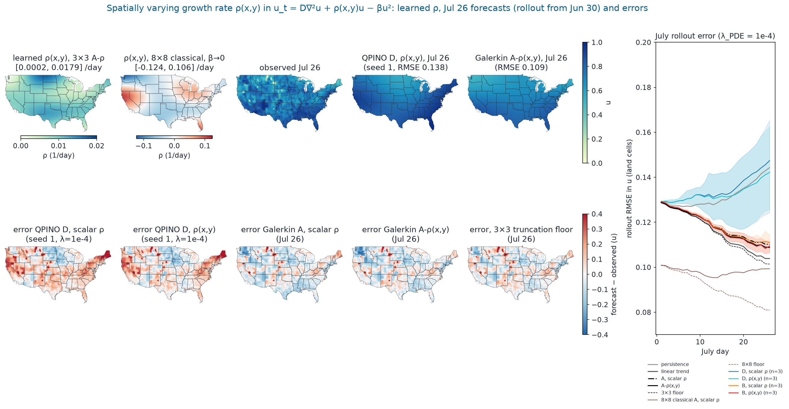

**Fig. 20.** Top row: the learned ρ(x,y) (3×3 A-ρ fit), the unstable 8×8 classical ρ(x,y) (signed, β → 0), the observed Jul 26 field, the QPINO D ρ(x,y) forecast (median seed), and the Galerkin A-ρ forecast. Bottom row: Jul 26 forecast − observed for QPINO D with scalar ρ and with ρ(x,y), Galerkin A with scalar ρ and with ρ(x,y), and the 3×3 truncation floor. Right: July rollout RMSE by day.

## 17.5 Caveats

* ρ(x,y) was **not mapped into the circuit Hamiltonian H_θ**. The ρ-coupling G⁻¹E(r) is a real, non-symmetric matrix on coefficient space. It has no natural Z/ZZ map onto the one-qubit-per-mode encoding, and forcing one would need a learned surrogate that adds no information. ρ(x,y) enters the QPINO only through the (now 1e-4-weighted) physics loss and the diagnostic.
* The selected shrinkage λ_L2 = 100 sits at the edge of the grid, so the data prefer an almost constant ρ at 3×3.
* The 12 QPINO C/D runs at λ = 1e-4 finished training, but the first evaluation crashed (a context manager reused twice). They were re-evaluated from their saved final checkpoints (`--eval_only`), so the same weights were evaluated. Their training wall times are recovered from the scheduler launch time and the checkpoint mtime (403–628 s); the per-epoch histories of those 12 runs were not kept.
* The 8×8 rows are classical Galerkin ODEs, not QPINOs (a 64-qubit statevector is out of reach).
* All circuits are classically simulated. **No quantum advantage** is shown or claimed.

# 18. Regional domain-decomposition QPINO (5 regions × 9 qubits)

**Idea.** A single 3×3 basis on the whole USA has a floor of 0.1157. The map is split into 5 regions (state groups). Each region gets its own 3×3 land-masked cosine basis on its bounding box, with the natural no-flux condition at its own boundary, and its own 9-qubit QPINO. That gives 45 real coefficients, one qubit per coefficient. **The regional circuits are never entangled with each other.** They are 5 independent 9-qubit statevectors, so no 45-qubit state is ever formed. Neighbouring regions are coupled *classically* at every step through the diffusive flux across their shared cell faces.

## 18.1 Decomposition and coupling

**Regions** (`data/processed/usa_regions_256x128.npz`; 137 grid cells not covered by a state polygon were assigned to the nearest region):

* West: WA OR CA NV ID MT WY UT CO (5782 cells)
* Southwest/Texas: AZ NM TX OK (3065)
* Midwest: ND SD NE KS MN IA MO WI IL MI IN OH (4661)
* Southeast: AR LA MS AL GA FL SC NC TN KY VA WV (2983)
* Northeast: PA NY NJ CT RI MA VT NH ME MD DE DC (1118)

The regions share 381 interface cell faces. cond(G) per region is 29, 898, 30, 106 and 234. The Southwest/Texas mask fills its bounding box poorly, which explains its large value.

**Interface flux.** For region r and basis function i, $S_{r,i}=D\sum_{(p,q)\in\partial_{rs}}\phi^{(r)}_i(p)\,[u_s(q)-u_r(p)]\,A/h^2$, summed over faces between a cell p in r and a cell q in a neighbour s. This is exactly the cross-interface part of the 5-point finite-volume Laplacian (`src/regional_galerkin.py`). The regional Galerkin system is $G_r\dot b_r = -D\mathcal K_r b_r + \rho_r G_r b_r - \beta C_r(b_r,b_r) + S_r(b)$.

**Tests** (`tests/test_regional.py`, 3 new; **44/44 tests pass**):

1. Flux conservation: the total flux summed over regions is zero to machine precision, and a constant field gives zero flux.
2. Interface consistency: the assembled interface flux equals the cross-interface part of an explicit global FV Laplacian.
3. Decoupled limit: without coupling, or with D = 0, the regional system matches 5 independent single-region cosine Galerkin models. The torch and numpy versions agree.

**Models.**

* *Regional Galerkin ODE A* (classical): global D and β plus a per-region growth rate ρ_r. Here ρ_r is a piecewise-constant spatial ρ, the natural "per-region ρ". It is fitted with the §17 rollout protocol (H = 7, window chosen on validation: 56 days). The fit gives D = 8.8e-6 (7.4 km²/day), β = 0.0060, and ρ_r = 0.0083 (West), 0.0127 (Southwest/Texas), 0.0097 (Midwest), 0.0080 (Southeast) and 0.0076 (Northeast) /day.
* *Regional QPINO D and MLP B*: one model per region, trained independently on that region's coefficient series, 3 seeds. Training uses λ_PDE = 1e-4 with the local weak-form physics (D, ρ_r, β) and the same epochs and optimiser as §16. The 5 regions ran in parallel; each regional D took 478–539 s.
* *Coupled rollout*: $b^{t+1}_r = \mathcal N_r(b^t_r) + \Delta t\,S_r(b^t)$, with the classical flux added explicitly once per day. The *decoupled* ablation drops $S_r$.

## 18.2 Results (same splits, seeds and metrics; vs observed full-resolution field)

### T15. Regional decomposition, July 2020

Regions (cells): West (5782), Southwest/Texas (3065), Midwest (4661), Southeast (2983), Northeast (1118); 381 interface cell faces. cond(G) per region: 29, 898, 30, 106, 234. Regional truncation floor: rel. L2 train 0.300 / val 0.172 / July 0.135, RMSE July 0.0949 (single 3×3 basis: RMSE July 0.1157).

Regional Galerkin ODE A fit (rollout protocol, H=7, window 56 d chosen on validation): D = 8.8e-06 (7.37 km²/day), β = 0.0060, ρ_r = West 0.0083, Southwest/Texas 0.0127, Midwest 0.0097, Southeast 0.0080, Northeast 0.0076 /day. July interface-flux / local-RHS norm ratio (observed coefficients): 0.141.

Rollout from the observed Jun 30 state, RMSE in u vs the full-resolution observed field (land cells); 'vs projection' is against the model's own projection (regional 45-mode projection for regional rows, single 3×3 projection for single-region rows). PDE violation: regional rows use the regional physics (D, ρ_r, β; pointwise PDE, 400 points per region); single-region rows use the §17 scalar reference — the two are not on the same scale of physics, compare within a block. Trained rows: 3 seeds, λ_PDE = 1e-4.

| model | params | 1-step RMSE | rollout RMSE | Jul 12 | Jul 26 | rollout vs projection | PDE viol. rollout | West | Southwest/Texas | Midwest | Southeast | Northeast |
|---|---|---|---|---|---|---|---|---|---|---|---|---|
| **regional** truncation floor | – | 0.0949 | 0.0949 | 0.0961 | 0.0840 | 0.0000 | 0.0027 | 0.1188 | 0.0830 | 0.0965 | 0.0556 | 0.0533 |
| regional persistence | 0 | 0.0950 | 0.1149 | 0.1086 | 0.1350 | 0.0649 | 0.0036 | 0.1402 | 0.1125 | 0.1112 | 0.0795 | 0.0580 |
| regional linear trend | 0 | 0.0949 | 0.0972 | 0.0971 | 0.0919 | 0.0211 | 0.0020 | 0.1210 | 0.0876 | 0.0987 | 0.0565 | 0.0538 |
| regional Galerkin A, coupled (flux) | 7 | 0.0949 | 0.0997 | 0.0986 | 0.0979 | 0.0307 | 0.0002 | 0.1255 | 0.0905 | 0.0982 | 0.0591 | 0.0570 |
| regional Galerkin A, decoupled | 7 | 0.0949 | 0.0999 | 0.0987 | 0.0984 | 0.0313 | 0.0000 | 0.1256 | 0.0912 | 0.0982 | 0.0589 | 0.0571 |
| regional QPINO D (5×9 qubits), coupled | 2390 | 0.0960 ± 0.0003 | 0.1348 ± 0.0139 | 0.1279 ± 0.0171 | 0.1705 ± 0.0151 | 0.0949 ± 0.0192 | 0.0111 ± 0.0014 | 0.1533 ± 0.0029 | 0.1360 ± 0.0195 | 0.1159 ± 0.0117 | 0.1121 ± 0.0335 | 0.1383 ± 0.0616 |
| regional QPINO D (5×9 qubits), decoupled | 2390 | 0.0960 ± 0.0003 | 0.1369 ± 0.0153 | 0.1278 ± 0.0177 | 0.1713 ± 0.0165 | 0.0977 ± 0.0208 | 0.0113 ± 0.0013 | 0.1555 ± 0.0068 | 0.1363 ± 0.0202 | 0.1164 ± 0.0104 | 0.1087 ± 0.0380 | 0.1575 ± 0.0679 |
| regional MLP B, coupled | 2425 | 0.0961 ± 0.0003 | 0.1311 ± 0.0251 | 0.1191 ± 0.0170 | 0.1698 ± 0.0533 | 0.0870 ± 0.0354 | 0.0080 ± 0.0016 | 0.1367 ± 0.0025 | 0.1500 ± 0.0312 | 0.1249 ± 0.0294 | 0.1148 ± 0.0677 | 0.0606 ± 0.0006 |
| regional MLP B, decoupled | 2425 | 0.0961 ± 0.0003 | 0.1308 ± 0.0245 | 0.1192 ± 0.0168 | 0.1684 ± 0.0511 | 0.0867 ± 0.0347 | 0.0079 ± 0.0016 | 0.1368 ± 0.0027 | 0.1516 ± 0.0335 | 0.1228 ± 0.0261 | 0.1142 ± 0.0663 | 0.0619 ± 0.0016 |
| *single 3×3 basis (§16/§17)* | | | | | | | |  |  |  |  |  |
| single-region truncation floor | – | 0.1157 | 0.1157 | 0.1188 | 0.1014 | 0.0000 | – | 0.1385 | 0.1036 | 0.1133 | 0.0803 | 0.1082 |
| single-region persistence | 0 | 0.1158 | 0.1318 | 0.1285 | 0.1443 | 0.0630 | – | 0.1520 | 0.1210 | 0.1298 | 0.1069 | 0.1143 |
| single-region linear trend | 0 | 0.1158 | 0.1164 | 0.1190 | 0.1039 | 0.0125 | – | – | – | – | – | – |
| single-region Galerkin A (rollout protocol) | 3 | 0.1158 | 0.1189 | 0.1206 | 0.1101 | 0.0272 | – | 0.1396 | 0.1071 | 0.1146 | 0.0917 | 0.1153 |
| single-region QPINO D (9 qubits), λ=1e-4 | 478 | 0.1161 ± 0.0000 | 0.1348 ± 0.0081 | 0.1324 ± 0.0076 | 0.1474 ± 0.0172 | 0.0673 ± 0.0173 | – | 0.1576 ± 0.0120 | 0.1141 ± 0.0030 | 0.1265 ± 0.0038 | 0.1021 ± 0.0037 | 0.1626 ± 0.0328 |
| single-region MLP B, λ=1e-4 | 485 | 0.1164 ± 0.0004 | 0.1190 ± 0.0010 | 0.1205 ± 0.0008 | 0.1110 ± 0.0031 | 0.0274 ± 0.0048 | – | 0.1410 ± 0.0032 | 0.1061 ± 0.0017 | 0.1149 ± 0.0012 | 0.0862 ± 0.0063 | 0.1197 ± 0.0094 |

* regional D: training wall time per region 495 s (range 478–539 s, 1 thread, regions run in parallel).
* regional B: training wall time per region 9 s (range 9–10 s, 1 thread, regions run in parallel).

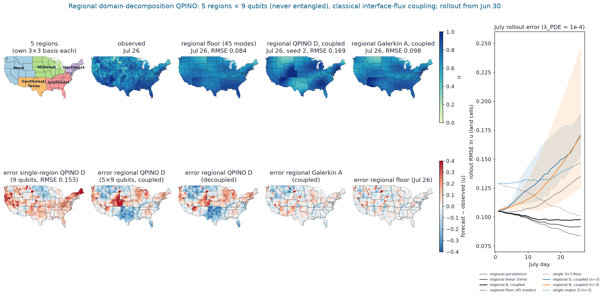

**Fig. 21.** Top: the 5 regions, observed Jul 26, the regional truncation floor, the regional QPINO D forecast (coupled, median seed) and the regional Galerkin A forecast. Bottom: Jul 26 errors of the single-region QPINO D, the regional D coupled and decoupled, the regional A, and the regional floor. Right: July rollout RMSE by day.

## 18.3 Findings

* **New truncation floor:** decomposition lowers the July floor from 0.1157 to **0.0949** (rel. L2 0.135). That is roughly the 8×8 single-basis floor (0.0911) with 45 rather than 64 coefficients. The floor falls in every region, most in the Northeast (0.108 → 0.053) and the Southeast (0.080 → 0.056).
* **Classical baselines gain the most.** The regional linear trend (0.0972) and the regional Galerkin A (0.0997 coupled, 0.0999 decoupled) beat every single-region model; the best single-region model is the linear trend at 0.1164. Regional persistence reaches 0.1149.
* **The regional QPINO does not convert the lower floor into a better forecast.** The regional D gives 0.1348 ± 0.0139 coupled and 0.1369 ± 0.0153 decoupled; the seeds give 0.1222, 0.1541 and 0.1282 coupled. That equals the single-region D (0.1348 ± 0.0081) and is worse than regional persistence. Its one-step error sits on the new floor (0.0960), but the July rollout drifts away from its own projection (0.095 vs 0.067 for the single-region D). Its largest per-region rollout errors are in the West (0.153) and the Northeast (0.138 ± 0.062). The regional MLP B (0.1311 ± 0.0251; seeds 0.1155, 0.1666, 0.1113) is also worse and less stable than the single-region MLP (0.1190 ± 0.0010). Each regional model sees one short series of 9 coefficients, and the per-region series are noisier than the national one.
* **The coupling is weak.** The fitted diffusion is tiny, and the July flux is 14% of the local right-hand side in norm. Coupled and decoupled differ by ≤ 0.002 for A and by about 0.002 for D (coupled is slightly better on average, not significant over 3 seeds).
* **Physics violation** (regional physics, pointwise): observed data 0.0027, regional A 0.0002, regional linear trend 0.0020, persistence 0.0036, regional MLP 0.0080 ± 0.0016, regional QPINO D 0.0111 ± 0.0014. The QPINO again violates the fitted physics about 4× more than the data do.

## 18.4 Caveats

* The regional bases are independent, so the reconstructed field is **discontinuous across region borders** (visible in Fig. 21). The flux uses face differences of the reconstructed cell values; it is consistent with finite-volume diffusion but does not enforce continuity.
* The QPINOs were trained without the flux term (the coupling is added classically in the rollout). This is a deliberate choice to keep the regional circuits independent. Training with the coupled rollout in the loss would require joint backpropagation through the 5 circuits, which was not done.
* The pointwise PDE-violation metric excludes the interface flux and is not on the same scale as the single-region diagnostic of §17.
* Explicit (forward-Euler, Δt = 1 day) flux coupling for the learned models; RK4 with the flux inside for the regional A.
* All circuits are classically simulated. **No quantum advantage** is shown or claimed.

# 19. Joint regional training: interface flux inside the training rollouts and a long-rollout curriculum

§18 trained each regional QPINO on its own and added the classical interface flux only at rollout time. The July rollouts then drifted away from the 45-mode projection: RMSE vs projection was 0.095 for the regional D. Here we change two things and keep the circuit architecture unchanged (Ry embedding of the 9 real Galerkin coefficients, custom $H_\theta$, one 9-qubit circuit per region, never entangled across regions):

1. **Flux in training.** The 5 regional models are trained *jointly*: every training rollout step is $B^{t+1}_r=\mathcal N_r(B^t_r)+\Delta t\,S_r(B^t)$, so neighbour states feed the classical flux at every step. Gradients from region s's loss reach region r's parameters through $S$ whenever r and s share faces. With the flux off, the joint loss separates into 5 independent regional problems.
2. **Long rollout windows in the loss.** We use a curriculum of 7 → 14 → 21-day windows (300 epochs each, 900 total). The "short" control keeps 7-day windows (the §18 rollout length) for the same 900 epochs. Each epoch draws 32 random windows. Step weights are $w_s\propto s^{-\alpha}$, normalised to mean 1.

**Selection on the validation window.** Every 5 epochs we score the 14-day rollout from the observed Jun 16 state over Jun 17–30. The best checkpoint from epoch 150 onward is kept, so the *training horizon* (curriculum stage) is chosen on validation. The selection window is identical for every curriculum. The step weighting α ∈ {0, 1} was chosen per model family on a seed-0 pilot (flux on, 7→14→21): α = 1 for D (validation 0.1134 vs 0.1135, effectively a tie) and for C (0.1116 vs 0.1143), and α = 0 for B (0.1105 vs 0.1115). The D ablation grid had already been launched at α = 0 before the D pilot finished. The D ablation is therefore internally consistent at α = 0, and T16 lists the α = 1 main row separately. λ_PDE = 1e-4 throughout. The pointwise regional Fisher–KPP residual is logged every 5 epochs on train one-step predictions and on the validation rollout, and is reported on the July rollout.

**Tests first** (`tests/test_regional_training.py`, 2 new; **46/46 tests pass**):

* *Flux gradients.* In a joint rollout with a 9-qubit QPINO in region 0 and MLPs elsewhere, a loss on one region gives non-zero gradients to its neighbour's parameters with the flux on (0.24) and exactly zero with the flux off. A central finite difference matches autograd (relative error 1.5e-8).
* *Rollout loss.* The step-weighted joint rollout loss equals a manual numpy rollout (model calls plus the numpy flux) to 1.8e-15. The flux-off joint rollout equals independent regional models exactly.

## 19.1 Results (3 seeds; same splits and metrics as §16–§18; coupled rollout from Jun 30)

### T16. Joint regional training, July 2020

Rollout from the observed Jun 30 state (coupled rollout for every row), RMSE in u vs the observed full-resolution field; 'vs floor' = against the regional 45-mode projection of the observed field (the 0.0949 floor itself is the projection's error vs observed). PDE violation = pointwise regional Fisher–KPP residual (u/day, interface flux excluded). λ_PDE = 1e-4. 'selected' = training horizon and epoch of the validation-selected checkpoint per seed.

| model | seeds | 1-step RMSE | rollout RMSE | Jul 12 | Jul 26 | rollout vs floor | vs floor, Jul 26 | PDE viol. rollout | PDE viol. train 1-step | selected (H@epoch) |
|---|---|---|---|---|---|---|---|---|---|---|
| regional truncation floor | 1 | 0.0949 | 0.0949 | 0.0961 | 0.0840 | 0.0000 | 0.0000 | 0.0027 | – | – |
| regional persistence | 1 | 0.0950 | 0.1149 | 0.1086 | 0.1350 | 0.0649 | 0.1057 | 0.0036 | – | – |
| regional linear trend | 1 | 0.0949 | 0.0972 | 0.0971 | 0.0919 | 0.0211 | 0.0373 | 0.0020 | – | – |
| regional Galerkin A (coupled) | 1 | 0.0949 | 0.0997 | 0.0986 | 0.0979 | 0.0307 | 0.0503 | 0.0002 | – | – |
| §18 regional D (independent training, flux only in rollout) | 3 | 0.0960 ± 0.0003 | 0.1348 ± 0.0139 | 0.1279 ± 0.0171 | 0.1705 ± 0.0151 | 0.0949 ± 0.0192 | 0.1481 ± 0.0173 | 0.0111 ± 0.0014 | – | – |
| §18 regional B (independent training, flux only in rollout) | 3 | 0.0961 ± 0.0003 | 0.1311 ± 0.0251 | 0.1191 ± 0.0170 | 0.1698 ± 0.0533 | 0.0870 ± 0.0354 | 0.1447 ± 0.0606 | 0.0080 ± 0.0016 | – | – |
| **§19 QPINO D: flux in training, 7→14→21 d (α=1, main)** | 3 | 0.0953 ± 0.0002 | 0.1328 ± 0.0083 | 0.1253 ± 0.0091 | 0.1659 ± 0.0104 | 0.0925 ± 0.0122 | 0.1429 ± 0.0121 | 0.0068 ± 0.0005 | 0.0080 ± 0.0000 | 7d@150, 7d@175, 7d@155 |
| §19 QPINO D: flux in training, 7→14→21 d (α=0) | 3 | 0.0953 ± 0.0001 | 0.1303 ± 0.0038 | 0.1245 ± 0.0050 | 0.1607 ± 0.0078 | 0.0893 ± 0.0056 | 0.1370 ± 0.0092 | 0.0071 ± 0.0006 | 0.0080 ± 0.0001 | 21d@885, 14d@395, 7d@185 |
| §19 QPINO D: no flux in training, 7→14→21 d (α=0) | 3 | 0.0952 ± 0.0001 | 0.1336 ± 0.0094 | 0.1290 ± 0.0092 | 0.1632 ± 0.0149 | 0.0936 ± 0.0134 | 0.1396 ± 0.0173 | 0.0073 ± 0.0002 | 0.0080 ± 0.0000 | 14d@365, 7d@225, 7d@180 |
| §19 QPINO D: flux in training, 7 d only (α=0) | 3 | 0.0953 ± 0.0001 | 0.1294 ± 0.0032 | 0.1264 ± 0.0052 | 0.1528 ± 0.0107 | 0.0879 ± 0.0048 | 0.1275 ± 0.0126 | 0.0068 ± 0.0006 | 0.0080 ± 0.0001 | 7d@585, 7d@285, 7d@185 |
| §19 QPINO D: no flux in training, 7 d only (α=0) | 3 | 0.0952 ± 0.0001 | 0.1341 ± 0.0088 | 0.1287 ± 0.0095 | 0.1655 ± 0.0130 | 0.0943 ± 0.0124 | 0.1425 ± 0.0150 | 0.0075 ± 0.0004 | 0.0080 ± 0.0001 | 7d@335, 7d@225, 7d@180 |
| **§19 HEA C: flux in training, 7→14→21 d (α=1, main)** | 3 | 0.0953 ± 0.0001 | 0.1206 ± 0.0123 | 0.1134 ± 0.0071 | 0.1472 ± 0.0273 | 0.0730 ± 0.0193 | 0.1196 ± 0.0328 | 0.0067 ± 0.0015 | 0.0079 ± 0.0002 | 7d@155, 7d@160, 7d@155 |
| §19 HEA C: no flux in training, 7→14→21 d (α=1) | 3 | 0.0954 ± 0.0001 | 0.1229 ± 0.0091 | 0.1145 ± 0.0051 | 0.1541 ± 0.0179 | 0.0773 ± 0.0149 | 0.1286 ± 0.0218 | 0.0076 ± 0.0005 | 0.0079 ± 0.0002 | 14d@310, 7d@160, 7d@150 |
| §19 HEA C: flux in training, 7 d only (α=1) | 3 | 0.0953 ± 0.0001 | 0.1206 ± 0.0123 | 0.1134 ± 0.0071 | 0.1472 ± 0.0273 | 0.0730 ± 0.0193 | 0.1196 ± 0.0328 | 0.0067 ± 0.0015 | 0.0079 ± 0.0002 | 7d@155, 7d@160, 7d@155 |
| §19 HEA C: no flux in training, 7 d only (α=1) | 3 | 0.0953 ± 0.0001 | 0.1207 ± 0.0088 | 0.1111 ± 0.0057 | 0.1513 ± 0.0174 | 0.0738 ± 0.0143 | 0.1253 ± 0.0211 | 0.0071 ± 0.0008 | 0.0079 ± 0.0002 | 7d@195, 7d@160, 7d@150 |
| **§19 MLP B: flux in training, 7→14→21 d (α=0, main)** | 3 | 0.0952 ± 0.0001 | 0.1058 ± 0.0019 | 0.1030 ± 0.0015 | 0.1106 ± 0.0033 | 0.0467 ± 0.0044 | 0.0719 ± 0.0051 | 0.0031 ± 0.0001 | 0.0078 ± 0.0001 | 7d@150, 7d@225, 7d@275 |
| §19 MLP B: no flux in training, 7→14→21 d (α=0) | 3 | 0.0953 ± 0.0001 | 0.1075 ± 0.0026 | 0.1033 ± 0.0012 | 0.1163 ± 0.0067 | 0.0503 ± 0.0056 | 0.0801 ± 0.0097 | 0.0037 ± 0.0004 | 0.0079 ± 0.0001 | 7d@165, 14d@315, 14d@340 |
| §19 MLP B: flux in training, 7 d only (α=0) | 3 | 0.0952 ± 0.0001 | 0.1057 ± 0.0018 | 0.1028 ± 0.0014 | 0.1110 ± 0.0034 | 0.0465 ± 0.0043 | 0.0726 ± 0.0053 | 0.0031 ± 0.0001 | 0.0078 ± 0.0001 | 7d@150, 7d@225, 7d@355 |
| §19 MLP B: no flux in training, 7 d only (α=0) | 3 | 0.0953 ± 0.0001 | 0.1093 ± 0.0037 | 0.1035 ± 0.0015 | 0.1233 ± 0.0112 | 0.0538 ± 0.0078 | 0.0896 ± 0.0155 | 0.0040 ± 0.0006 | 0.0080 ± 0.0002 | 7d@165, 7d@260, 7d@450 |

Step-weighting pilot (seed 0, flux in training, 7→14→21 d; w_s ∝ s^-α), selected by the validation rollout:

| model | α | val rollout RMSE (Jun 17–30) | July rollout RMSE |
|---|---|---|---|
| QPINO D | 0 | 0.1135 | 0.1250 |
| QPINO D | 1 | 0.1134 | 0.1211 |
| HEA C | 0 | 0.1143 | 0.1146 |
| HEA C | 1 | 0.1116 | 0.1121 |
| MLP B | 0 | 0.1105 | 0.1031 |
| MLP B | 1 | 0.1115 | 0.1102 |

* training wall time, MLP B long: 24 s per run (5 regions jointly, 1 thread; n=7)
* training wall time, MLP B short: 16 s per run (5 regions jointly, 1 thread; n=6)
* training wall time, HEA C long: 1025 s per run (5 regions jointly, 1 thread; n=7)
* training wall time, HEA C short: 817 s per run (5 regions jointly, 1 thread; n=6)
* training wall time, QPINO D long: 1240 s per run (5 regions jointly, 1 thread; n=9)
* training wall time, QPINO D short: 1063 s per run (5 regions jointly, 1 thread; n=6)

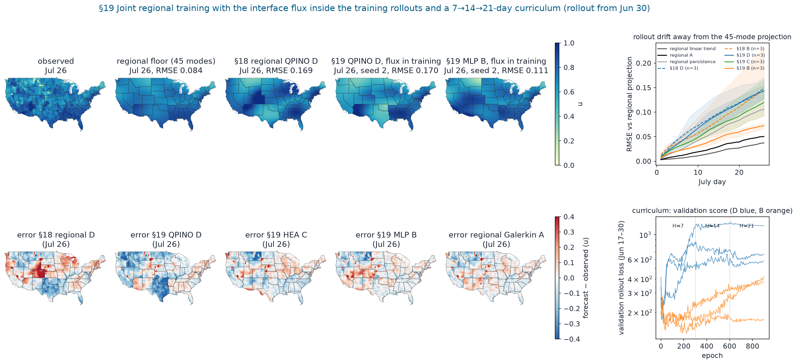

**Fig. 22.** Top: observed Jul 26, the regional floor, the §18 regional QPINO D, and the §19 D and B forecasts (median seeds). Bottom: Jul 26 errors. Right, top: drift, i.e. RMSE vs the regional 45-mode projection by July day. Right, bottom: the validation rollout loss over the curriculum (D blue, B orange; dotted lines mark the 7/14/21-day stage boundaries).

## 19.2 Findings

* **The rollout drift was not fixed for the QPINO; it was reduced for the MLP.** RMSE vs the regional projection:

  | model | §18 | §19 main |
  |---|---|---|
  | QPINO D | 0.0949 ± 0.0192 | 0.0925 ± 0.0122 (α = 1); 0.0893 ± 0.0056 (α = 0) |
  | HEA C | – | 0.0730 ± 0.0193 |
  | MLP B | 0.0870 ± 0.0354 | 0.0467 ± 0.0044 |

  The baselines sit lower still: regional linear trend 0.0211, regional A 0.0307, regional persistence 0.0649. Against the observed field:

  * D: 0.1348 → 0.1328 ± 0.0083 (α = 1) / 0.1303 ± 0.0038 (α = 0).
  * C: 0.1206 ± 0.0123.
  * B: 0.1311 → 0.1058 ± 0.0019.

  The regional QPINO and HEA remain **worse than regional persistence (0.1149)**. The MLP beats persistence but not the regional linear trend (0.0972) or the regional Galerkin A (0.0997), and no learned model reaches the 0.0949 floor.
* **Most of the MLP's gain is the training and selection protocol, not the flux or the horizon.** The flux-off, 7-day control (the §18 configuration but with joint batching, 900 epochs and validation-rollout selection) already gives 0.1093 ± 0.0037, against 0.1311 in §18. The seed spread also falls from 0.025 to 0.004.
* **Flux in training helps a little, consistently, but within the seed spread.** Rollout RMSE with vs without the flux:

  | model | 7→14→21 d | 7 d |
  |---|---|---|
  | D (α = 0) | 0.1303 vs 0.1336 | 0.1294 vs 0.1341 |
  | C | 0.1206 vs 0.1229 | 0.1206 vs 0.1207 |
  | B | 0.1058 vs 0.1075 | 0.1057 vs 0.1093 |

  The physics violation of the rollout also falls slightly with the flux, e.g. B 0.0031 vs 0.0037–0.0040 and D 0.0068–0.0071 vs 0.0073–0.0075. The coupling is weak (fitted D ≈ 7 km²/day, flux ≈ 14% of the local RHS), so a large effect was not expected.
* **The long-horizon curriculum does not help.** The validation rollout loss is lowest early in the 7-day stage and then *rises* as training continues: the final-to-best validation ratio averages 3.4 for D, 3.9 for C and 2.7 for B. Validation therefore selects a 7-day-stage checkpoint in 17 of the 23 curriculum runs. When it does, the curriculum run is identical to the 7-day control up to epoch 300 (same seed, data order and LR schedule). That is why the C flux-on long and short rows coincide exactly, and B's nearly so. Long vs short: D 0.1303 vs 0.1294, C 0.1206 vs 0.1206, B 0.1058 vs 0.1057. The 14- and 21-day losses fit the March–June training dynamics more closely, and that transfers *worse* to the June 17–30 window. This is the same regime shift that hurt the full-window ρ(x,y) fit in §17.
* **Physics violation.** The fitted physics is violated by the July rollouts at 0.0068 (D), 0.0067 (C) and 0.0031 (B), against 0.0027 for the observed data and 0.0111 / 0.0080 for §18's D / B. Train one-step violation is about 0.008 for all models; λ_PDE = 1e-4 makes it a diagnostic only.

## 19.3 Caveats

* §19 differs from §18 in more than the flux and the horizon: joint batching (32 windows per epoch), 900 instead of 1500 epochs, and selection by a 14-day validation rollout. The flux-off, 7-day rows are the control that isolates those changes.
* The step weighting was chosen on one pilot seed. For D the two values tie (0.1134 vs 0.1135), and the α = 0 grid happens to be slightly better on July (0.1303 vs 0.1328), which is not used for selection.
* Training wall time per joint run (1 thread): D about 1240 s (7→14→21) / 1063 s (7 d), C about 1025 / 817 s, B about 24 / 16 s.
* All circuits are classically simulated (5 independent 9-qubit statevectors). **No quantum advantage** is shown or claimed.

## Selected figures

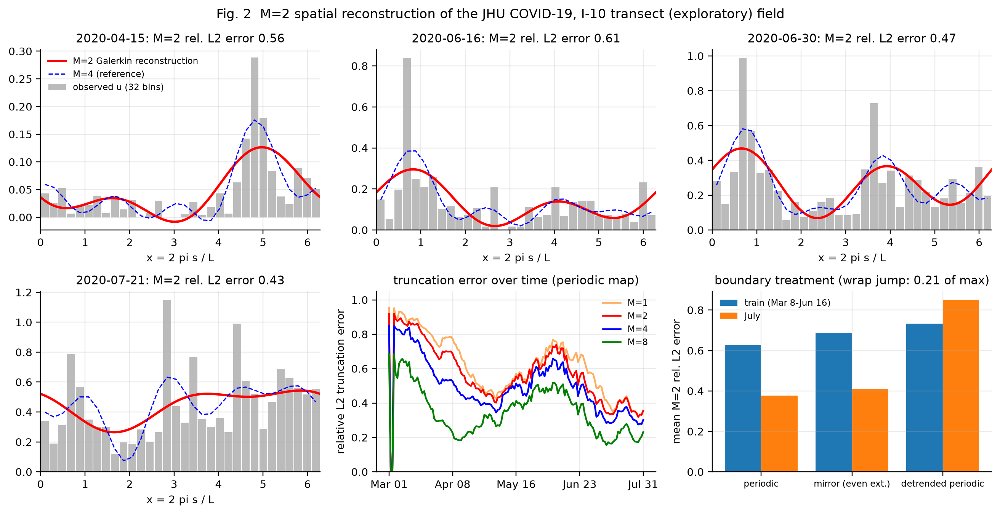

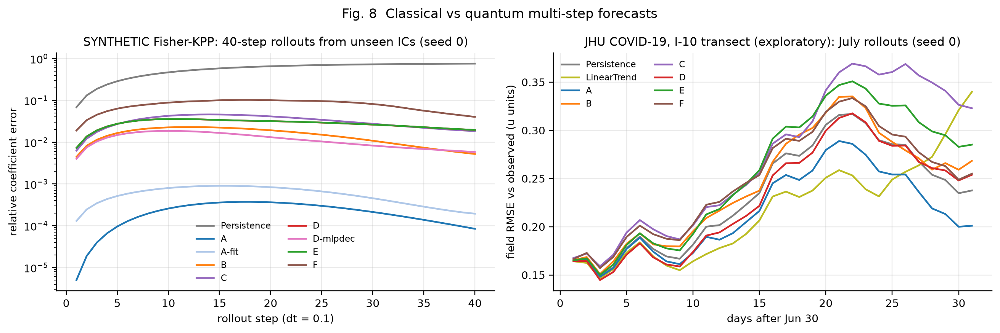

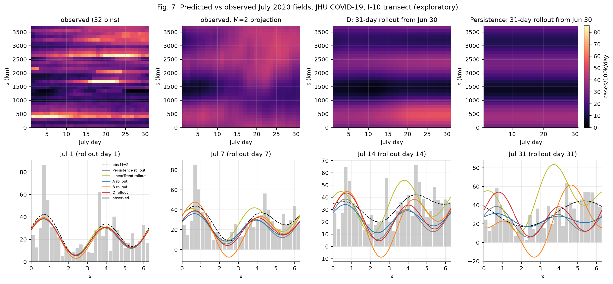

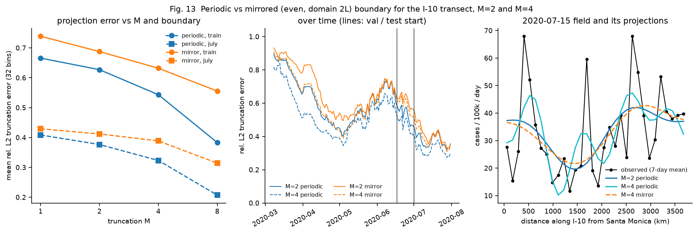

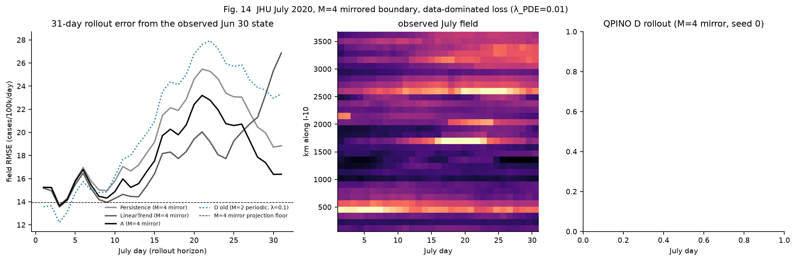

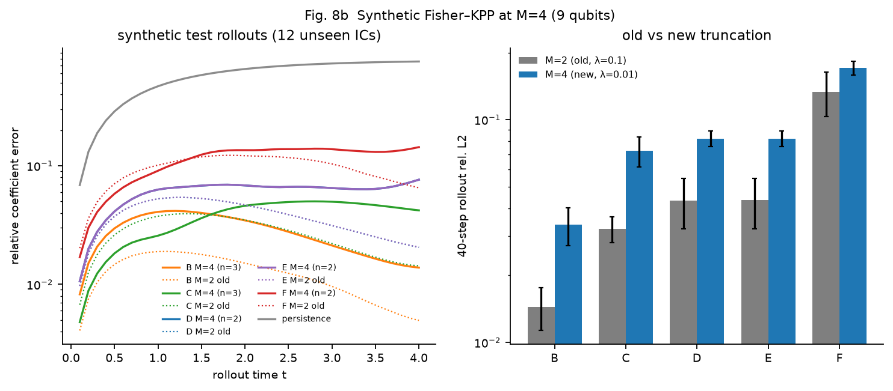

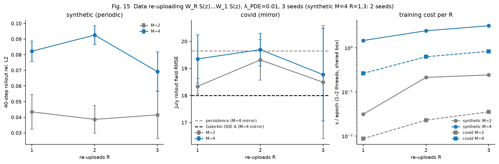

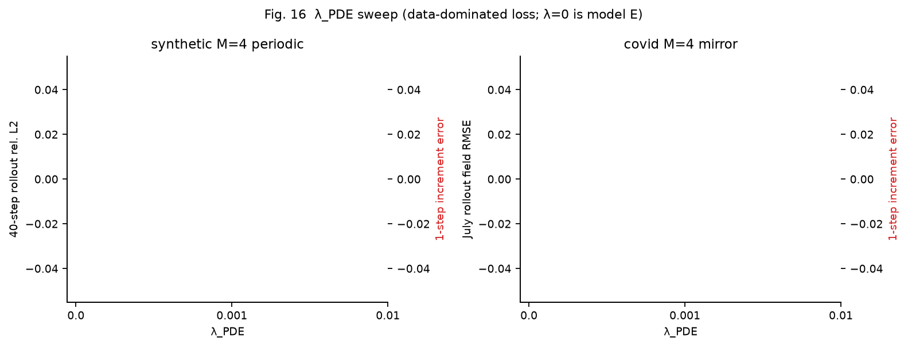

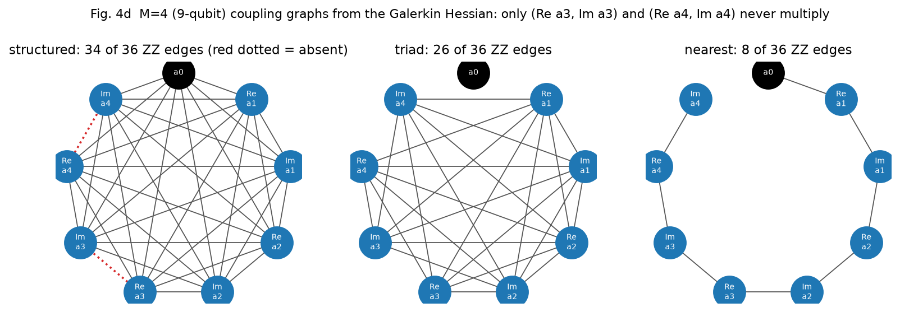
