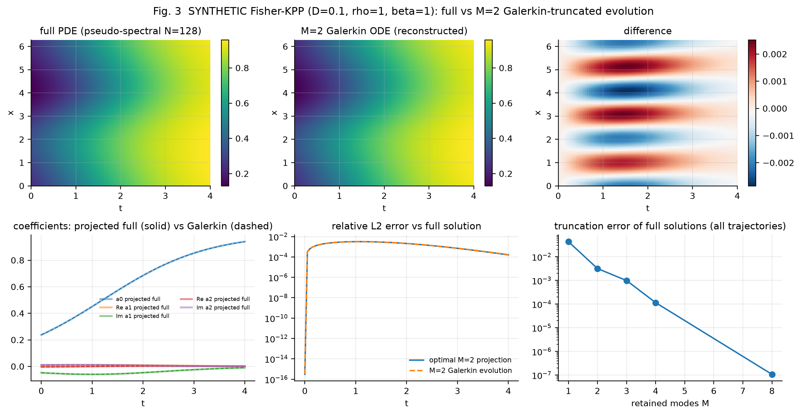
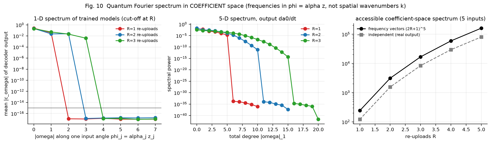
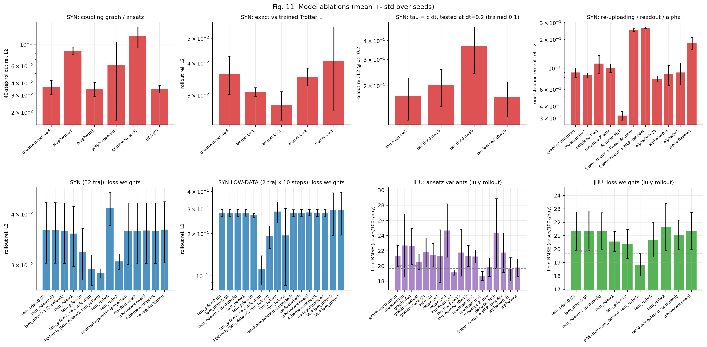
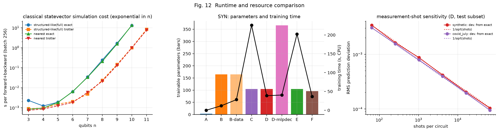

**Status.** Everything below was produced by the code in this repository (branch `qpino-fisher-kpp`). All numbers are read from `results/metrics/*.json`; full tables are in [`docs/results_tables.md`](results_tables.md). All quantum circuits are *classically simulated* (exact 5-qubit statevector). No quantum advantage is claimed or implied.

# 1. Question and summary

**Research question.** Can a custom quantum Hamiltonian $H_\theta$, through the unitary $U_\theta(\tau)=e^{-iH_\theta\tau}$ together with an $R_y$ data embedding, $Z$-basis measurement and a classical decoder, approximate the nonlinear, dissipative one-step evolution operator of the $M=2$ Galerkin-truncated Fisher–KPP system?

* **Verification:** all 19 Phase-12 tests pass (§6).
* **Synthetic Fisher–KPP (primary validation):** the 5-qubit custom-Hamiltonian QPINO with a *linear* decoder learns the M=2 one-step operator to a one-step increment error of 0.100 ± 0.017 and a 40-step rollout error of 0.043 ± 0.011 on unseen initial conditions (persistence: 1.0 / 0.69). It does **not** match the classical Galerkin ODE (0.0011 / 0.0004), and it is not better than a 165-parameter MLP (0.047 / 0.015) or a generic hardware-efficient ansatz with the same parameter count (0.086 / 0.032). With an MLP decoder it reaches 0.039 / 0.015.
* **Entanglement is necessary:** removing the $ZZ$ couplings triples the error (0.31 / 0.13). Training the Hamiltonian beats frozen random quantum features by ≈3×. The Galerkin-derived graph matches full connectivity and beats nearest-neighbour and "triad-only" graphs.
* **Design pitfalls found:** (i) τ = cΔt with a derivative readout makes the model fail to transfer across Δt (one-step error 0.49–0.56 at Δt = 0.05 / 0.2), while the τ-free HEA transfers. (ii) The default physics-loss curriculum switches the PDE term on too late to matter. Applied from epoch 0 with the true physics, it cuts low-data rollout error from 0.28 to 0.11.
* **JHU COVID-19 (exploratory, I-10 transect, train Mar 1–Jun 16, validate Jun 17–30, test July 2020):** M = 2 leaves 38 % (July) to 63 % (train) of the field unresolved, and the periodic wrap is artificial, so this experiment is exploratory. No learned model beats persistence for next-day prediction (QPINO increment error 1.13 ± 0.09; linear trend 0.95). For the 31-day rollout the best methods are the fitted 3-parameter Fisher–KPP models (field RMSE 18.0 Galerkin / 16.9 full grid vs persistence 19.7 cases/100k/day). The QPINO (21.3 ± 1.4) and the classical MLP (22.3 ± 2.8) are worse than persistence.
* Fitted COVID parameters: ρ = 0.035 /day, β = 0.104 /day, D = 1.5e-3 (528 km²/day), with **D unidentifiable** below ~1e-2.
* **No quantum advantage** is shown or claimed (§10).

# 2. The Fisher–KPP model and its M = 2 Galerkin truncation

## 2.1 Model

$$\partial_t u = D\,\partial_x^2 u + \rho u - \beta u^2,\qquad D,\rho,\beta>0,\qquad x\in[0,2\pi)\ \text{(periodic)}.$$

$D$ (effective diffusion), $\rho$ (growth) and $\beta$ (saturation; carrying capacity $K=\rho/\beta$) are treated as **phenomenological** parameters. For the COVID field they are *not* interpreted as literal mobility or transmission rates. The model does not conserve $\int u\,dx$, and no conservation constraint is imposed.

## 2.2 Derivation

Insert $u_M(x,t)=\sum_{k=-2}^{2}a_k(t)e^{ikx}$ with $a_{-k}=a_k^*$ (real field). Then $\partial_x^2 e^{ikx}=-k^2e^{ikx}$ and
$$u_M^2=\sum_{p=-2}^{2}\sum_{q=-2}^{2}a_pa_q e^{i(p+q)x},$$
which contains wavenumbers $|p+q|\le 4$. Galerkin projection onto $e^{ikx}$, $|k|\le2$ (multiply by $e^{-ikx}/2\pi$ and integrate; $\frac{1}{2\pi}\int_0^{2\pi}e^{i(m-k)x}dx=\delta_{mk}$) keeps only $p+q=k$:
$$\boxed{\dot a_k=(\rho-Dk^2)a_k-\beta\sum_{p+q=k,\ |p|,|q|\le2}a_pa_q,\qquad k=-2,\dots,2.}$$
The discarded $|p+q|=3,4$ terms are the **unresolved modes** produced by the nonlinearity.

**Convolution sums.** Writing $a_1=b_1+ic_1$, $a_2=b_2+ic_2$:

* $k=0$: pairs $(0,0),(\pm1,\mp1),(\pm2,\mp2)$: $\ (u^2)_0=a_0^2+2|a_1|^2+2|a_2|^2$.
* $k=1$: pairs $(0,1),(1,0),(-1,2),(2,-1)$: $\ (u^2)_1=2a_0a_1+2a_1^*a_2$, with $a_1^*a_2=(b_1b_2+c_1c_2)+i(b_1c_2-c_1b_2)$.
* $k=2$: pairs $(0,2),(2,0),(1,1)$: $\ (u^2)_2=2a_0a_2+a_1^2$, with $a_1^2=(b_1^2-c_1^2)+2ib_1c_1$.

**Explicit real equations** for $\mathbf a=(a_0,b_1,c_1,b_2,c_2)=(a_0,\mathrm{Re}a_1,\mathrm{Im}a_1,\mathrm{Re}a_2,\mathrm{Im}a_2)$ (implemented in `src/galerkin.py::galerkin_rhs`):
$$
\begin{aligned}
\dot a_0 &= \rho a_0-\beta\left[a_0^2+2(b_1^2+c_1^2+b_2^2+c_2^2)\right]\\
\dot b_1 &= (\rho-D)b_1-2\beta\left[a_0b_1+b_1b_2+c_1c_2\right]\\
\dot c_1 &= (\rho-D)c_1-2\beta\left[a_0c_1+b_1c_2-c_1b_2\right]\\
\dot b_2 &= (\rho-4D)b_2-\beta\left[2a_0b_2+b_1^2-c_1^2\right]\\
\dot c_2 &= (\rho-4D)c_2-\beta\left[2a_0c_2+2b_1c_1\right]
\end{aligned}
$$

**Conjugate symmetry.** If $a_{-k}=a_k^*$ then $(u^2)_{-k}=\sum_{p+q=-k}a_pa_q=\sum_{p'+q'=k}a_{-p'}a_{-q'}=\big((u^2)_k\big)^*$, and $(\rho-Dk^2)$ is real and even in $k$, so $\dot a_{-k}=\dot a_k^*$ and $\dot a_0\in\mathbb R$: the real-field constraint is invariant under the flow. Verified numerically (Section 6) by integrating all five *complex* modes with no symmetry imposed.

**Reconstruction and derivatives** (analytic, used in the PDE residual):
$u_M=a_0+2(b_1\cos x-c_1\sin x)+2(b_2\cos2x-c_2\sin2x)$, $\ \partial_x^2u_M=-2(b_1\cos x-c_1\sin x)-8(b_2\cos2x-c_2\sin2x)$.
Projection: $a_k=\frac1N\sum_j u(x_j)e^{-ikx_j}$ on a uniform grid (exact for band-limited fields when $N\ge 2M+1$; the Galerkin RHS is recovered exactly from a grid projection when $N\ge3M+1$ because $u_M^2$ has $|k|\le4$).

**Coupling structure.** The Hessian $\partial^2\dot a_i/\partial a_j\partial a_k$ is constant (the RHS is quadratic). Its non-zero off-diagonal pattern is the set of coefficient pairs that interact through the convolution: $(a_0,b_1),(a_0,c_1),(a_0,b_2),(a_0,c_2),(b_1,c_1),(b_1,b_2),(b_1,c_2),(c_1,b_2),(c_1,c_2)$ — **9 of the 10 possible pairs**; only $(b_2,c_2)$ never appears. This defines the "structured" $ZZ$ graph (computed programmatically in `custom_ansatz.galerkin_graph`). Removing the five $a_0$ "mean-field" edges leaves the 5-edge "triad" graph of $k=1\leftrightarrow k=2$ mode-transfer couplings.

## 2.3 Reference solvers

* Full PDE: method of lines, Fourier pseudo-spectral Laplacian (or 2nd-order central differences), `scipy.integrate.solve_ivp(method="DOP853", rtol=1e-9, atol=1e-11)` (`src/fisher_kpp.py`).
* Galerkin ODE (baseline A): `solve_ivp(DOP853, rtol=1e-10, atol=1e-12)`, and a differentiable RK4 flow map with 20 sub-steps per step (agrees with DOP853 to $<10^{-10}$, test `test_galerkin_integrator_agreement`).

# 3. Quantum model

## 3.1 Embedding: why $R_y$

Standardise $\mathbf z=(\mathbf a-\mu)/\sigma$ (training-set statistics). $H_{\mathrm{emb}}(\mathbf z)=\frac12\sum_j\alpha_jz_jY_j$; the terms act on different qubits and commute, so
$S(\mathbf z)=e^{-iH_{\mathrm{emb}}}=\bigotimes_jR_y(\alpha_jz_j)$ (verified to $10^{-12}$ against `scipy.linalg.expm`), with
$$R_y(\phi)|0\rangle=\cos\tfrac\phi2|0\rangle+\sin\tfrac\phi2|1\rangle .$$
Reasons for $R_y$: (i) it produces **real** amplitudes, so $|\psi_{\mathrm{emb}}\rangle$ is a real product state whose computational-basis amplitudes are the products $\prod_j\{\cos\frac{\phi_j}2,\sin\frac{\phi_j}2\}$, i.e. the embedding moves probability between $|0\rangle$ and $|1\rangle$ on each qubit by an amount that encodes the size of the coefficient; (ii) a single qubit then has $\langle Z\rangle=\cos\phi$, $\langle X\rangle=\sin\phi$, $\langle Y\rangle=0$ — the coefficient value appears as a point on the $x$–$z$ great circle of the Bloch sphere; (iii) because $Y/2$ has eigenvalues $\pm\frac12$, every expectation value is a trigonometric polynomial with integer frequencies in $\phi_j$ (next section). Note that $\cos\phi$ is even: measuring $Z$ right after the embedding loses the **sign** of $z_j$. The transverse terms $g_jX_j$ of $H_\theta$ are what rotate $\sin\phi_j$ (sign-carrying) information into the $Z$ basis — with $g=0$ the ansatz is diagonal, commutes with every $Z$-basis observable, and the circuit would do nothing to the measured statistics.

## 3.2 Fourier expressibility (coefficient space)

For one embedding layer, $\langle O\rangle(\boldsymbol\phi)=\langle0|S^\dagger U^\dagger OUS|0\rangle$ and each $R_y(\phi_j)$ appears once in the ket and once in the bra. With generator eigenvalues $\lambda_\pm=\pm\frac12$ the accessible frequency differences per input are $\Omega_j=\{\lambda_a-\lambda_b\}=\{-1,0,1\}$, so
$$f(\mathbf z)=\sum_{\boldsymbol\omega\in\{-1,0,1\}^5}c_{\boldsymbol\omega}(\theta)\,e^{i\boldsymbol\omega\cdot(\boldsymbol\alpha\odot\mathbf z)} ,$$
$3^5=243$ frequency vectors (122 independent for a real output). With $R$ data re-uploads $W_R S\cdots W_1S$ the spectrum per input becomes $\{-R,\dots,R\}$ (sums of $R$ copies of $\Omega_j$), i.e. $(2R+1)^5=243,\ 3125,\ 16807$ frequency vectors for $R=1,2,3$. The trainable $\alpha_j$ rescale (but do not add) frequencies. These are **coefficient-space frequencies**: they describe how a decoded output varies with the *value* of a Galerkin coefficient, i.e. with the angle $\phi_j=\alpha_jz_j$. They are unrelated to the **spatial wavenumbers** $k\in\{-2,\dots,2\}$, which label *which* coefficients exist. The Galerkin RHS is a quadratic *polynomial* in $\mathbf a$; a degree-$R$ trigonometric polynomial represents it only approximately (e.g. $\sin\phi\approx\phi$, $\cos\phi\approx1-\phi^2/2$, products $\sin\phi_j\sin\phi_k$ from $\langle Z_jZ_k\rangle$-type terms), so accuracy depends on staying in a moderate-angle regime — tested by the $\alpha$ ablation. The numerical spectrum of trained models (Fig. 10) confirms the cut-off: Fourier power beyond $|\omega|=R$ is at round-off.

## 3.3 Custom Hamiltonian ansatz (every term)

$$H_\theta=\sum_{j=0}^4h_jZ_j+\sum_{j=0}^4g_jX_j+\sum_{(j,k)\in E}J_{jk}Z_jZ_k,\qquad U_\theta(\tau)=e^{-iH_\theta\tau}\ (\hbar=1).$$

* $h_jZ_j$ — **local phase evolution**: precession of qubit $j$ about $z$. On its own it changes no $Z$-basis probability, but it rotates the $x$–$y$ components ($\sin\phi_j$ information) so that, combined with $X$ mixing, the measured $\langle Z_j\rangle$ can become a general first-harmonic function $c_0+c_1\cos\phi_j+c_2\sin\phi_j$.
* $g_jX_j$ — **single-qubit mixing** (transverse field): rotates population between $|0\rangle$ and $|1\rangle$; required for any non-trivial $Z$-basis output (Section 3.1).
* $J_{jk}Z_jZ_k$ — **interactions between quantum features**: conditional phases that, together with $X$ mixing, make $\langle Z_j\rangle$ depend on $z_k$ and create entanglement. These are the only terms able to generate the cross-coefficient products that appear in the Galerkin convolution (e.g. $a_0b_1$, $b_1b_2+c_1c_2$). $E$ is the 9-edge Galerkin graph (structured), compared with the 10-edge fully connected graph, a 4-edge nearest-neighbour chain $0\!-\!1\!-\!2\!-\!3\!-\!4$, the 5-edge triad graph and $E=\varnothing$ (baseline F). We do **not** assume that two-body $ZZ$ terms reproduce the classical quadratic convolution; adequacy is tested experimentally.

**Time.** $\tau$ is the quantum evolution parameter; $\Delta t$ is the classical step. We use $\tau=c\,\Delta t$ with $c$ fixed or learned ($c=\mathrm{softplus}(\tilde c)>0$). Because the data use a single $\Delta t$, $c$ is degenerate with the overall scale of $H_\theta$ during training (only $cH_\theta$ enters); it matters only when the trained model is applied at a different $\Delta t$ (Section 8.4).

**Exact vs Trotter.** Exact: `torch.linalg.matrix_exp` on the $32\times32$ matrix. First-order product formula:
$U_\theta(\tau)\approx\big[\prod_je^{-ih_jZ_j\delta\tau}\prod_je^{-ig_jX_j\delta\tau}\prod_{(j,k)}e^{-iJ_{jk}Z_jZ_k\delta\tau}\big]^L$, $\delta\tau=\tau/L$ (the $ZZ$ factors act first). In gates: `IsingZZ(2Jδτ)`, `RX(2gδτ)`, `RZ(2hδτ)`.

**Re-uploading.** $U(\mathbf z,\tau)=W_R(\theta_R,\tau)S(\mathbf z)\cdots W_1(\theta_1,\tau)S(\mathbf z)$ with independent $\theta_r$. Because $S(\mathbf z)$ does not commute with $W_r$, this circuit is **not** in general evolution under any single time-independent Hamiltonian; it is a data-dependent product of unitaries and loses the "Hamiltonian surrogate" interpretation in exchange for a richer spectrum.

## 3.4 Measurement, decoder, update

$m_j=\langle Z_j\rangle$ and $m_{jk}=\langle Z_jZ_k\rangle$ (15 features). Decoder $D_\eta$: **linear** (default, so that the non-linearity must come from the circuit) or a 1-hidden-layer tanh MLP (variant D-mlpdec). Output scale $s_G=s_{\mathrm{inc}}/\Delta t$ (training increment scale). Residual update $\hat{\mathbf a}(t+\Delta t)=\mathbf a(t)+\Delta t\,G(\mathbf a,\Delta t)$, which gives an exact identity at $\Delta t=0$ (there $U=I$ and $G$ stays finite; verified). Gradients: PyTorch autograd through `matrix_exp`/Trotter products (exact statevector); on hardware this would be replaced by parameter-shift / generalised shift rules.

# 4. Loss

$\mathcal L=\lambda_{\mathrm{data}}\mathcal L_{\mathrm{data}}+\lambda_{\mathrm{PDE}}\mathcal L_{\mathrm{PDE}}+\lambda_{\mathrm{roll}}\mathcal L_{\mathrm{roll}}+\lambda_{\mathrm{reg}}\mathcal L_{\mathrm{reg}}$, defaults $(1,\,0.1,\,0.5,\,1)$.

* $\mathcal L_{\mathrm{data}}=\frac1B\sum_b\|(\hat{\mathbf a}_{n+1}-\mathbf a_{n+1})/s_{\mathrm{inc}}\|^2$ — the spec's squared error with a fixed diagonal metric $s_{\mathrm{inc}}$ = per-component training std of one-step increments (otherwise $a_0$ would dominate the $\sim\!20\times$ smaller $k=1,2$ coefficients). A value $\approx1$ means "as large as a typical one-step change". A reconstructed-field loss on the grid is also computed and logged.
* $\mathcal L_{\mathrm{PDE}}$ (default target): full reconstructed-field residual on $N_c=64$ collocation points, $R(x_i)=\frac{\hat u_M(x_i,t+\Delta t)-u_M(x_i,t)}{\Delta t}-\mathcal N[u]$, with $\mathcal N[u]=D\partial_x^2u+\rho u-\beta u^2$ evaluated analytically from the Fourier representation and $u^2$ taken **pointwise** (so it contains the $|k|=3,4$ modes). The model is a discrete map, not a continuous trajectory, so no autograd time derivative is used. Schemes: forward ($\mathcal N$ at $t$), **trapezoid** (default, average of $\mathcal N$ at $t$ and $t+\Delta t$), midpoint ($\mathcal N$ at the average state).
* Projected Galerkin residual $R_k=\frac{\hat a_k-a_k}{\Delta t}-f_k(\cdot)$ with the same schemes, always reported separately (and selectable as the training target).
* $\mathcal L_{\mathrm{roll}}$: $H$-step autonomous rollouts ($H=5$ synthetic, $7$ COVID) over all training windows.
* $\mathcal L_{\mathrm{reg}}$: negativity $\overline{\mathrm{relu}(-\hat u)^2}$ (weight 1), saturation $\overline{\mathrm{relu}(\hat u-1.2K)^2}$ (implemented; weight 0 by default because the COVID $K$ is poorly constrained), Hamiltonian-parameter $L_2$ ($10^{-4}$), rollout stability $\overline{\mathrm{relu}(\|\hat{\mathbf a}_{n+s}\|-3\max\|\mathbf a\|)^2}$ (weight 1).
* **Curriculum:** $\lambda_{\mathrm{PDE}}$ is 0 for the first 20 % of epochs and ramps linearly to its target by 60 %. **Model selection** (best validation one-step + rollout loss) is restricted to the last 40 % of epochs for *every* run, with or without physics loss (an earlier version allowed physics-free runs to select from all epochs; this confounded the physics ablation and was fixed before the reported runs).
* Optimiser: Adam, lr 0.02, cosine decay to 5 %, 1500 full-batch epochs, gradient clipping 10, float64, seeds 0/1/2.

# 5. Data: JHU CSSE COVID-19 and the I-10 transect

## 5.1 Source and documentation (computed in `src/data_loader.py::dataset_summary`)

* Repository: <https://github.com/CSSEGISandData/COVID-19> (archived 10 Mar 2023), folder `csse_covid_19_data/csse_covid_19_time_series/`. Files: `time_series_covid19_confirmed_US.csv` (county rows with FIPS, `Admin2`, `Province_State`, `Lat`, `Long_`), `time_series_covid19_deaths_US.csv` (same rows plus `Population`), `time_series_covid19_confirmed_global.csv` (inspected only).
* US file: 3,342 rows; 3,234 have non-zero coordinates and 3,227 have population > 0; 104 are "Unassigned"/"Out of <state>" rows without a location. Dates 2020-01-22 to 2023-03-09 (1,143 daily columns; the archive was frozen on 10 Mar 2023). No missing values (NaN) in the counts.
* Global file: 289 rows (countries / some provinces), a single Lat/Long per row and no population, so it is too coarse for a spatial field.
* Quantity: **cumulative reported confirmed cases**. Differencing gives daily *reported* new cases. That is a testing- and reporting-dependent incidence proxy, **not** infection prevalence.
* Corrections: 40,168 negative daily differences over the whole US file, and 6,408 (totalling 68,900 cases) between Mar 1 and Jul 31 2020. Within the selected corridor counties, 361 negative entries (1,936 cases) were clipped to 0 on the day they appear. Backlog dumps (positive spikes) and weekday reporting cycles remain in the raw series and are damped by the trailing 7-day mean.

## 5.2 Why a transect along Interstate 10

A 1-D PDE needs a spatial coordinate where neighbouring points are neighbouring places. We use the I-10 corridor from Santa Monica, CA to Jacksonville, FL (23 waypoints, arc length L = 3,735 km). It is a single, contiguous, heavily travelled east–west chain of adjacent counties across 9 states (CA, AZ, NM, TX, LA, MS, AL, FL, GA), and it is where the summer-2020 Sun Belt wave happened, so June→July is a non-trivial forecasting window. Each of the 199 counties whose JHU centroid lies within 100 km of the polyline is assigned the arc length $s$ of its nearest transect point. Counties are binned into 32 equal bins of 117 km, and each bin's population-weighted incidence is (sum of cases)/(sum of population). All 32 bins are populated (minimum bin population 4,886). Ordering is purely geographic, never by case counts or names.

**Field:** $u(x_j,t_n)$ = [7-day trailing mean of new reported cases per 100k in bin $j$] / $S$, with $S=82.53$ cases/100k/day, the maximum over bins and **training days only**, and $x_j=2\pi(j+\frac12)/32$. It uses no future data: differences, clipping and the trailing window use only days $\le t$, and the normalisation uses only training statistics.

**Splits (chronological, no shuffling of overlapping windows):** train Mar 1 – Jun 16 2020 (107 one-step pairs; 7-step rollout windows lie inside the training period), validation Jun 17 – Jun 30 (14 pairs), test = July 1–31 (31 one-step-ahead targets, each predicted from the observed previous day, plus one 31-day autonomous rollout from the observed Jun 30 state). Forecast horizon: 1 day (one-step) and 1–31 days (rollout).

## 5.3 The periodic assumption and M = 2 sufficiency (tested, Fig. 2)

Identifying Los Angeles ($x=0$) with Jacksonville ($x=2\pi$) is a **modelling choice**: the two ends are not neighbours. The wrap-around jump averages 21 % of the field maximum (23 % in training, 14 % in July). Mean relative $L^2$ error of the M = 2 projection of the observed field:

| representation | train | July |
|---|---|---|
| periodic (used) | 0.63 | 0.38 |
| mirror / even extension (cosine series, Im $a_k\equiv0$) | 0.69 | 0.41 |
| periodic after removing the end-to-end linear ramp | 0.73 | 0.85 |

July truncation error versus M: 0.41 (M=1), 0.38 (M=2), 0.32 (M=4), 0.21 (M=8). **M = 2 is not sufficient for this field.** It keeps only the large-scale (~1,900 km and ~3,700 km wavelength) structure, and 38–63 % of the field norm lies in unresolved modes made of localized county-cluster outbreaks. The periodic map is the least-bad of the three boundary treatments for M = 2. The mirror alternative was also trained end to end (model D; July rollout field RMSE 21.5 vs persistence 20.0 cases/100k/day in that representation), which gave the same qualitative conclusion. Following the spec, **the JHU experiment is therefore exploratory**, and the synthetic Fisher–KPP data carry the physical validation.

# 6. Verification (Phase 12) — all 19 tests pass (`pytest -v tests`, log in `results/metrics/verification_tests.log`)

| # | requirement | test | result |
|---|---|---|---|
| 1 | Fourier transform / inverse | `test_fourier_roundtrip` | max error 1.8e-15 (both grids; agrees with `numpy.fft`) |
| 2 | Galerkin eqs vs direct spectral projection | `test_galerkin_equations_vs_projection` | explicit vs convolution 7.1e-15; vs N=64 projection 1.8e-14 |
| 3 | conjugate symmetry | `test_conjugate_symmetry` | RHS symmetry error 1.8e-15; drift after integrating 5 complex modes 3.5e-37 |
| 4 | classical solver | `test_solver_linear_modes`, `_logistic`, `_self_convergence`, `test_galerkin_integrator_agreement` | spectral vs exact mode decay 2.4e-11; FD order 2.02 / 2.00; logistic 7.3e-11; nonlinear self-convergence N=64 1.3e-11; RK4 vs DOP853 5.3e-15 |
| 5 | all circuits unitary | `test_all_circuits_unitary` | max $\|U^\dagger U-I\|$ = 7.8e-15 (exact, Trotter L=1,2,8, five graphs, HEA, R=3 re-upload) |
| – | Trotter consistency | `test_trotter_converges_first_order` | error 0.210, 0.105, 0.052, 0.026 for L=4,8,16,32 (order 1.00) |
| – | torch simulator = PennyLane | `test_torch_matches_pennylane` | max diff 8.1e-15 (exact `qml.exp`, Trotter, re-upload, HEA) |
| 6 | measurements differentiable | `test_measurement_gradcheck` | autograd vs central FD, max relative error 8.1e-8; `torch.autograd.gradcheck` passes |
| 7 | gradients reach decoder and circuit | `test_gradients_reach_all_parameters` | all parameter gradients non-zero for 5 model variants |
| 8 | residual → 0 with resolution | `test_galerkin_residual_converges`, `test_full_pde_residual_converges` | projected residual on the exact Galerkin trajectory: forward order 1.00 (1.5e-3 → 1.9e-4), trapezoid/midpoint order 2.00 (2.6e-5 → 4.0e-7). Full residual: at M=2 it plateaus at 8.1e-3 = the unresolved-mode level (independent estimate 9.9e-3 vs 9.9e-3 on a Galerkin trajectory), and it vanishes as M grows: 8.1e-3, 4.1e-4, 5.4e-7, 6.3e-8 for M=2,4,8,16 |
| 9 | identity at Δt = 0 | `test_identity_at_zero_dt` | max error exactly 0 |
| 10 | training loop on small synthetic set | `test_training_loop_smoke` | total loss 728 → 12.8 in 60 epochs (finite) |
| – | Fourier degree of re-uploaded circuits | `test_fourier_spectrum_degree` | power beyond $|\omega|=R$ ≤ 7e-17 for R=1,2,3 |

These tests passed before any full training. The final `pytest` run after all experiments also passes, 19/19.

# 7. Synthetic Fisher–KPP validation (primary physical test)

Setup: $D=0.1,\rho=1,\beta=1$ (K = 1), $\Delta t=0.1$, 40 steps (T = 4), pseudo-spectral reference on N=128, with random positive low-mode ICs: 32 train, 8 validation and 12 **unseen test** trajectories. The targets are the M=2 projections of the *full* PDE solution, so they include truncation. The M=2 truncation error of the full solutions is 0.32 % (M=1: 4.3 %, M=4: 0.011 %), and the Galerkin ODE tracks the projected full solution to 0.024 % (Fig. 3). Parameter identification from the training coefficients gives $(D,\rho,\beta)=(0.0980, 0.9985, 0.9981)$ against true $(0.1,1,1)$.

Results (mean ± std over seeds 0,1,2; increment error = $\|\hat{\mathbf a}_{n+1}-\mathbf a_n-(\mathbf a_{n+1}-\mathbf a_n)\|/\|\mathbf a_{n+1}-\mathbf a_n\|$, which is 1 for persistence; full table in `results_tables.md`):

| model | params | 1-step increment rel. L2 | 40-step rollout rel. L2 | full PDE residual RMS (trap.) | 400-step distance to equilibrium u=K |
|---|---|---|---|---|---|
| Persistence | 0 | 1.000 | 0.686 | 1.9e-1 | 0.815 |
| A Galerkin (true params) | 3 | 0.0011 | 0.0004 | 2.7e-3 | 0.000 |
| A Galerkin (fitted params) | 3 | 0.0014 | 0.0006 | 2.8e-3 | 0.000 |
| B MLP (same loss as D) | 165 | 0.047 ± 0.010 | 0.0145 ± 0.0032 | 1.0e-2 | 0.075 |
| B-data MLP (no PDE loss) | 165 | 0.047 ± 0.010 | 0.0144 ± 0.0032 | 1.0e-2 | 0.079 |
| C Ry + hardware-efficient | 105 | 0.086 ± 0.005 | 0.032 ± 0.004 | 1.8e-2 | 0.138 |
| **D QPINO (structured)** | 105 | 0.100 ± 0.017 | 0.043 ± 0.011 | 2.0e-2 | 1.015 |
| D-mlpdec (MLP decoder) | 366 | 0.039 ± 0.011 | 0.015 ± 0.007 | 8.6e-3 | 0.012 |
| E QPINO, no physics loss | 105 | 0.100 ± 0.017 | 0.044 ± 0.011 | 2.0e-2 | 1.015 |
| F QPINO, no ZZ | 96 | 0.309 ± 0.019 | 0.134 ± 0.030 | 5.8e-2 | 5.81 |

What these show:

* **Answer to the research question (synthetic):** yes, approximately. A 5-qubit custom-Hamiltonian evolution with a *linear* readout reproduces the one-step operator to ~10 % of the increment, and its 40-step rollout from unseen ICs stays within 4.3 % (Figs. 8, 9). It is not competitive with the 3-parameter classical Galerkin ODE (0.04 %), and it does not beat a 165-parameter classical MLP or the generic HEA (C) at equal parameter count.
* **Entanglement matters:** removing the $ZZ$ couplings (F) triples the one-step error (0.31 vs 0.10) and makes long rollouts drift far from the $u=K$ equilibrium. Without couplings the state stays a product state, so $\langle Z_j\rangle$ can depend only on $z_j$, and the cross-coefficient products of the convolution are unavailable.
* **Long-term stability:** all models stay finite over 400 steps with no positivity violations, but D (linear decoder) settles away from the equilibrium (mean distance 1.0; one seed 2.2). B, C and D-mlpdec remain close.
* **Physics loss at the default weight is inert here** (D ≈ E, B ≈ B-data), because the data are already exactly consistent with the PDE. See the ablation in §9.2.
* **Generalisation.** Unseen ICs: the table above. Resolution: re-projecting the test trajectories from N = 8 or 256 grids changes the coefficients by ≤1.3e-5 and every model's error by <1 %, so resolution generalisation is trivially satisfied by a 5-coefficient model and is separate from truncation error. Time window: a D model trained only on $t\le2$ has a later-window ($t\in[2,4]$) one-step increment error of 0.113 vs 0.056 in-window (B: 0.128 vs 0.044), with later-window rollout errors of 0.020 (D) and 0.017 (B), vs 0.230 for persistence. **Time step:** D trained at Δt = 0.1 degrades to a one-step increment error of 0.49 at Δt = 0.05 and 0.56 at Δt = 0.2 (rollouts 0.16 / 0.21), while C (HEA, no τ) stays at 0.091 / 0.097 and the MLP at 0.053 / 0.056. Tying the quantum evolution time to the step, τ = cΔt, makes the decoded "derivative" G depend on Δt even though the true RHS does not (§9.1).

# 8. JHU COVID-19 I-10 results — July 2020 (exploratory)

Fitted Fisher–KPP (Galerkin one-step least squares on train pairs, 12 starts): **D = 1.49e-3** in $x\in[0,2\pi)$ units = **528 km²/day**, **ρ = 0.0352 /day**, **β = 0.104 /day**, K = ρ/β = 0.339 u = 28 cases/100k/day. The scaled fit loss is 0.991, i.e. barely better than persistence. **D is not identified from below:** the profile loss is flat at 0.991–1.000 for D ∈ [1e-4, 1e-2] and rises only for D ≥ 0.03 (1.09) and 0.1 (2.09). β trades off against D, and ρ stays at 0.033–0.044 across the profile. The July field (a₀ rising to ≈0.45) exceeds the fitted K, so the fitted saturation is contradicted by the test period. These are phenomenological parameters only.

Test results (mean ± std over 3 seeds; field RMSE in cases/100k/day vs the **observed 32-bin field**, so M=2 truncation error is included; full table in `results_tables.md`):

| model | 1-step coeff. rel. L2 | 1-step increment rel. L2 | 1-step field RMSE | 31-day rollout coeff. rel. L2 | rollout field RMSE | day-7 / day-31 field RMSE |
|---|---|---|---|---|---|---|
| Persistence | 0.042 | 1.000 | 13.70 | 0.388 | 19.71 | 14.6 / 19.6 |
| Linear trend (7-day) | **0.040** | **0.951** | 13.70 | **0.298** | 18.42 | 14.0 / 28.1 |
| A Galerkin ODE (fitted) | 0.043 | 1.025 | 13.71 | 0.327 | **18.01** | 14.4 / **16.6** |
| B MLP | 0.051 | 1.21 ± 0.03 | 13.76 | 0.46 ± 0.09 | 22.3 ± 2.8 | 16.2 / 23.1 |
| B-data MLP | 0.051 | 1.21 ± 0.03 | 13.76 | 0.47 | 22.7 ± 2.5 | 16.4 / 23.3 |
| C Ry + HEA | 0.050 | 1.19 ± 0.07 | 13.75 | 0.42 ± 0.05 | 21.5 ± 1.6 | 16.0 / 23.4 |
| **D QPINO** | 0.048 | 1.13 ± 0.09 | 13.73 | 0.41 ± 0.06 | 21.3 ± 1.4 | 15.0 / 23.4 |
| D-mlpdec | 0.061 | 1.45 ± 0.05 | 13.82 | 0.51 ± 0.12 | 24.3 ± 4.6 | 16.2 / 28.6 |
| E QPINO, no physics | 0.048 | 1.13 ± 0.09 | 13.73 | 0.41 ± 0.07 | 21.4 ± 1.4 | 15.1 / 23.3 |
| F QPINO, no ZZ | 0.051 | 1.21 ± 0.09 | 13.76 | 0.44 ± 0.05 | 21.8 ± 1.9 | 15.6 / 24.4 |

Full-resolution references (no M=2 truncation): persistence of the full field: 1-step 3.31, rollout 18.93. Linear trend: 3.59 / 31.8. Finite-difference Fisher–KPP on all 32 bins with the fitted parameters: 3.70 / **16.95**, the best rollout of any method.

Interpretation:

* **Next-day prediction:** no learned model beats persistence. Every trained model's increment error is > 1, and so are their validation (Jun 17–30) increment errors (D 1.21, E 1.21, B 1.43), so validation would have warned about this. Only the linear trend is marginally better (0.951). Over 1 day the 7-day-smoothed field barely changes, so the 1-step field error (13.7) is almost entirely the M=2 truncation. A full-field persistence gives 3.3.
* **31-day rollout:** the 3-parameter Fisher–KPP models are best: Galerkin 18.0, full-grid 16.9 (vs persistence 19.7). The quantum and classical networks (21–24) are **worse than persistence**. Among them, D is slightly better than C, F and B, but the seed spread (±1.4) covers those differences. B rollouts have 12 % negative grid values; D has 0.7 %.
* Physics loss at the default weight changes nothing (D ≈ E). Stronger physics does help (§9.2).

# 9. Ablations (Fig. 11; synthetic: seeds 0,1; COVID: seeds 0,1,2)

## 9.1 Ansatz (synthetic, 40-step rollout rel. L2 / one-step increment)

* **Coupling graph:** structured (9 edges) 0.036 / 0.090; full (10) 0.035 / 0.082; nearest-neighbour chain (4) 0.061 ± 0.045 / 0.119 (unstable across seeds); triad (5, no $a_0$ edges) 0.086 / 0.272; none (F) 0.121 / 0.301; HEA 0.035 / 0.088. The Galerkin graph is as good as full connectivity with one fewer edge and clearly better than NN or triad. The $a_0$-coupling ("mean-field") edges are the important ones. Because the structured graph contains 9 of 10 edges, the comparison with full connectivity cannot discriminate strongly. On COVID all graphs fall within seed noise (rollout 20.6–22.7, persistence 19.7).
* **Trotter L (trained with Trotter):** L=1: 0.031, L=2: 0.028, L=4: 0.035, L=8: 0.041, vs exact 0.036. A trained Trotter circuit is just a different ansatz and works as well as exact evolution. **Post-hoc Trotterisation** of the exact-trained model is poor because $\|H_\theta\|\tau≈13.5$ (learned c = 13.2, τ = 1.32, $\|H\|_2$ = 10.2). The unitary error is 0.82, 0.52, 0.26, 0.13, 0.066 for L = 1, 8, 16, 32, 64, and rollout error falls from 0.41 (L=1) to 0.039 (L=64, vs 0.036 exact). Hardware deployment of an exactly trained model would therefore need L ≈ 64 (≈ 576 two-qubit gates), or training directly at the target L.
* **τ = cΔt:** at the training Δt the choices are equivalent (fixed c = 2/10/50 → 0.042/0.040/0.055; learned c (→12.7) 0.036). c is degenerate with the scale of $H_\theta$. At Δt = 0.2, rollouts are 0.17 (c=2), 0.20 (c=10), 0.37 (c=50), 0.17 (learned). All are far worse than the τ-free HEA (0.037). This is a real design finding: when the circuit outputs a *derivative* through a residual update, τ ∝ Δt couples the readout to Δt. Making τ independent of Δt, or decoding $\hat{\mathbf a}(t+\Delta t)$ directly from $U(\tau=c\Delta t)$ without the Δt prefactor, are the obvious fixes and were not tested.
* **Re-uploading:** R=1: 0.036 / 0.090, R=2: 0.037 / 0.084, R=3: 0.052 / 0.112, at 7× the training time (≈430 s vs 50–60 s per run under load). The richer spectrum does not help on this smooth target and generalises worse in Δt (0.43–0.47 at Δt = 0.2). On COVID, R=3 gave the best quantum rollout (18.7 ± 0.6 vs persistence 19.7). That is one of 18 variants, so it may be a multiple-comparison effect.
* **Readout / decoder:** Z-only (5 features) 0.033 / 0.101 vs Z+ZZ 0.036 / 0.090. The MLP decoder is much better (0.011 / 0.032). **Controls:** a frozen random circuit with a linear decoder gives 0.111 / 0.251, and with an MLP decoder 0.120 / 0.266. Training the Hamiltonian therefore reduces the error by ≈3× relative to random quantum features, and the MLP decoder's gain needs the trained circuit.
* **Embedding scale α:** α₀ = 0.25 gave 0.028 / 0.077 (best), 0.5 gave 0.035, 1 gave 0.036 and 2 gave 0.046. With α fixed at 1 (not trained) the error was 0.126 / 0.184. Small angles suit the quadratic target (§3.2), and learning α, the "frequency scale" of the encoding, matters.

## 9.2 Loss weights (Fig. 11, bottom)

* Synthetic, 32 trajectories, rollout rel. L2: λ_PDE = 0, 0.01, 0.1, 1, 10 → 0.0365, 0.0365, 0.0364, 0.0358, 0.0322. **No curriculum** (λ_PDE = 1 from epoch 0): 0.029. **PDE-only** (no data or rollout loss, true physics): 0.029. λ_roll = 0 → 0.041 and λ_roll = 2 → 0.031. Projected-Galerkin vs full residual, forward vs midpoint vs trapezoid, and removing the regulariser all make <0.5 % difference (Δt = 0.1 is small, as §6 shows, and the residual targets differ only by unresolved modes of size 1e-2).
* Synthetic **low-data** (2 trajectories × 10 steps): λ_PDE = 0 → 0.282, λ_PDE = 0.1 → 0.282, λ_PDE = 10 → 0.270, **λ_PDE = 1 without curriculum → 0.113**, PDE-only → 0.192. The MLP gives 0.293 (λ = 0) and 0.295 (λ = 1, with curriculum). When the physics is correct, the physics loss *does* help a lot, but only if it acts early. Under the default curriculum (ramp 20→60 % of epochs) combined with cosine learning-rate decay, it arrives too late to matter. The default curriculum is therefore not a good choice, and this is the most actionable training finding.
* An earlier run allowed physics-free models to select checkpoints from all epochs, which made "λ_PDE = 0" look better in the low-data regime (0.114 vs 0.282). That was a model-selection artefact, and it was fixed (same selection window for every run) before all reported numbers.
* COVID (rollout field RMSE, persistence 19.7): λ_PDE = 0 → 21.35, 0.1 → 21.33, 1 → 20.57, 10 → 20.38, PDE-only → 18.83 ± 0.82. Projected residual 21.06, λ_roll = 0 → 20.71. Pulling the model toward the fitted Fisher–KPP dynamics improves the rollout, consistent with the classical Galerkin model being the best M=2 forecaster, but no QPINO setting beats the classical Galerkin ODE (18.0).

# 10. Resources, runtime and shots (Fig. 12)

* **Model size:** 5 qubits. D has 105 trainable parameters: 19 Hamiltonian ($h$ 5, $g$ 5, $J$ 9) + α 5 + c 1 + linear decoder 80. C has 105, F 96, B 165, D-mlpdec 366, and A 3.
* **Circuit depth** (embedding + Trotter, from `qml.specs`; IsingZZ counted as one gate): structured graph L=1: depth 9, 24 gates, 9 two-qubit; L=4: depth 30, 81 gates, 36 two-qubit (72 CNOTs). Full graph L=4: depth 31, 40 two-qubit. NN L=4: depth 19, 16 two-qubit. No couplings, L=4: depth 9. HEA (2 layers): depth 15, 35 gates, 10 CNOTs.
* **Circuit evaluations:** per synthetic epoch, 7,040 state evaluations (1,280 one-step + 1,152 windows × 5 rollout steps), i.e. 1.06e7 per 1,500-epoch run in the simulator. On hardware with parameter-shift (2 × 25 quantum parameters + 1) that becomes 3.6e5 circuit executions per epoch, or 3.6e8 shots per epoch at 1,000 shots. Exact gradients of $e^{-iH\tau}$ as a single block need generalised shift rules.
* **Measured runtime (CPU, this box):** batched torch statevector costs 1.3e-5 s per sample-forward vs 6.6e-3 s for a PennyLane `default.qubit` QNode call (≈500×; hence the torch simulator, verified equal to PennyLane). A 1,500-epoch QPINO run takes ≈40–55 s single-process, vs ≈12 s for the MLP and ≈0 for the Galerkin ODE. Wall-clock numbers inside the result JSONs were taken under 2–7 concurrent jobs and are inflated (e.g. 200+ s). Scaling of one forward+backward with batch 256: exact `matrix_exp` 1.9e-3 s (n=5), 0.24 s (n=8), 13.1 s (n=10). Trotter-4: 1.5e-3, 0.024, 1.0 s, and 8.5 s at n=11. Cost grows ≈8× per qubit for exact exponentiation and ≈4–8× for Trotter matrices, because classical simulation is exponential in n.
* **No speed-up claim.** End-to-end costs include classical FFT projection, standardisation, 5 single-qubit rotations, the circuit, $O(\epsilon^{-2})$ shots for each of the 15 expectation values, decoding, and a parameter-shift optimiser loop. For 5 coefficients, the classical Galerkin RHS costs ~30 flops per step. There is no regime in this study where the quantum model is cheaper, and the M=2 problem size is tiny by construction.
* **Shot sensitivity (trained D, exact expectations replaced by multinomial sampling):** synthetic one-step MSE 2.39e-6 (exact) → 1.48e-5 (64 shots), 5.1e-6 (256), 3.1e-6 (1,024), 2.55e-6 (4,096), 2.45e-6 (16,384). The RMS prediction deviation falls as $\approx S^{-1/2}$ (3.4e-3 → 1.0e-4 from 64 to 65,536 shots). For COVID July, exact 4.425e-4 vs 4.54e-4 at 64 shots and 4.42e-4 at ≥1,024, so shot noise is negligible next to model error above ~1k shots. PennyLane finite-shot check (20,000 shots, 3 samples × 15 observables): max deviation from exact 0.016 (1σ ≤ 0.0071, so ≈2.2σ over 45 values, consistent).

# 11. Limitations (honest)

1. **The 1-D field is weak.** M = 2 keeps 37–63 % of the field norm out of reach. The periodic wrap joins Los Angeles to Jacksonville (jump ≈21 % of max). Bins with ~5k residents are noisy. Reported cases depend on testing. The I-10 corridor is one of many possible transects, and no alternative transect was tried.
2. **COVID forecasts:** no learned model (quantum or classical) beats persistence one day ahead. Over 31 days only the 3-parameter Fisher–KPP models beat it. D is poorly identified (flat for D ≤ 1e-2), and the fitted carrying capacity is contradicted by July. With a single 107-pair trajectory, every learned model is data-starved. July 2020 also includes reporting artefacts (e.g. backlogs) that no PDE captures.
3. **QPINO vs classical:** on synthetic data the linear-decoder QPINO is worse than a small MLP and similar to a generic HEA at equal parameter count. With an MLP decoder it is about as good as the MLP, but then part of the capacity is classical (the frozen-circuit control shows the trained circuit is still necessary).
4. **τ coupling:** τ = cΔt plus a derivative readout generalises poorly across Δt (§9.1).
5. **Statistics:** 2–3 seeds per configuration, with no multiple-comparison correction across ~60 ablation cells. Small differences (<1 std) should not be read as effects.
6. **Not done / simplified:** no hardware or noise-model runs (shots only). No training through finite shots or with parameter-shift gradients. The saturation penalty is implemented but disabled by default. The $\langle Z_jZ_k\rangle$-only readout (no single-$Z$) was not tested. The structured graph is nearly complete for M=2 (9/10 edges), so the "selective graph" idea is only weakly tested here and would be more informative at larger M. No full-PDE-trained QPINO (target always the M=2 coefficients). Runtime figures inside JSONs are affected by concurrent jobs.

# 12. Extensions

Decouple τ from Δt or decode the state directly. Use a physics loss from epoch 0, or an adaptive λ. Try larger M, where triad (p+q=k) coupling graphs become genuinely sparser than all-to-all, with qubit-per-mode encodings. Choose encoding scales α from the Galerkin linear spectrum $\rho-Dk^2$ (the spectral-matching idea of the abstract), and learn them jointly. Try alternative transects (I-95, I-35), 2-D Fourier bases, or a population-weighted metric instead of the periodic map. Run noise-model and hardware experiments with Trotter-trained circuits (L ≤ 4).

# 13. Figures

| # | file | content |
|---|---|---|
| 1 | `results/figures/fig01_covid_data.png` | counties and I-10 ordering, raw vs smoothed series, raw and processed space–time fields (JHU) |
| 2 | `fig02_m2_reconstruction.png` | observed vs M=2 reconstruction, truncation error over time, boundary treatments (JHU) |
| 3 | `fig03_galerkin_vs_full.png` | full PDE vs M=2 Galerkin evolution, coefficients, truncation vs M (SYNTHETIC) |
| 4 | `fig04a_circuit_qpino.png`, `fig04b_circuit_hea.png`, `fig04c_coupling_graphs.png` | circuits and coupling graphs |
| 5 | `fig05_loss_curves.png` | train / validation data loss (SYN and JHU) |
| 6 | `fig06_data_vs_pde_losses.png` | data, full PDE, projected Galerkin and rollout losses with the λ_PDE curriculum |
| 7 | `fig07_covid_pred_vs_obs.png` | July observed vs predicted fields and snapshots (JHU) |
| 8 | `fig08_multistep_forecasts.png` | rollout error vs horizon, classical vs quantum (SYN and JHU) |
| 9 | `fig09_fourier_trajectories.png` | coefficient trajectories (SYN test IC; JHU with July rollouts) |
| 10 | `fig10_frequency_spectrum.png` | coefficient-space spectra of trained R=1,2,3 models; accessible frequency counts |
| 11 | `fig11_ablations.png` | graph, Trotter, τ, re-upload/readout/α, loss-weight ablations |
| 12 | `fig12_runtime_resources.png` | simulation cost vs qubits, parameters/time, shot sensitivity |

All figures also exist as PDF.

## Selected figures

